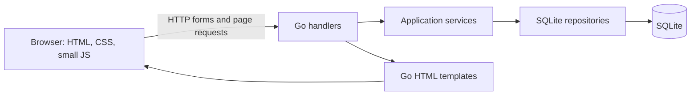
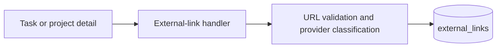

# LifeOps Architecture

## Overview

LifeOps is a local-first, server-rendered Go application. A single process owns
HTTP routing, application services, SQLite persistence, template rendering, and
static assets. The browser uses small JavaScript modules for charts, tracker
actions, theme settings, and the roadmap interaction; there is no frontend build
step.



## Process and routing

- `main.go` and `cmd/lifeops/main.go` are equivalent entrypoints.
- `internal/app/cli.go` reads command-line configuration and starts the HTTP
  server.
- `internal/app/app.go` opens the database, applies migrations, constructs the
  application, and registers routes.
- `internal/handlers/` handles requests and renders `web/templates/`.

Runtime paths are configured with command-line flags such as `-addr`, `-db`,
`-migrations`, `-templates`, and `-static`. Public calendar feeds are disabled
unless `ALLOW_PUBLIC_CALENDAR_FEEDS` is explicitly enabled; tokenized feeds stay
available.

## Application layers

```text
Page or form submission
        ↓
HTTP handler
        ↓
Service (recurrence, course, roadmap, calendar, or LifeOps rules)
        ↓
Repository query/update
        ↓
SQLite
```

- `internal/models/` contains data exchanged between layers.
- `internal/services/` owns recurrence, course, roadmap, calendar, quest, and
  dashboard behavior.
- `internal/repository/` owns SQLite queries and mutations.
- `migrations/` is the source of truth for schema evolution.
- `seeds/example.sql` initializes an empty development database when seeding is
  enabled.

## User interface

The UI is server-rendered from `web/templates/`. `web/templates/layout.html`
provides the shared navigation and loads one production stylesheet,
`web/static/css/styles.css`.

The current design is the restrained design-v2 system: a 960px content area,
flat surfaces, one accent color, quiet status treatments, and a full-width
Galaxy surface. Historical prototype files and design rationale live under
`docs/design/v2/`; they are references, not runtime dependencies.

Browser behavior is intentionally small:

- `web/static/js/app.js` controls tracker interactions, prayer countdown/alerts,
  route-map compatibility behavior, and minor UI interactions.
- `web/static/js/charts.js` renders static charts and handles theme and tracker
  controls.
- `web/static/js/galaxy.js` consumes `/galaxy/data` and renders the optional 3D
  project map. Three.js `0.180.0` is pinned at
  `web/static/js/vendor/three.module.js`; there is no package manager or build
  step. The adjacent project list remains the keyboard and WebGL fallback.

## Data

SQLite data lives in `data/lifeops.db` by default and is excluded from Git.
Migrations currently cover the base task/project/goal system, trackers, AI
roadmaps, quests, multiple roadmaps, courses, application settings, and manual
external work-item references.

Recurring task occurrences are calculated by services instead of being copied
into the task table. Per-date completion records preserve occurrence history.
Stable UUID, sync version, timestamp, and device fields prepare records for a
future client sync layer without implementing that layer today.

## External work references

Tasks, projects, and project missions can hold compact links to Jira, GitHub,
Slack, Linear, Asana, Notion, or another web system. The browser posts a URL and
summary to the handler; the external-link service validates and classifies the
URL without making a network request; the repository stores it in the additive
`external_links` table.



External links are context, not evidence. They are not stored in proof fields,
do not complete tasks or missions, and are absent from all XP and achievement
queries.

GitHub, Jira, and Slack links may refresh their stored title/status snapshots
through `internal/services/providers/`. Page rendering never performs remote
I/O. GitHub can use `GITHUB_TOKEN`; Jira requires `JIRA_EMAIL` and
`JIRA_API_TOKEN`; Slack requires `SLACK_BOT_TOKEN`. Missing credentials leave
the manual snapshot unchanged.

## Calendar integration

Calendar output is an HTTP boundary over the existing project, course, and task
data. Detailed behavior and security decisions are documented in
`google-calendar-plan.md` and `calendar-course-integration.md`.

## Prayer calculation

Prayer times are calculated locally in `internal/services/prayer.go` using solar
coordinates and the configured calculation method. Settings are read through
the existing `app_settings` repository; missing or invalid values fall back to
Winnipeg, ISNA, and Shafi defaults. The engine makes no network request and has
no cache table. Timezone conversion occurs after each astronomical event is
calculated in UTC, which preserves the correct offset on DST transition days.

## Deployment

Docker Compose runs the Go app on port 3005 for local diagnostics and Caddy on
HTTPS port 3443. Caddy terminates TLS and reverse-proxies to the private Compose
service. VAPID private keys and provider tokens enter through environment
variables and are never written to `app_settings` or committed.

The root-scoped service worker caches the application shell and handles prayer
push payloads. `push_subscriptions` stores browser endpoints/keys, while the
unique `push_deliveries` key prevents duplicate sends across scheduler ticks and
restarts. Invalid or expired endpoints are removed on HTTP 404/410 responses.

## Designed for later

The data model supports a future mobile sync client. AI roadmap and quest logic
is kept in services and repositories; a future coding-agent execution subsystem
should remain separate from the LifeOps task/project domain and communicate
through a provider/session boundary.

## Health dashboard foundation (Milestone 1)

The shared shell uses Today, Projects (linking to Galaxy), Health, Courses, and
More. On mobile these become a persistent bottom bar with safe-area padding;
desktop keeps header navigation. Add and command search stay in the header.
All existing routes remain available, including project lists and roadmaps.

Health is still rendered by the existing handler and repository queries for
habits, goals, and tasks. Its new summary cards contain explicitly labeled
static samples and empty states, with no health records or schema additions.
`health.js` only switches presentation periods; it makes no requests and saves
nothing. Nutrition and Training link to preview cards, Progress and Plan to
empty-state sections. Meal and workout actions are disabled until implemented.
Milestone 2 replaces the Plan link with `/health/plan`; Summary samples remain unchanged.

## Health Core (Milestone 2)

```mermaid
flowchart TD
    Shortcut[Apple Shortcut - future M3] --> API[POST /api/health/sync]
    API --> Auth[Bearer authentication and JSON validation]
    Auth --> Health[Health service]
    Plan[Server-rendered /health/plan] --> Health
    Health --> Repository[Health repository]
    Repository --> SQLite[(SQLite)]
```



`internal/models/health.go`, `internal/repository/health.go`, and
`internal/services/health.go` contain the Health domain. Migration
`018_health_core.sql` only creates four tables and their indexes: `health_cycles`,
`daily_health_snapshots`, `health_weight_entries`, and `health_sync_states`.
It changes no existing application rows or tables and seeds no health records.

`health_api.go` handles only `/api/health/*`; push API routing is unchanged.
`GYST_HEALTH_SYNC_TOKEN` is injected through app configuration and required for
both reads and writes. Fixed-length SHA-256 digests are compared in constant
time. Tokens never enter templates. API responses use `no-store`; the service
worker bypasses Health APIs, authenticated requests, and the plan page.

Sync uses an atomic partial upsert and a transaction covering snapshot plus sync
state. Omitted or null metrics preserve existing values; explicit zero replaces
them. Steps from Watch and phone are stored separately. The service validates
cycles and overlap, backed by conditional SQL writes that prevent races.
`/health/plan` uses the existing private web-app access model, with cross-site
browser POST rejection. It does not require or expose the API token.

Observed energy is deterministic arithmetic on received metrics. No projections,
step-to-calorie calculations, or extra workout calories are introduced. Health
Summary remains the M1 preview. See [the contract](HEALTH_CORE.md) for details.
