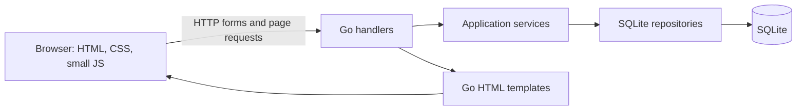
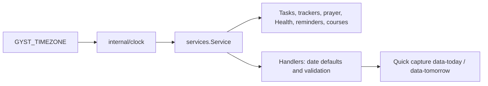
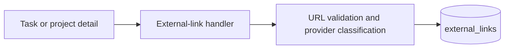
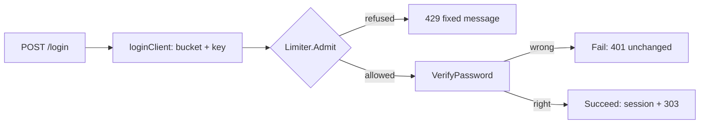
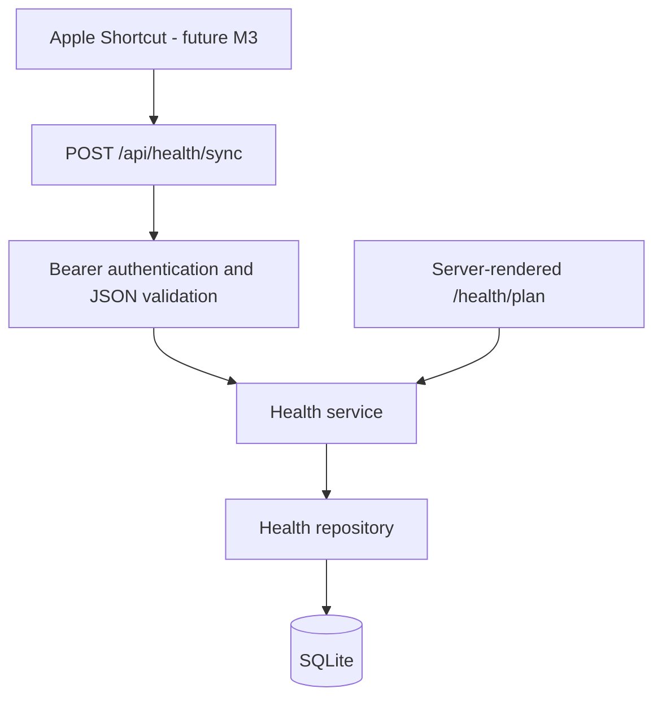

# LifeOps Architecture

## Overview

LifeOps is a local-first, server-rendered Go application. A single process owns
HTTP routing, application services, SQLite persistence, template rendering, and
static assets. The browser uses small JavaScript modules for charts, tracker
actions, theme settings, and the roadmap interaction; there is no frontend build
step.



## Process and routing

- `main.go` and `cmd/lifeops/main.go` are equivalent entrypoints.
- `internal/app/cli.go` reads command-line configuration and starts the HTTP
  server.
- `internal/app/app.go` opens the database, applies migrations, constructs the
  application, and registers routes.
- `internal/handlers/` handles requests and renders `web/templates/`.

Runtime paths are configured with command-line flags such as `-addr`, `-db`,
`-migrations`, `-templates`, and `-static`. Public calendar feeds are disabled
unless `ALLOW_PUBLIC_CALENDAR_FEEDS` is explicitly enabled; tokenized feeds stay
available.

## Application layers

```text
Page or form submission
        ↓
HTTP handler
        ↓
Service (recurrence, course, roadmap, calendar, or LifeOps rules)
        ↓
Repository query/update
        ↓
SQLite
```

- `internal/models/` contains data exchanged between layers.
- `internal/services/` owns recurrence, course, roadmap, calendar, quest, and
  dashboard behavior.
- `internal/repository/` owns SQLite queries and mutations.
- `migrations/` is the source of truth for schema evolution.
- `seeds/example.sql` initializes an empty development database when seeding is
  enabled.

## User interface

The UI is server-rendered from `web/templates/`. `web/templates/layout.html`
provides the shared navigation and loads one production stylesheet,
`web/static/css/styles.css`.

The current design is the restrained design-v2 system: a 960px content area,
flat surfaces, one accent color, quiet status treatments, and a full-width
Galaxy surface. Historical prototype files and design rationale live under
`docs/design/v2/`; they are references, not runtime dependencies.

Browser behavior is intentionally small:

- `web/static/js/app.js` controls tracker interactions, prayer countdown/alerts,
  route-map compatibility behavior, and minor UI interactions.
- `web/static/js/charts.js` renders static charts and handles theme and tracker
  controls.
- `web/static/js/galaxy.js` consumes `/galaxy/data` and renders the optional 3D
  project map. Three.js `0.180.0` is pinned at
  `web/static/js/vendor/three.module.js`; there is no package manager or build
  step. The adjacent project list remains the keyboard and WebGL fallback.

## Data

SQLite data lives in `data/lifeops.db` by default and is excluded from Git.
Migrations currently cover the base task/project/goal system, trackers, AI
roadmaps, quests, multiple roadmaps, courses, application settings, and manual
external work-item references.

Recurring task occurrences are calculated by services instead of being copied
into the task table. Per-date completion records preserve occurrence history.
Stable UUID, sync version, timestamp, and device fields prepare records for a
future client sync layer without implementing that layer today.

## Application timezone and local days

GYST has one application timezone, set by `GYST_TIMEZONE` and defaulting to
`America/Winnipeg` (GYST-VN-003). `internal/clock` is the only source of "now"
and of the local calendar day; `services.Service` embeds it, so `s.Now()`,
`s.Today()`, `s.TodayString()` and `s.Location()` are available everywhere a
service is.

- Every stored calendar day (`YYYY-MM-DD`: task due and occurrence dates,
  tracker and prayer check-ins, reminders, goal progress, learning blocks,
  the Health day) is the day in the application timezone, never the process
  (container, UTC) day.
- Prayer times, the Health day, the ICS feed and quick capture's
  Today/Tomorrow chips read the same clock. The prayer timezone in Settings is
  a read-only display of the application timezone; old `prayer.timezone`
  rows are ignored, not deleted.
- Browser-supplied dates must be canonical `YYYY-MM-DD`; a malformed value is
  rejected with HTTP 400 before anything is written. An empty value becomes
  the local Today where the form defines a default.
- `app.New` resolves the timezone before opening the database, so an invalid
  explicit `GYST_TIMEZONE` stops startup without creating or migrating it. The
  IANA zone database is embedded in the binary (`time/tzdata`).
- `internal/clock/guard_test.go` fails the build if code outside
  `internal/clock` and `internal/db` uses `time.Now`, `time.Local`,
  `time.LoadLocation` or the zone name, or derives a day from a `Now()` call
  without `.In(location)`. Deliberate instants carry `//gyst:instant <reason>`.



Rows written before this change may carry the UTC day for evening entries;
their remediation is a separate decision (GYST-VN-011). How absolute
timestamps are stored and displayed is GYST-VN-004.

## External work references

Tasks, projects, and project missions can hold compact links to Jira, GitHub,
Slack, Linear, Asana, Notion, or another web system. The browser posts a URL and
summary to the handler; the external-link service validates and classifies the
URL without making a network request; the repository stores it in the additive
`external_links` table.



External links are context, not evidence. They are not stored in proof fields,
do not complete tasks or missions, and are absent from all XP and achievement
queries.

GitHub, Jira, and Slack links may refresh their stored title/status snapshots
through `internal/services/providers/`. Page rendering never performs remote
I/O. GitHub can use `GITHUB_TOKEN`; Jira requires `JIRA_EMAIL` and
`JIRA_API_TOKEN`; Slack requires `SLACK_BOT_TOKEN`. Missing credentials leave
the manual snapshot unchanged.

## Calendar integration

Calendar output is an HTTP boundary over the existing project, course, and task
data. Detailed behavior and security decisions are documented in
`google-calendar-plan.md` and `calendar-course-integration.md`.

## Prayer calculation

Prayer times are calculated locally in `internal/services/prayer.go` using solar
coordinates and the configured calculation method. Settings are read through
the existing `app_settings` repository; missing or invalid values fall back to
Winnipeg, ISNA, and Shafi defaults. The prayer timezone is the application
timezone (see above). The engine makes no network request and has
no cache table. Timezone conversion occurs after each astronomical event is
calculated in UTC, which preserves the correct offset on DST transition days.

## Deployment

Docker Compose runs the Go app on port 3005 for local diagnostics and Caddy on
HTTPS port 3443. Caddy terminates TLS and reverse-proxies to the private Compose
service. VAPID private keys and provider tokens enter through environment
variables and are never written to `app_settings` or committed.

The root-scoped service worker caches the application shell and handles prayer
push payloads. `push_subscriptions` stores browser endpoints/keys, while the
unique `push_deliveries` key prevents duplicate sends across scheduler ticks and
restarts. Invalid or expired endpoints are removed on HTTP 404/410 responses.

## Login throttling (GYST-VN-006)

`POST /login` is throttled by `internal/authlimit` (no HTTP dependency), called
from `login()` in `internal/handlers/auth.go` after the same-origin, form-parse
and "password configured" checks and **before** the password is compared. A
refusal therefore never depends on whether the password was right.



**Limits (code constants in `authlimit.DefaultPolicy`; no environment
variables):**

| Layer | Rule |
|---|---|
| Per key | One password check in flight. After failure 1, 2, 3, 4 the next attempt is not admitted for 1 s, 2 s, 4 s, 8 s (a "not before" timestamp, never a sleep). The 5th failure inside 15 min blocks the key for 15 min. |
| Per ingress bucket (`public`, `tailnet`) | Once 50 failures are inside the last hour (in-flight attempts count), admissions must be at least 75 s apart. The gate applies to every login in that bucket, including the correct password. |
| Memory | At most 10,000 keys. Expired keys are pruned lazily (no goroutine). When full of blocked or in-flight keys, new keys are refused (fail closed). |

All windows are half-open: a failure counts while `now - window < t <= now`. A
success clears only its own key, never the bucket. Refused requests are not
counted and never extend a block. A refusal is HTTP 429 with the fixed text
"Too many sign-in attempts. Try again later." and no counts, times or
`Retry-After`. The 401 text is unchanged. A nil limiter fails closed.

**Client key.** The app only ever sees Caddy as its peer. Caddy replaces any
client `X-Forwarded-For` with its immediate peer (verified by probe P1 against
`caddy:2.10.2` with the committed Caddyfile), so the rightmost
`X-Forwarded-For` element is the address Caddy saw. `CF-Connecting-IP` passes
through Caddy unchanged on both sites, so it is trusted **only** when the
normalised `Host` is exactly `gyst.zaylolabs.com` (the public Caddy site).
Hosts ending in a `.ts.net` label use the tailnet bucket; every other or empty
Host is treated as public (fail safe). Keys: `pub|<cf ip>` (IPv6 grouped by
/64), `pub-peer|<ip>`, `ts|<ip>`, or `<bucket>|unknown` (one shared key per bucket). The key is for
rate limiting only, never authorisation.

**State is in memory and is lost on restart or deploy**, which gives an
attacker a fresh budget. This is accepted for a single process.

**If public sign-in is blocked, in order:**

1. An existing session keeps working. Throttling only affects new sign-ins.
2. Use the tailnet URL. It has its own buckets and its own (host-only) cookie.
3. Restart the container (resets all throttle state; needs host access).
4. `GYST_AUTH_DISABLED=1` is the emergency hatch (see
   `docs/tasks/A4-application-auth.md`). Unset it immediately afterwards.

There is no bypass: no IP allowlist, header, cookie, query parameter or
tailnet exemption.

**Residuals (accepted, decision D1):**

- A container on the shared `proxy` Docker network, or a misconfigured Nginx
  Proxy Manager host pointed at `gyst-caddy:8081`, can forge `CF-Connecting-IP`.
  That can evade the per-client limit (still bounded by the bucket gate) or
  target a known IP for a 15-minute block. It is never an authentication
  bypass. Tracked through the dual-listener / network-hardening work (for
  example GYST-VN-073).
- Under a sustained attack the public gate never disengages, so new public
  sign-ins are effectively unavailable (use the recovery order above).
- Shared keys (`pub-peer`, `unknown`, and `ts` if tailnet source addresses are
  not preserved) mean one client's success resets the key for everyone on it.
- A refused attempt answers faster than a checked one (no bcrypt). That reveals
  only "throttled", never password correctness.
- Local development has no Caddy in front: the rightmost `X-Forwarded-For` is
  client-controlled there, and `localhost` classifies as public keyed by peer.
- Logs carry only transitions (key blocked, gate engaged/disengaged, limiter
  missing), with IPs truncated to /24 (IPv4) or /48 (IPv6). Per-failure audit
  events belong to the later audit-log work.

## Sessions

Sessions roll for 30 days from last use (`sessionLifetime`). Lapsed rows are
removed by `Service.RunSessionSweeper`, started in `app.New` on the context
`App.Close` cancels: one sweep at start, then hourly. The cutoff is the
service clock (`s.Now`), the DELETE is scoped to `expires_at <= now`, and the
log line carries only a count. Validation never depends on the sweep.

## Designed for later

The data model supports a future mobile sync client. AI roadmap and quest logic
is kept in services and repositories; a future coding-agent execution subsystem
should remain separate from the LifeOps task/project domain and communicate
through a provider/session boundary.

## Health dashboard foundation (Milestone 1)

The shared shell uses Today, Projects (linking to Galaxy), Health, Courses, and
More. On mobile these become a persistent bottom bar with safe-area padding;
desktop keeps header navigation. Add and command search stay in the header.
All existing routes remain available, including project lists and roadmaps.

Health is still rendered by the existing handler and repository queries for
habits, goals, and tasks. Its new summary cards contain explicitly labeled
static samples and empty states, with no health records or schema additions.
`health.js` only switches presentation periods; it makes no requests and saves
nothing. Nutrition and Training link to preview cards, Progress and Plan to
empty-state sections. Meal and workout actions are disabled until implemented.
Milestone 2 replaces the Plan link with `/health/plan`; Summary samples remain unchanged.

## Health Core (Milestone 2)



`internal/models/health.go`, `internal/repository/health.go`, and
`internal/services/health.go` contain the Health domain. Migration
`018_health_core.sql` only creates four tables and their indexes: `health_cycles`,
`daily_health_snapshots`, `health_weight_entries`, and `health_sync_states`.
It changes no existing application rows or tables and seeds no health records.

`health_api.go` handles only `/api/health/*`; push API routing is unchanged.
`GYST_HEALTH_SYNC_TOKEN` is injected through app configuration and required for
both reads and writes. Fixed-length SHA-256 digests are compared in constant
time. Tokens never enter templates. API responses use `no-store`; the service
worker bypasses Health APIs, authenticated requests, and the plan page.

Sync uses an atomic partial upsert and a transaction covering snapshot plus sync
state. Omitted or null metrics preserve existing values; explicit zero replaces
them. Steps from Watch and phone are stored separately. The service validates
cycles and overlap, backed by conditional SQL writes that prevent races.
`/health/plan` uses the existing private web-app access model, with cross-site
browser POST rejection. It does not require or expose the API token.

Observed energy is deterministic arithmetic on received metrics. No projections,
step-to-calorie calculations, or extra workout calories are introduced. Health
Summary remains the M1 preview. See [the contract](HEALTH_CORE.md) for details.
