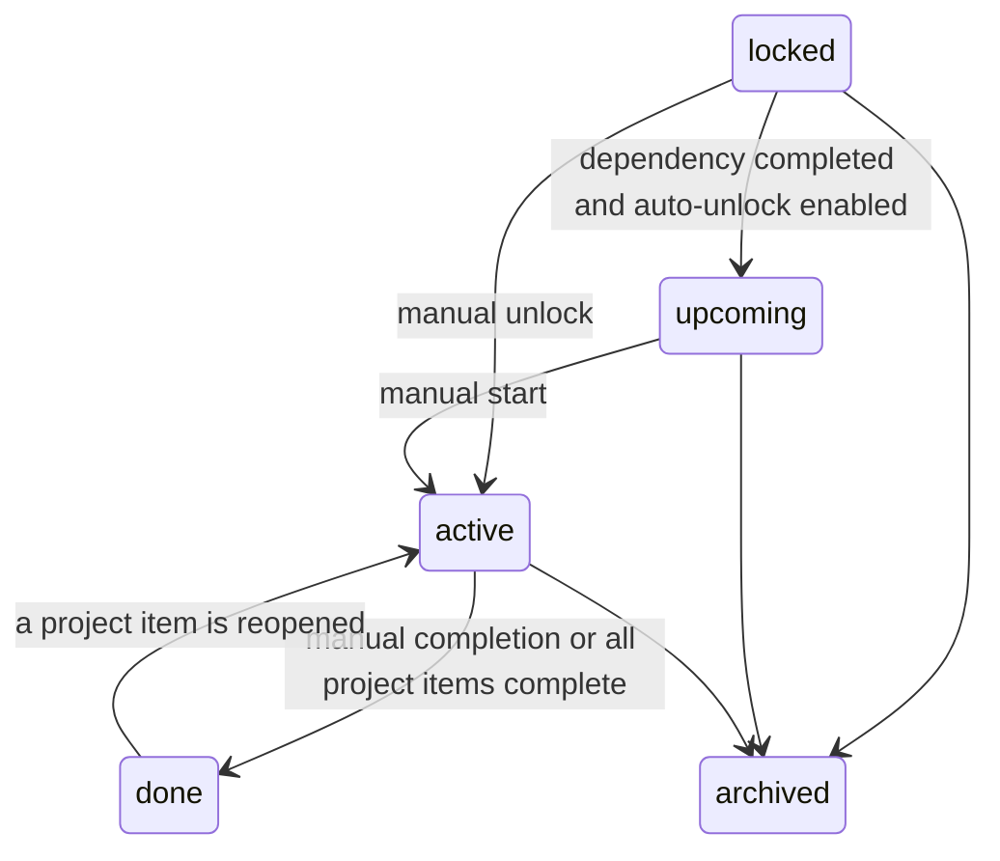

# Quest System

## Domain model

```text
Campaign / Goal
└── Quest / main project
    └── Chapter / phase or subproject
        └── Mission / project item or standalone task
```

Projects store hierarchy, status, dependency, automatic-unlock preference, and
locked notes. Both project items and standalone tasks carry structured XP and
proof fields. Standalone tasks additionally feed the daily recurrence system.

## Project status flow

The canonical quest statuses are `active`, `upcoming`, `locked`, `done`, and
`archived`. Legacy `paused` and `completed` values remain accepted by the schema
for compatibility and are normalized by repository writes.



Completing a project calls `AutoUnlockDependents`. Only locked dependents with
`auto_unlock = 1` move to `upcoming`; opted-out and manually changed projects
are left untouched.

## Rewards and proof

Standalone tasks and project items store their full award in `stars_awarded`
when completed. Recurring tasks store it per dated occurrence. The default XP
economy is:

- standalone tasks: low `5`, medium `10`, high `20` XP;
- project missions: low `10`, medium `20`, high `35` XP;
- valid proof: `+5` XP;
- completing every mission in a project: `+100` XP once.

Custom rewards remain editable on task and mission forms. Existing earned XP is
never rewritten. Every `100 XP` advances one level; the application shell shows
progress through the current level.
Required proof blocks completion until a matching location is supplied:

- `link` requires an absolute HTTP or HTTPS URL in `proof_url`.
- `photo` and `file` require a non-empty path in `proof_path`.
- `text` requires non-empty text in `proof_path`.

Generated proof and quest-completion achievements carry their source task,
project item, or project ID. Unique partial indexes prevent retries, reopens, or
repeated completion requests from creating duplicate achievements or bonus XP.

Each project mission awards its configured XP once. Project completion awards
an additional 100 XP once when all project items become complete. Reopening and
recompleting either level does not duplicate rewards.

## Markdown import

The Markdown parser maps:

- level-one headings to a campaign goal;
- level-two headings to main quests;
- level-three headings to chapters/phases;
- checklist entries to project items;
- status, notes, dependency, auto-unlock, locked notes, privacy, stars, and proof
  labels to the import plan.

Relationships are resolved after every imported project has an ID, so `Depends
On` can name a project that appears earlier or later in the document.

## Integration boundaries

- Roadmap, Rocket Route, and Cosmic views read the same project hierarchy and
  canonical project statuses; they do not maintain a second quest state.
- Course and learning-block statuses are a separate scheduling domain. Course
  completion does not award quest XP.
- Roadmap milestones are planning records, while project items are executable
  quest missions that reconcile project completion and rewards.

## Verification

Run the repository checks with an installed Go toolchain:

```sh
gofmt -l $(find . -name '*.go' -type f)
go test ./...
go vet ./...
```

Migration tests cover both a fresh database and a populated pre-quest database
upgrading through the latest migration.

## Known product gaps

- Move-under-parent and locked-note editing are available through the project
  edit form, but dedicated contextual actions would make them easier to find.
- Required-proof completion currently returns the normal server error response;
  an inline validation message would improve the browser workflow.
- A visual browser pass is still required for the final dashboard, project tree,
  and campaign-map polish.
