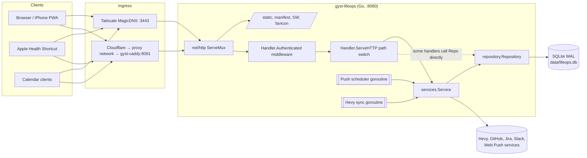
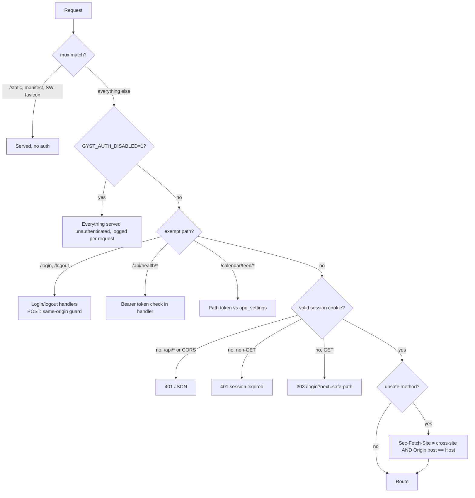
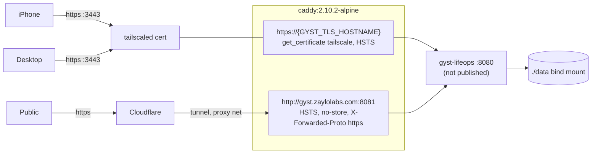

# GYST vNext audit — 01 Current system

- **Stage:** 1 — repository and system discovery (read-only)
- **Date:** 2026-09-27
- **Baseline:** `feature/health-hardening` at `dab7995` (last code commit `0b2ea78`)
- **Method:** source reading and request tracing, plus the CI-equivalent checks
  run in an isolated worktree. No production database, `.env` or container
  internals were inspected.
- **Scope:** what GYST *is today*. It contains no design proposals.

Evidence labels used below:

| Label | Meaning |
|---|---|
| **Verified** | Read in source or observed by running a command |
| **Inferred** | Follows from source but not exercised at runtime |
| **Unknown** | Cannot be established from the repository |

---

## 1. Executive overview

GYST (Go module `lifeops-tracker`) is a **single-user, server-rendered Go web
application** backed by **one SQLite file**. One process does all of the
following:

- HTTP routing and cookie-session authentication
- business services
- SQL persistence
- template rendering
- two background goroutines: prayer Web Push and Hevy training sync

The browser receives HTML from Go templates, plain CSS and a few vanilla JS
modules. The one exception is the Galaxy page, which loads a vendored
Three.js. There is no frontend build step and no JS package manager.

Two ingress paths are active in production: Tailscale MagicDNS on host port
3443, and Cloudflare to a Docker-network-only Caddy origin for
`gyst.zaylolabs.com`. Both go through Caddy to the app on container port 8080.

The product has grown by accretion. It currently contains:

- a task/recurrence system with XP rewards
- projects organised as quests with dependencies, proof and "missions"
- AI-roadmap Markdown import/export
- courses with learning blocks and ICS calendar feeds
- a prayer-first Today page with local prayer-time calculation and push notifications
- a 3D Galaxy project map
- goals and analytics
- a Health area: Apple Health Shortcut ingestion, plan cycles, nutrition, progress
  and Hevy training

Size (verified): about 20.9k lines of Go including tests. `internal/handlers/handlers.go`
alone is 2,465 lines. There are 40 templates, and a 5,082-line legacy
`styles.css` alongside 9 newer `ui-*.css` files. 20 migrations define 31 tables.

---

## 2. Repository map

```text
main.go, cmd/lifeops/        identical entrypoints → internal/app.Run()
cmd/passwordhash/            bcrypt hash generator (also: `lifeops passwordhash`)
cmd/vapid/                   VAPID keypair generator for Web Push
internal/app/                config from flags/env, wiring, CLI subcommands (backup, passwordhash)
internal/db/                 Open (DSN + per-connection PRAGMAs), Migrate, SeedIfEmpty, Backup (VACUUM INTO)
internal/handlers/           ALL HTTP: hand-written path router, middleware, views, templates
internal/services/           business logic on one `Service` struct
internal/services/providers/ GitHub / Jira / Slack snapshot fetchers for external links
internal/providers/hevy/     read-only Hevy API client
internal/repository/         SQL for every table, on one `Repository` struct
internal/models/             shared structs (models.go 750 lines, health, roadmap, training)
internal/xp/                 XP reward constants
migrations/                  001–018 numeric + 2 timestamped SQL files
seeds/example.sql            loaded on startup only when DB has no tasks/projects/goals
web/templates/               40 Go html/templates (layout + partials + pages)
web/static/                  css/, js/, js/vendor/three.*, favicon.svg, manifest, service-worker.js, one PNG
scripts/                     check.sh (Go in Docker), check-ui-shell.cjs, check-galaxy.cjs, codex-build.sh
docs/                        see Stage 0 report
Dockerfile, docker-compose.yml, Caddyfile, Makefile, run.ps1
.github/workflows/check.yml  the only CI workflow
```

---

## 3. Runtime architecture



**Verified details:**

- **Startup** (`internal/app/app.go`):
  1. `db.Open` → `db.Migrate` → `db.SeedIfEmpty` (seed on by default)
  2. `repository.New` → `services.New`
  3. start the push scheduler; start Hevy sync only if `HEVY_API_KEY` is set
  4. `handlers.New`, then mux registration
- **Routing** is not a router library. `Handler.ServeHTTP` in `handlers.go:266`
  splits the path into segments and `switch`es on the first segment. Sub-handlers
  switch again on later segments.
- **The layering is Browser → handler → service → repository → SQLite, but it is
  not strict.** Many handlers call `h.Service.Repo.*` directly (for example task
  list and detail, push subscribe, course blocks, trackers). The service layer is
  bypassed wherever there is no business rule.
- **Templates are parsed on every request.** `render` in `handlers.go:2104` calls
  `ParseFiles` on `layout.html` plus 7 shared partials plus the page, each time.
  Every render also runs a `PlayerStats` (XP) query for the header.
- **Timezone:** Health's "today" uses the timezone from the *prayer* settings
  (`HealthTodayDate`, `services/health.go:206`). Other services use the process
  local time through `Service.Now`.

### Example trace: page request (`GET /health`)

```mermaid
sequenceDiagram
    participant Br as Browser
    participant C as Caddy
    participant M as middleware.Authenticated
    participant H as handlers.health
    participant S as services.Service
    participant R as repository
    participant D as SQLite
    Br->>C: GET /health (cookie gyst_session)
    C->>M: proxy :8080
    M->>S: ValidateSession(sha256(token))
    S->>R: GetSession / TouchSession (≤1×/24h)
    M->>H: ServeHTTP → "health"
    H->>R: ListGoals, ListTasks (filter category=="health")
    H->>S: DailyMission, BodyRhythmChart, HealthToday
    S->>R: snapshot for local date, cycle for date
    S-->>H: observed energy = resting+active; balance; food remaining
    H->>H: buildHealthTodayView (absent ≠ zero)
    H-->>Br: layout.html + health.html
```

### Example trace: Health ingestion (`POST /api/health/sync`)

```text
Shortcut ─Bearer token─▶ Caddy ─▶ Authenticated (path exempt) ─▶ healthAPI
  → token check: SHA-256 both sides, constant-time compare (503 if unset, 401 if wrong)
  → only segment "sync", POST, Content-Type application/json, ≤16 KiB,
    DisallowUnknownFields, single object
  → services.SyncHealth → ValidateHealthSync → Repo.ApplyHealthSync
    (partial upsert: null/absent = keep existing, explicit 0 = store 0;
     snapshot + sync_state in one transaction)
  → 200 JSON snapshot
```

---

## 4. Major packages

| Package | Responsibility | Notes |
|---|---|---|
| `internal/app` | Config (flags + env), wiring, `backup` / `passwordhash` subcommands | `GYST_AUTH_DISABLED=1` bypasses auth entirely and logs loudly |
| `internal/db` | DSN building, `foreign_keys(1)` and `busy_timeout(5000)` on **every pooled connection**, WAL, filename-tracked migrations (`schema_migrations`), seed, backup | Migration runner has no checksum. Backup uses `VACUUM INTO` plus `integrity_check`. |
| `internal/handlers` | Routing, auth middleware, CSRF guard, form parsing, view models, rendering | 18 non-test files; `handlers.go` holds most routes |
| `internal/services` | Recurrence and occurrences, dashboard/analytics, reminders, prayer, push, calendar ICS, courses, roadmap import/export, AI plan import, quests/rocket route, Galaxy, health, training, auth | One `Service` struct with `Repo`, `Now`, `Training` |
| `internal/repository` | All SQL; XP awards (`achievements`) written inside task/project transactions | One `Repository` struct |
| `internal/providers/hevy` | Paginated read-only Hevy client, redirect refusal, 4 MiB/page limit | Converts to the provider-neutral `models.TrainingEntry` |
| `internal/services/providers` | GitHub, Jira, Slack link-snapshot fetchers | Triggered manually per link (`/external-links/{id}/sync`) |
| `internal/xp` | Reward constants (task 5/10/20, mission 10/20/35, proof +5, project +250, 100 XP/level) | |

---

## 5. Major product areas

| Area | What exists (verified in source) | Main code |
|---|---|---|
| **Today** (`/`, `/today`, `/checklist`) | Task occurrences for today (recurrence computed, not stored), overdue one-time tasks, reminders, prayer schedule plus countdown, tracker "daily mission" (5 prayers, 2 athkar, gym), study blocks from courses, ship stats/XP, compact Health snapshot | `handlers.today`, `today_view.go`, `services/lifeops.go`, `prayer.go` |
| **Tasks** | CRUD, priority, status, recurrence (`repeat_type`), per-occurrence completion, skip, archive, checklist items, proof, XP; quick capture from the command palette | `handlers.go` tasks*, `repository/tasks.go` |
| **Projects / quests** | Projects with parent/child (moons), dependencies/unlock, status, colour, items ("missions") with proof and XP, roadmap membership, filters, detail sections | `handlers.go` projects*, `repository/projects.go`, `services/rocket.go`, `cosmic.go` |
| **Roadmaps** | Multiple roadmaps; Markdown import; public/private Markdown export; weekly review; milestones; per-project roadmap meta and resources | `services/roadmap.go` (1,165 lines), `repository/roadmap*.go` |
| **AI plan import** | Paste Markdown (for example from ChatGPT), preview, then write projects, tasks and checklists. **Parsing only; no LLM API calls exist anywhere in the code.** | `services/plan_import.go` |
| **Galaxy** | Three.js 3D scene of top-level non-complete projects plus child moons. Positions derived from a UUID hash and persisted. Gesture/camera modules. List fallback when WebGL fails. | `services/galaxy.go`, `static/js/galaxy*.js`, `vendor/three.*` |
| **Courses** | Courses with status and provider; learning blocks (complete/reopen/skip/postpone/delete); catch-up; ICS feeds | `handlers/courses.go`, `services/course.go`, `calendar.go` |
| **Goals** | Goals with progress entries, charts, archive | `repository/goals.go` |
| **Reminders** | Read view of today's and overdue reminders. Reminders are created and updated as a side effect of task writes (`repository/tasks.go`). | `handlers.reminders` |
| **Monthly / Analytics / Archive** | Monthly completion chart; dashboard aggregates; archived tasks, projects and goals | `services.Dashboard`, `charts.js` |
| **Health summary** | Today's snapshot (nullable metrics, Watch and phone steps kept separate), observed energy, active cycle targets, health-tagged goals and tasks, gym rhythm. Week, Month and Year buttons are **disabled**; "Plan meal" and "Start workout" are **disabled**. | `handlers.health`, `health_view.go`, `services/health.go` |
| **Nutrition** | Today's totals and macros vs. cycle targets, stale indicator (8 h). No meals: "Keep logging meals in MyFitnessPal." | `nutrition.go` |
| **Training** | Hevy routines, recent sessions, sets, muscle map from the cached snapshot; manual sync POST (1/min, 3-minute timeout) | `training.go`, `services/training*.go` |
| **Health progress** | Weight history chart and table (30/90/all). **No code path writes weight entries** (see §14). | `health_progress.go` |
| **Health plan** | Create/edit cycles (any duration, overlap rejected), targets, notes | `health_plan.go` |
| **Menu** (`/more`) | 19 links in 5 static groups | `ui_shell.go` |
| **Settings** | Prayer location, method and adjustments; calendar token generate/revoke; appearance and motion (client-side localStorage) | `handlers.settings`, `settings.html` |
| **External links** | Attach Jira/GitHub/Slack/Linear/Asana/Notion/other URLs to tasks, projects and missions. Snapshot refresh for GitHub/Jira/Slack. Never affects XP. | `handlers.externalLinks`, `services/external_links.go` |

---

## 6. Route and screen inventory

All routes below require a valid session unless marked. Unsafe methods also
pass the same-origin guard (§10). "Page" means an HTML render through `layout.html`.

### Pages and form actions

| Route | Methods | Kind / notes |
|---|---|---|
| `/`, `/today` | GET | Page `today.html` |
| `/checklist` | GET | Page `checklist.html` (from the same handler as Today) |
| `/dashboard` | any | 308 → `/today`. `dashboard.html` is only referenced by tests. |
| `/galaxy` | GET | Page |
| `/galaxy/data` | GET | JSON planets. **Writes** missing `pos_x/y/z` on first read. |
| `/more` | GET | Menu page |
| `/monthly`, `/reminders`, `/analytics`, `/archive` | GET | Pages |
| `/tasks` | GET | List, `?status=pending\|completed\|skipped\|overdue` |
| `/tasks/new` | GET, POST | Form |
| `/tasks/quick` | POST | Command-palette capture |
| `/tasks/{id}` | GET | Detail |
| `/tasks/{id}/edit` | GET, POST | Form |
| `/tasks/{id}/complete\|skip\|archive` | POST | Actions |
| `/tasks/{id}/checklist/{itemId}` | POST | Toggle checklist item |
| `/projects` | GET | List/tree, `?status=`, `?roadmap=` |
| `/projects/new` | GET, POST | Form |
| `/projects/{id}` | GET | Detail |
| `/projects/{id}/edit` | GET, POST | Form |
| `/projects/{id}/archive\|status` | POST | Actions |
| `/projects/{id}/items` | POST | Create mission |
| `/projects/{id}/items/{itemId}/complete\|reopen\|proof\|delete` | POST | Mission actions |
| `/goals`, `/goals/new`, `/goals/{id}` | GET (+POST new) | Pages/forms |
| `/goals/{id}/progress\|archive` | POST | Actions |
| `/roadmap` | GET | Roadmap page |
| `/roadmap/import` | POST | Markdown import |
| `/roadmap/export/public\|private` | GET | Markdown download |
| `/roadmap/weekly-review` | POST | Create review |
| `/roadmap/projects/{id}/meta` | POST | Roadmap metadata |
| `/roadmap/projects/{id}/items/{itemId}/complete\|reopen` | POST | |
| `/roadmap/milestones/{id}/complete\|reopen` | POST | |
| `/roadmaps/new`, `/roadmaps/{id}/edit` | GET, POST | Forms |
| `/roadmaps/{id}/feature\|archive` | POST | |
| `/courses`, `/courses/new`, `/courses/{id}`, `/courses/{id}/edit` | GET (+POST forms) | |
| `/courses/{id}/status\|archive` | POST | |
| `/courses/{id}/blocks` | POST | Create block |
| `/courses/{id}/blocks/{blockId}/complete\|reopen\|skip\|postpone\|delete` | POST | |
| `/health` | GET | Summary |
| `/health/nutrition`, `/health/training`, `/health/progress` | GET | Pages |
| `/health/training/sync` | POST | Manual Hevy sync |
| `/health/plan` | GET, POST | `?id=`, `?new=1` |
| `/settings` | GET | |
| `/settings/prayer`, `/settings/calendar-token` | POST | |
| `/trackers/{key}/toggle` | POST | Prayer/athkar/gym tracker (JSON or redirect) |
| `/external-links` | POST | Create |
| `/external-links/{id}/edit\|delete\|sync` | POST | |
| `/plan-import` | GET, POST | Preview / import |
| `/login` | GET, POST | **Exempt.** Separate template (no layout). |
| `/logout` | POST | **Exempt.** Revokes the session server-side. |

### Unauthenticated static surface (registered on the mux before auth)

`/static/*`, `/manifest.webmanifest`, `/service-worker.js` (`no-cache`), `/favicon.ico`.

### Screens

40 templates. `layout.html` is the shell. Partials: `ui_shell`, `ui_icons`,
`ui_components`, `today_components`, `project_components`, `health_components`,
`rocket_route`. `login.html` is standalone. `ui_gallery.html` is test-only
(a development gallery generated by a test, with no route). `dashboard.html` is
test-only.

---

## 7. API inventory

| Endpoint | Auth | Contract |
|---|---|---|
| `POST /api/health/sync` | Exempt from session; `Authorization: Bearer $GYST_HEALTH_SYNC_TOKEN` | JSON `{date, source, dietary_calories, protein_g, carbs_g, fat_g, fiber_g, steps_watch, steps_phone, active_energy_kcal, resting_energy_kcal, exercise_minutes}`. Unknown fields rejected. Null means unchanged. Returns the snapshot. 503 when the token is unset. **This is the whole Health API: write-only, no read endpoint.** |
| `GET /api/push/vapid-key` | Session | `{publicKey}`, or 503 if VAPID is unset |
| `POST\|DELETE /api/push/subscribe` | Session + same-origin | Web Push subscription JSON (https endpoint only, ≤16 KiB) |
| `GET /galaxy/data` | Session | Planet/moon JSON for the Three.js scene |
| `POST /trackers/{key}/toggle` | Session | JSON if `Accept` asks for it, else redirect |
| `GET /calendar/feed/{token}.ics` and `/{token}/courses.ics`, `/{token}/projects.ics` | Exempt; path token compared in constant time against `app_settings` | ICS |
| `GET /calendar.ics`, `/courses/calendar.ics`, `/courses/{id}/calendar.ics`, `/projects/calendar.ics` | **Session and** `ALLOW_PUBLIC_CALENDAR_FEEDS=true` | ICS. Inferred: because these paths are not auth-exempt, the "public" feeds are not actually public. They are only reachable by a signed-in browser, and only when the flag is set. |
| `GET /roadmap/export/{public\|private}` | Session | Markdown |

There is no general JSON/REST API, no GraphQL and no API versioning.

---

## 8. External integration inventory

| Integration | Direction | Trigger | Credential (env) | Status |
|---|---|---|---|---|
| Apple Health via iOS Shortcut | Inbound push | User-run or automated Shortcut | `GYST_HEALTH_SYNC_TOKEN` | Live. You reported a successful sync on 2026-09-23. Nutrition completeness and automation are unverified (M3). |
| MyFitnessPal | Indirect: MFP → Apple Health → Shortcut | — | none | Daily totals only; no meals |
| Hevy | Outbound GET `api.hevyapp.com/v1/*` | Goroutine every 37 min plus manual POST | `HEVY_API_KEY` | Code deployed; **key not configured** according to the handoff (Unknown from repo) |
| Web Push (browser push services) | Outbound | Prayer times, 30 s ticker, 2-minute window, per-delivery dedupe row | `VAPID_PUBLIC_KEY`, `VAPID_PRIVATE_KEY`, `VAPID_SUBSCRIBER` | Scheduler exits silently if any value is unset. Configured in prod: Unknown. |
| GitHub | Outbound `api.github.com/repos/{o}/{r}/issues/{n}` | Manual per-link sync | `GITHUB_TOKEN` (optional) | Snapshot of title/state for a linked issue or PR. **No repository, PR-list or Actions integration.** |
| Jira | Outbound `{link host}/rest/api/3/issue/{key}` | Manual per-link sync | `JIRA_EMAIL`, `JIRA_API_TOKEN` | See §15: the request goes to whatever host the stored link has |
| Slack | Outbound `slack.com/api/conversations.replies` | Manual per-link sync | `SLACK_BOT_TOKEN` | |
| Linear, Asana, Notion, other | none | — | — | Stored as classified links only |
| Calendar clients | Inbound pull | Subscription | Path token | ICS for courses and projects |
| Tailscale | Caddy reads certificates from the host `tailscaled` socket | Caddy | host socket bind-mount | Live |
| Cloudflare | Tunnel to `gyst-caddy:8081` on the external `proxy` Docker network | — | outside repo | Live according to handoff; the tunnel config is **not in this repo** |

There are **no** integrations with n8n, SamVision, server status, Claude, Codex,
or GitHub repositories and Actions. The only mentions are the manual
external-link snapshot above and the architecture prose.

---

## 9. Database and migration overview

- **Engine:** `modernc.org/sqlite` v1.52.0 (pure Go, `CGO_ENABLED=0`).
  WAL mode. `foreign_keys(1)` and `busy_timeout(5000)` are set in the DSN so
  every pooled connection gets them (proven by `internal/db/pragma_scope_test.go`).
- **Migrations:** `db.Migrate` applies `migrations/*.sql` in filename order.
  Each file runs in a transaction and is recorded in `schema_migrations(filename)`.
  There is no checksum, no down migrations and no Go-side schema.
  Numeric `001`–`018`, then timestamped `20260911203000_sessions` and
  `20260924010000_training_cache`.
- **Historical destructive migrations:** 005 rebuilt `projects` (DROP plus copy),
  and 006 and 014 ran `UPDATE`s. Current rules forbid this going forward.

### Tables by domain (31)

| Domain | Tables | Code references (non-test files) |
|---|---|---|
| Tasks | `tasks`, `task_completions`, `task_checklist_items`, `reminders` | yes |
| Projects / quests | `projects`, `project_items`, `achievements`, `external_links` | yes |
| Roadmaps | `roadmaps`, `roadmap_imports`, `roadmap_milestones`, `roadmap_project_meta`, `roadmap_resources`, `roadmap_weekly_reviews` | yes |
| Goals | `goals`, `goal_progress_entries` | yes |
| Trackers | `tracker_items` (seeded by migration 002), `tracker_logs` | yes |
| Courses | `courses`, `learning_blocks` | yes |
| Settings | `app_settings` (prayer config, calendar token) | yes |
| Push | `push_subscriptions`, `push_deliveries` | yes |
| Health | `health_cycles`, `daily_health_snapshots`, `health_weight_entries`, `health_sync_states` | yes, but weight is read-only (see §14) |
| Training | `training_snapshots(provider PK, entries_json, synced_at, last_error)` | yes |
| Auth | `sessions(token_hash, expires_at, last_seen_at)`, `schema_migrations` | yes |
| **Unused** | `categories` (001), `activity_events` (017) | **0 references**. The code that used `activity_events` exists only in `stash@{2}`. |

Notes:

- **Hevy training is stored as one JSON blob per provider**
  (`training_snapshots.entries_json`), replaced wholesale on each sync. The Go
  model is provider-neutral, but it is **not** a set of normalized `training_*`
  tables as `AI_HANDOFF.md` §5 describes. It cannot be queried in SQL.
- **Many tables carry sync-ready columns** (`uuid`, `sync_version`, device id)
  for a future client sync that has not been implemented.
- **No `users` table.** There is one password hash from the environment.
- **Production data** was not inspected. Row counts, FK state and the applied
  migration list are **Unknown**.

---

## 10. Authentication overview



Verified facts:

- **Password:** a single bcrypt hash in `GYST_PASSWORD_HASH`. When it is unset,
  login fails closed with a 503 message.
- **Session:**
  - 32 random bytes, base64url, sent in cookie `gyst_session`
    (HttpOnly, SameSite=Lax; Secure when TLS or `X-Forwarded-Proto: https`)
  - stored as a SHA-256 hex hash
  - 30-day rolling expiry, refreshed at most once per 24 h
  - expired rows are deleted when they are encountered
- **`SweepExpiredSessions` exists but nothing calls it.** Root `AGENTS.md`
  says it "runs hourly", which is incorrect.
- **No login rate limiting or lockout exists** (grep found none).
- **Open-redirect protection:** `next` must be a rooted path, not `//`, and
  contain no CR/LF.
- **CSRF:** header-based (Sec-Fetch-Site plus Origin). No tokens. Requests
  carrying neither header are allowed; this is intended for non-browser clients.
- **Authorization:** none beyond "signed in". Single user.

---

## 11. PWA overview

- **Manifest:** `standalone`, `start_url=/today`, a single SVG icon marked
  `any maskable`. There are no PNG icons (iOS home-screen icon quality:
  Unknown, needs a device check).
- **Service worker** (`web/static/service-worker.js`, cache `lifeops-shell-v42-galaxy`):
  - precaches 14 versioned CSS/JS assets
  - navigations are network-only with an inline offline page, so no private
    HTML is cached
  - only `/static/*` GETs enter CacheStorage, and only if not `no-store` and not HTML
  - requests with an `Authorization` header are bypassed
  - handles `push` and `notificationclick`
- **Push subscribe flow** (`app.js`): SW ready → `GET /api/push/vapid-key` →
  `PushManager.subscribe` → `POST /api/push/subscribe`.
- **Asset versioning is manual:** query strings like `?v=ui-2` and `?v=nav-1`
  are hand-edited in `layout.html` and the SW list. `scripts/check-ui-shell.cjs`
  guards the cache policy.
- **Offline data or background sync:** none.

---

## 12. Testing and CI overview

- **Go tests:** 206 top-level `Test*` functions (324 passing tests including
  subtests) across app, db, handlers, repository, services, hevy, providers and
  xp. They use temporary databases.
- **Node checks:** `scripts/check-ui-shell.cjs` (cache and theme policy) and
  `scripts/check-galaxy.cjs` (gesture and camera maths). These are static and
  logic checks, not browser tests.
- **Browser tests:** none automated in the repo. Task files record manual
  Chromium/WebKit runs done outside the repo.
- **CI** (`.github/workflows/check.yml`, on every push and PR): the two node
  checks, gofmt, vet, build, test, `test -race`, migration-prefix uniqueness,
  and no committed `*.db`.
- **Host:** Go is **not** installed. Use `scripts/check.sh`, which runs Go in a
  Docker container.

### Stage 1 verification run (2026-09-27, audit worktree at `dab7995`)

```text
node scripts/check-ui-shell.cjs   → passed
node scripts/check-galaxy.cjs     → passed (gestures; camera portrait/landscape/desktop)
docker golang:1.25-bookworm (go1.25.14):
  gofmt -l .                      → no output (clean)
  go vet ./...                    → ok
  go build ./...                  → ok
  go test ./...                   → all 8 packages ok
  go test -race -count=1 ./...    → all 8 packages ok
```

No failures. No code was modified.

---

## 13. Deployment overview



- **Build:** multi-stage Dockerfile, `golang:1.25-bookworm` → `debian:bookworm-slim`,
  static binary. Copies `web/`, `migrations/`, `seeds/` and CA certificates.
  The container runs as **root**, since no `USER` is set.
- **Compose:** services `gyst-lifeops` and `caddy`. Env is passed through from
  the untracked `.env`. Only `3443:443` is published. Caddy also joins the
  external `proxy` network.
- **Deploy method:** manual `docker compose up -d --build` from
  `/srv/server/repos/gyst-lifeops` (the working checkout). No CD pipeline,
  registry or image tagging.
- **Backup:** manual, `docker compose exec gyst-lifeops /app/lifeops backup`.
  No schedule exists in the repo.
- **Seed risk (inferred):** production runs with the default `-seed=true`. If
  the DB ever has zero tasks, projects and goals, example data is inserted on
  startup.
- **Observability:** `log` to stdout only. No health-check endpoint, metrics
  or compose `healthcheck`.

---

## 14. Known TODOs, dead code and incomplete areas

| Item | Evidence |
|---|---|
| Weight cannot be entered | `Service.CreateHealthWeightEntry` has no caller outside tests. The Progress page says entry and import are unavailable, so `health_weight_entries` is empty unless written by hand. |
| Health Week/Month/Year | Buttons disabled in `health.html:22-24`. `health.js` still contains descriptive text for those periods. |
| Meal planning / workout start | Disabled buttons in `health.html:124` |
| Historical nutrition and activity | "not available" in `health_progress.html:21` |
| Hevy live data | Needs `HEVY_API_KEY` (handoff) |
| M3 nutrition completeness | Handoff: unverified |
| Unused tables | `categories`, `activity_events` |
| Dead templates | `dashboard.html` (route redirects); `ui_gallery.html` (test fixture by design) |
| Session sweep | `SweepExpiredSessions` never scheduled |
| Stashed WIP | `stash@{2}` activity-events feature (14 files) was never applied |
| Legacy CSS | 5,082-line `styles.css` coexists with the `ui-*.css` layer. `theme.js` maintains two theme conventions ("legacy dark styles use absence of data-theme"). |
| Monolithic handler file | `handlers.go` holds 73 functions, 43 of them `Handler` methods |
| Sync columns | `uuid`, `sync_version` and device fields exist for an unbuilt sync client |
| README "Future iOS App Plan" / "Reminders TODO" | Documentation-only plans |
| `scripts/codex-build.sh` | Runs Codex with `--ask-for-approval never` against `BUILD_PLAN.md` phases, which conflicts with the current approval-gated process (Stage 0, C11) |

---

## 15. Areas needing deeper investigation

1. **Jira credential destination.** `providers/jira.go` sends Basic auth
   (`JIRA_EMAIL:JIRA_API_TOKEN`) to `scheme://host` of the stored link. A link is
   classified as Jira when its host merely *contains* `jira` or `atlassian.`,
   and plain `http` is accepted. Only a signed-in user can create links, so
   exposure depends on whether Jira credentials are configured (Unknown).
   Needs a security review.
2. **Production state.** Applied migrations, row counts, whether `categories` and
   `activity_events` hold data, the FK audit (Stage 0, C1), which env
   integrations are actually set, and push subscriptions. All Unknown; operator-only.
3. **GET with side effects.** `/galaxy/data` writes positions. This is harmless
   today but conflicts with the guard's assumption that GET is safe.
4. **Per-request template parsing** plus an XP query on every render.
   Performance impact not measured.
5. **Two health "today" clocks.** Health uses the prayer-settings timezone; the
   rest of the app uses process time (container TZ, Unknown, probably UTC).
   Needs checking around midnight.
6. **Login brute-force exposure** on the public Cloudflare hostname. There is
   no rate limit. Whether Cloudflare applies one is Unknown.
7. **Container runs as root** with a bind-mounted data directory.
8. **Training snapshot model vs. documented "normalized tables".** Decide
   whether the JSON blob is acceptable before building training history or analytics.
9. **Service-layer bypass.** Handlers call the repository directly in many
   places. This matters if an agent or API layer later needs one entry point.
10. **Real-device behaviour** (iPhone PWA install, push, Galaxy performance)
    has not been verified from the repository. Task files say physical-device
    review is pending.
11. **Cloudflare tunnel and `proxy` network configuration** live outside this
    repository; they need to be located and documented.
