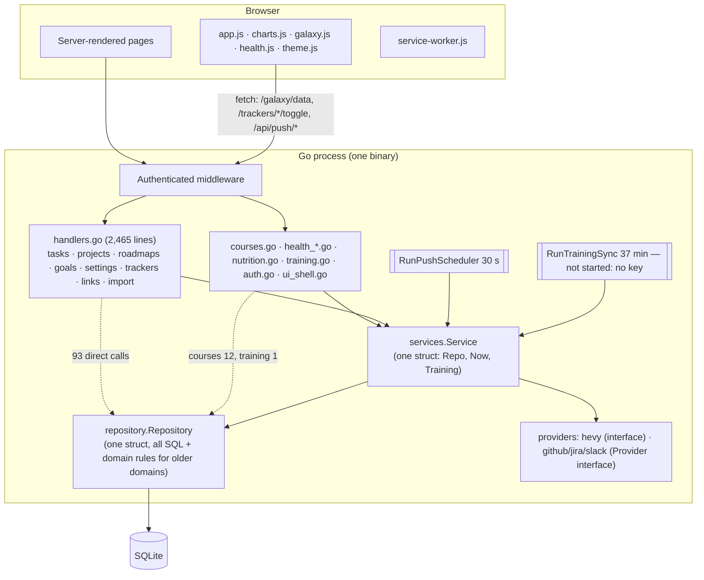
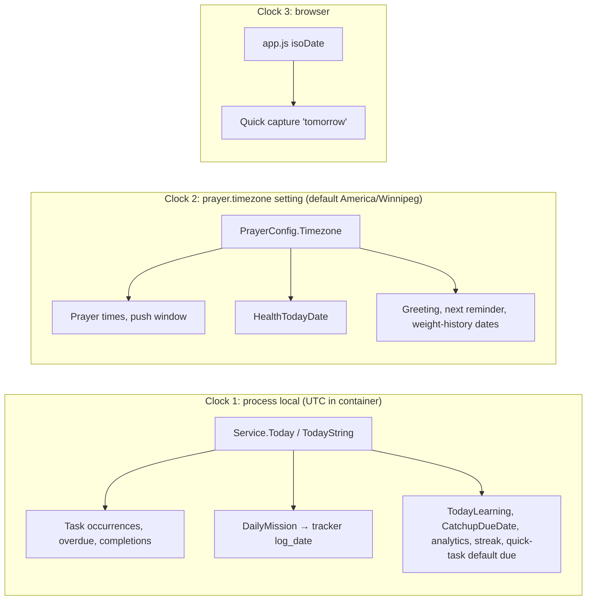

# Stage 2B — Backend and Product Architecture Review

- **Stage:** 2B, a read-only code and architecture review
- **Date:** 2026-09-27
- **Baseline:** `dab7995` (production source). Prior audit: Stage 1
  (`9be649a`) and Stage 2A (`05f2f96`).
- **Method:** source reading in the audit worktree. Production facts (row
  counts, credential presence, timezone) are reused from Stage 2A; no new
  production access was needed or performed.
- **Scope:** how the application is structured and what really exists behind
  the UI. No redesign, no fixes.

Feature status vocabulary (used only these five):
**IMPLEMENTED** · **PARTIAL** · **PLACEHOLDER** (UI or field exists, behaviour doesn't) ·
**DOCUMENTED ONLY** · **DEAD / UNUSED**.

Code evidence wins over documentation throughout.

---

## A. Executive assessment

GYST is a **working, coherent monolith** whose code quality varies by *age*,
not by domain difficulty:

- **Newer code (Health, auth, backup, Hevy provider, 2026-09)** follows the
  intended Browser → handler → service → repository → SQLite layering *strictly*.
  Presentation rules are explicit (absent ≠ zero), there's a provider interface,
  and there are negative tests. **0 direct repository calls** from Health handlers.
- **Older code (tasks, projects, roadmaps, courses, goals, 2026-06 to 2026-08)**
  lets handlers call the repository directly (**93 call sites, 60 distinct
  repository methods**), and **domain rules live in the repository**: XP awards,
  proof rules, quest completion and dependency unlocks.

The concrete consequences, rather than the file size, are what matter:
- the same "Quest complete" award is written in two places
- two GET routes write to the database
- project status is mapped to UI states by three functions that disagree
- **the calendar day is computed by three different clocks**: container UTC, the
  prayer-settings timezone, and the browser. This produces the confirmed
  wrong-day data from Stage 2A (S2-02).

What's behind the UI (§O):
- **Real and working:** Today/tasks/recurrence/XP, projects/quests/roadmaps,
  Galaxy, courses, goals, prayer and push, and the Health "today" slice.
- **Coded but dormant:** Hevy training (no key) and courses and calendar feeds
  (no rows, no token).
- **Placeholders:** Health Week/Month/Year, meals, workouts, weight entry,
  historical and strength trends, the static "Hevy not connected" card, and
  learning-block repeat.
- **Dead:** two tables, eight service/repository methods and one template.

**Command-center readiness:** links and launchers are easy. GitHub Issues and
n8n fit the existing *provider + snapshot + background sync* pattern (moderate).
Agents and server control need new subsystems, and they would need an
authorization model the single password doesn't provide (§L, §Q).

---

## B. Actual runtime architecture



Facts that shape everything below:
- **One `Service` struct** holds every domain method; there are no per-domain services.
- **One `Repository` struct** holds every query; there are no per-domain repositories.
- **Templates are re-parsed on every request.** Every render also queries
  `PlayerStats` (4 subqueries) for the header XP.
- `Service.Now` is injectable (`services/lifeops.go:14`), which makes
  time-dependent logic testable. `Today()` truncates `Now()` in **process-local
  time**, which is UTC in the container.

---

## C. Layering review

| Domain | Handler → service? | Handler → repository directly? | Where the domain rules live | Tests |
|---|---|---|---|---|
| Health (snapshots, cycles, energy) | ✔ | **No** (0) | `services/health.go`; presentation in `health_view.go` | Strong (service, repo, handler, "absent ≠ zero") |
| Auth / sessions | ✔ | No | `services/auth.go` | Strong |
| Training (Hevy) | ✔ sync | 1 (`TrainingCache`) | `services/training*.go`, `providers/hevy` | Good |
| Tasks / recurrence / XP | Partly (`TaskOccurrencesOn`) | Yes (`SetTaskOccurrenceStatus`, CRUD, checklist) | Recurrence in service; **XP and proof rules in the repository** (`tasks.go:147,185,244-329,395-415`) | Good |
| Projects / quests | Partly | Yes (CRUD, items, status, proof, unlock count) | **Repository**: awards, `reconcileProjectStatus`, `AutoUnlockDependents` (`projects.go:285-576`) | Good (quest workflow tests) |
| Roadmaps / imports | ✔ parse/import | Yes (meta, milestones, featured, adopt) | Parsing in service (1,165 lines) | Parser tests |
| Courses | ✔ deck/detail | Yes (12: create, update, blocks, status) | Split | Good |
| Goals | No | Yes | Repository | Light |
| Trackers | via `DailyMission` | `ToggleTrackerLogByKey` | Service (mission build) plus repository | Light |
| Settings / prayer | ✔ | No | `services/prayer.go` | Good |
| Push | Scheduler in service | Subscribe/unsubscribe direct | Service | Handler only; **scheduler untested** |

### Consequences with evidence (not "the file is big")

| # | Consequence | Evidence |
|---|---|---|
| C-1 | **Duplicated business rule.** The "Quest complete" achievement insert with the completion bonus appears twice. | `repository/projects.go:296-300` (manual status) and `:569-572` (reconcile) |
| C-2 | **Inconsistent state mapping.** Project status → UI state is implemented three times and they disagree on `paused`. `RouteState` gives "locked", `nodeState` gives "blocked". Both handle `blocked` and `in_progress`, which the projects CHECK constraint doesn't allow. The list filter is a third mapping. | `services/rocket.go:58`, `handlers.go:2351`, `projects_view.go:17`, migration 005 CHECK |
| C-3 | **GET requests write data.** `GET /projects` assigns every roadmap-less project to the dashboard roadmap. `GET /galaxy/data` persists positions. (Stage 2A only noted the second.) | `handlers.go:933-934` → `roadmaps.go:143`; `services/galaxy.go:44` |
| C-4 | **Transaction boundaries follow repository methods, not use cases.** Item completion commits, then project reconcile, award and unlock run as separate statements. | `projects.go:514,535,538-576` |
| C-5 | **Three clocks for "today"** (root cause of S2-02; see §J). | `services/lifeops.go:35-41`; `services/health.go:206`; `handlers.go:508`; `app.js:346` |
| C-6 | **Presentation rules sit in handlers**, which blocks reuse by any non-HTML client: greeting and current prayer (`handlers.go:492-515`), staleness 8 h (`health_view.go:88`) and 2 h (`training.go:100`). | cited |
| C-7 | **Celebration XP can differ from awarded XP.** The redirect shows `task.StarsReward` whatever was actually awarded (already-awarded, proof bonus, recurring minimum 1). | `handlers.go:839-843` vs `tasks.go:266-268,296-302` |
| C-8 | **Adding a non-HTML client** (API, agent, n8n) for tasks or projects would have to call the repository and re-implement the handler-side sequencing. No service-level use case exists for "complete a task" or "complete a mission". | 60 distinct repository methods called from handlers |

**Assessment:** the direct repository calls are harmless for simple CRUD
(list, get, archive). They matter where a **use case spans several writes or
rules**: task completion, mission completion, project status, roadmap adoption.
Those are the boundaries worth improving later (§S).

---

## D. Today / Tasks

**Domain model (actual):**
- `tasks`: one row per task definition, with `repeat_type ∈ {none, daily, weekly, monthly, yearly}` anchored on `due_date`.
- **Occurrences are computed, not stored** (`TaskOccurrencesBetween`, `taskDueOn`,
  `services/lifeops.go:321-380,739-760`).
- `task_completions`: `(task_id, occurrence_date)` unique; stores completed or skipped per occurrence plus `stars_awarded`.
- A one-time task *also* mirrors status on the `tasks` row.
- XP is **derived by summation** across `tasks`, `task_completions`,
  `project_items` and `achievements` (`PlayerStats`, `tasks.go:331-346`). There
  is no separate ledger, so XP can't drift.
- Reminders are rows synced from a task's `reminder_time` on write (`syncTaskReminder`).

| Capability | Status | Evidence / notes |
|---|---|---|
| Task CRUD, priority, category, due date | IMPLEMENTED | `handlers.go:757-850`, `tasks.go` |
| Recurrence expansion (daily/weekly/monthly/yearly, month-end and Feb-29 handling) | IMPLEMENTED | `lifeops.go:739-800` |
| Complete / skip an occurrence | IMPLEMENTED | `SetTaskOccurrenceStatus` (transactional) |
| Reopen / undo a completion | PARTIAL | No route. Only via the edit form (the status field); a recurring occurrence can't be reopened. |
| Proof-required completion | IMPLEMENTED | Server error on missing proof (QUEST_SYSTEM "known gap": no inline message) |
| Task checklist | IMPLEMENTED | 0 rows in production |
| Quick capture ("tomorrow", "!high") | IMPLEMENTED | Parsed **in the browser** (`app.js:346-348`) |
| Overdue one-time tasks | IMPLEMENTED | `ListActiveOneTimeOverdueTasks` |
| Reminders shown on Today | IMPLEMENTED | Task-derived. No UI to create a standalone reminder (1 `manual` row exists in production, origin not traced). |
| XP, levels, streak, medals | IMPLEMENTED | `PlayerStats`, `ShipStats`, `achievements` |
| Daily mission trackers (5 prayers, 2 athkar, gym) | IMPLEMENTED | Dated by UTC (S2-02) |
| Correct local calendar day | PARTIAL | UTC in the container (§J) |
| Priorities, focus, time-blocking, "plan my day" | DOCUMENTED ONLY / absent | Focus = first pending task (UI_SCREEN_MAP). No scheduler. |

**Suitability as a command-center Today foundation:** the recurrence and
completion model is sound and well tested. XP-by-derivation is a good pattern.
The weaknesses are foundational but narrow:
1. the day boundary (§J)
2. the Today handler composes **12 independent reads** in the handler
   (`handlers.go:441-543`), so a second client can't reuse "what is Today"
3. task, course, prayer and health "today" items have no common shape; each is
   assembled ad hoc for the template.

---

## E. Projects

**Domain model:**
- `projects`: parent/child (moons), `depends_on_project_id` plus `auto_unlock`,
  `project_kind`, a status CHECK allowing
  `active|paused|upcoming|locked|completed|done|archived`, category (free text),
  colour, Galaxy `pos_x/y/z`, roadmap membership.
- `project_items` ("missions"): priority, due date, proof (URL/path **string**;
  there's no file upload), XP reward and awarded amount.
- Roadmap side tables: `roadmap_project_meta`, `roadmap_resources`,
  `roadmap_milestones`, `roadmap_imports`, `roadmap_weekly_reviews`.
- `external_links`: polymorphic links to tasks, projects and items (no FK).

| Capability | Status | Evidence / notes |
|---|---|---|
| Project CRUD, hierarchy, move under parent (edit form) | IMPLEMENTED | `handlers.go:862-1290`. `Repository.MoveProject` itself is unused. |
| Dependencies and auto-unlock | IMPLEMENTED | `AutoUnlockDependents` (`projects.go:347`) |
| Missions with proof and XP; quest auto-complete | IMPLEMENTED | `projects.go:400-576` (not atomic, C-4) |
| Status filters, detail sections | IMPLEMENTED | `projects_view.go` |
| Multiple roadmaps, featured roadmap | IMPLEMENTED | 1 roadmap in production |
| Roadmap Markdown import | IMPLEMENTED | `ParseRoadmapMarkdown` (`services/roadmap.go:277-912`) |
| Roadmap export (public/private Markdown) | IMPLEMENTED | `ExportRoadmap`; the "public" variant filters privacy-tagged content |
| Weekly review | IMPLEMENTED | 0 rows in production |
| Milestones | IMPLEMENTED | 0 rows in production |
| **"AI plan" import** | IMPLEMENTED (**no AI**) | See below |
| External links (Jira/GitHub/Slack/Linear/Asana/Notion/other) | IMPLEMENTED | 1 row in production |
| Provider snapshot refresh (GitHub/Jira/Slack) | PARTIAL | Code present; all tokens EMPTY. GitHub works unauthenticated only for public repos (inferred). |
| Solar-system view (`ProjectSolarSystem`), `UpdateProjectNotes`, `HasRoadmap` | DEAD / UNUSED | No production callers |

**AI plan import, stated explicitly:** GYST contains **no AI integration**.
`services/plan_import.go:12` defines `AIPlanPromptTemplate`, a prompt the user
copies into an external chatbot (the page text names ChatGPT). The user pastes
the Markdown reply back; `ParseAIPlanMarkdown` parses it deterministically, with
a preview before anything is written. No LLM API, key or network call exists
anywhere in the code (Stage 1 grep). There are **two independent Markdown
grammars and parsers**, the plan import (`plan_import.go`, 242 lines) and the
roadmap import (`roadmap.go` parse helpers, about 640 lines), producing
overlapping entities.

**Can the project model support future development work?**

| Future need | Fit | Why |
|---|---|---|
| Repositories | Weak | No repository entity; `category` is free text and `project_kind` is main/sub. It could be approximated by convention, not modelled. |
| GitHub Issues | Partial | `external_links` already stores a GitHub issue URL, key, title and status snapshot, attached to a project, item or task. Missing: sync direction, issue identity as the canonical record, mapping to missions. |
| Development tasks | Partial | `project_items` has status, priority, due date and proof. No assignee, branch, PR or review fields. |
| Agents | None | No execution, run or session concept |
| Reviews | None | The proof field is the only "evidence" concept, and it's a URL/path string |

---

## F. Galaxy

| Aspect | Finding |
|---|---|
| Data source | `GET /galaxy/data` → `Service.GalaxyData`: top-level, non-complete projects as planets and their non-complete children as moons (`services/galaxy.go`) |
| What is data | Project ID, name, category (free text), colour, description, target date, next item, mission count, progress, route state, URL |
| What is persisted for Galaxy | Only `projects.pos_x/y/z`: a stable position derived from a hash of the UUID and written on the first GET (C-3) |
| What is purely visual | Size (derived from the item count), orbit and motion, camera, starfield, the PNG texture, category colours in the navigator |
| Coupling | One-way: Galaxy reads projects. No project behaviour depends on Galaxy. It shares `RouteState` with the rocket route. |
| Client | `galaxy.js` (480 lines) plus gesture (41) and camera (7) modules, vendored Three.js 0.180 (`three.core.js` 1.4 MB + `three.module.js` 0.6 MB), `oliver-galaxy-pixel.png` 1.17 MB |
| Interaction | Drag, pinch, zoom buttons, tap to open a preview panel, category filter, keyboard/list fallback when WebGL fails (`galaxy.js:96-97`, `galaxy.html:41`) |
| Mobile | Pixel ratio capped at 2 (`galaxy.js:406`); reduced-motion honoured (`:46`); gesture and camera logic covered by `scripts/check-galaxy.cjs` |
| Performance-sensitive facts | About 3.2 MB of Galaxy-only assets are **not in the SW precache**, and the public ingress sends `Cache-Control: no-store` on static files (2A C26), so on that path they are re-fetched every visit (inferred from headers, not measured). The render loop uses `requestAnimationFrame` (`:462`). Idle-frame behaviour was not measured. |
| Status | **IMPLEMENTED** |

Galaxy is cleanly separable: a read-only projection of Projects plus three
persisted coordinates. Nothing about it blocks other work. Its data contract
(`GalaxyPlanet`) is small enough that it could project other entities later
without changing Projects.

---

## G. Health

### G.1 Architecture (the strongest in the codebase)

```text
Shortcut → POST /api/health/sync → services.SyncHealth → Repo.ApplyHealthSync
            (validated, partial upsert, one tx)          → daily_health_snapshots, health_sync_states
/health, /health/nutrition → services.HealthToday → CalculateObservedHealthEnergy
            → handlers.buildHealthTodayView (all absent/zero decisions) → templates (no arithmetic)
Hevy → providers/hevy (TrainingProvider interface) → services.SyncTraining → training_snapshots (JSON)
```

**Invariants, verified in code:**
- **Missing ≠ zero.** `*float64`/`*int64` pointers end to end (`models/health.go:25-36`);
  `HealthMetricView.Present` (`health_view.go:33-130`); templates branch on
  `.Present` (`health.html:133-149`). Tested: `TestObservedZeroIsDistinctFromAbsent`,
  `TestAbsentMetricsNeverRenderAsZero`.
- **Watch and phone steps are separate.** Separate columns, fields and rows
  (`health_view.go:216-217`, `health.html:133,137`). Never summed.
- **Steps are never converted to calories.** No such arithmetic exists.
- **Burn = resting + active** only when **both** are present; balance only when
  intake is also present; food remaining = target − intake
  (`services/health.go:185-204`).

### G.2 Feature classification

| Feature | Status | Evidence / notes |
|---|---|---|
| Daily snapshot ingestion (10 metrics) | IMPLEMENTED | 5 snapshots in production (2026-09-12 → 09-25) |
| Sync state / last-synced / staleness (8 h) | IMPLEMENTED | `health_view.go:88` |
| Today summary: energy, macros vs. targets, steps (Watch/phone), active/resting, exercise minutes | IMPLEMENTED | `health.html` |
| Nutrition page (totals, macros, fibre, stale notice) | IMPLEMENTED | `nutrition.go`, `nutrition.html` |
| Individual meals / meal planning ("Plan meal") | PLACEHOLDER | Disabled button (`health.html:124`); "GYST receives daily totals, not individual meals" |
| Week / Month / Year summaries | PLACEHOLDER | Disabled buttons (`health.html:22-24`). `health.js` still carries text describing them. |
| Health plan cycles (targets, dates, overlap guard) | IMPLEMENTED | 1 cycle in production. One-day cycles are blocked by schema (2A S2-20). |
| Plan adherence | DOCUMENTED ONLY | UI_SCREEN_MAP "Adherence requires backend" |
| Weight history view (30/90/all, chart and table) | PARTIAL | Reads `health_weight_entries`, which has **no writer** (0 rows) |
| Weight entry / import | PLACEHOLDER | `health_progress.html:19` says "not available". `Service.CreateHealthWeightEntry` exists but has no route. The sync payload has no weight field. |
| Historical nutrition and activity trends | PLACEHOLDER | `health_progress.html:21` |
| Strength trend | PLACEHOLDER | Static "No strength records connected" (`health.html:168`, progress page) |
| Hevy import (templates, routines, workouts; paginated; errors retained) | PARTIAL (dormant) | Code complete and tested. `HEVY_API_KEY` EMPTY, so the goroutine never starts and `training_snapshots` has 0 rows. |
| Training page: routines, recent workouts, muscle map (primary/secondary, warm-ups excluded) | PARTIAL (dormant) | `training.go`, `training_summary.go`. Shows "unavailable" without data. |
| Health summary "Workout history" card | PLACEHOLDER | **Fixed text** "Hevy workouts are not connected yet" with no condition (`health.html:118-120`). It will contradict `/health/training` once Hevy connects. |
| "Start workout" | PLACEHOLDER | Disabled (`health.html:124`) |
| Gym consistency (manual tracker) | IMPLEMENTED | `tracker_items` `gym`. Separate from Hevy. |
| Health goals and tasks on Health | IMPLEMENTED | Filter `category == "health"` in the handler (`handlers.go:1575-1588`) |
| Health navigation (summary, nutrition, training, progress, plan) | IMPLEMENTED | 5 routes plus Menu section |
| Projected energy balance | DOCUMENTED ONLY | RULES 3.5 (future, "always labelled projected") |
| Health AI assistant | DOCUMENTED ONLY | AI_HANDOFF §5 "after deterministic services" |
| Health read API | DOCUMENTED ONLY (deliberately absent) | `health_api.go:30-35` |

**Hevy storage:** `training_snapshots(provider PK, entries_json, synced_at,
last_error)` holds the whole normalized `[]TrainingEntry` as one JSON document,
replaced wholesale on every sync (`repository/training.go`). The **Go model** is
provider-neutral (`models/training.go`), which satisfies the "don't bind the UI
to Hevy JSON" rule. The **storage** doesn't match the documented "generic
`training_*` tables" (2A C20). Consequences: history can't be queried in SQL,
there's no per-workout identity across syncs, and the full blob is decoded on
every Training page view.

---

## H. Courses

**Model:** `courses` (status, provider, instructor, URL, **manual
`progress_percent`**, target date, notes) and `learning_blocks` (type
lesson/module/study/assignment/review/exam/live_session; status
pending/completed/skipped/postponed; optional due date and times; URL; notes;
`is_catchup`; `repeat_type`).

| Capability | Status | Evidence / notes |
|---|---|---|
| Course CRUD, status, archive | IMPLEMENTED | `handlers/courses.go`. **0 courses in production.** |
| Learning blocks: create, complete, reopen, skip, delete | IMPLEMENTED | `courseBlocks` |
| Postpone → catch-up block (next day) | IMPLEMENTED | `CatchupDueDate`, `PostponeLearningBlock` |
| Progress | PARTIAL | `progress_percent` is typed by hand; block completion counts are shown alongside but don't drive it |
| Next block / next deadline per course | IMPLEMENTED | `decorateCourse` (`course.go:71-94`) |
| Today "learning missions" plus idle study suggestion | IMPLEMENTED | `TodayLearning` (UTC day) |
| Block repeat (daily/weekly/monthly) | PLACEHOLDER | Offered in the form (`course_detail.html:148`) and stored (`courses.go:159,165`). **No code expands or honours it.** |
| ICS feeds (all, courses, course, projects; tokenized) | IMPLEMENTED | Not in use: no `calendar_token` in production (2A) |
| Notes and resources | IMPLEMENTED | Text notes and a URL per course and block. There's no resources table for courses; `roadmap_resources` belongs to projects. |
| "Course trip type" on project form, weekly block editor | DOCUMENTED ONLY | `calendar-course-integration.md:64-72`, superseded by the dedicated Courses feature |
| Google Calendar OAuth / CalDAV | DOCUMENTED ONLY | `google-calendar-plan.md:92-116` |

**"What should I study next?"** The ingredients exist: next pending block per
course, the next deadline, due and overdue blocks for today, and an idle
suggestion. There's no ranking across courses, time budget or priority, and
progress is manual. That makes it a **moderate extension of an existing
service**, not a new subsystem.

---

## I. Goals / Analytics

| Capability | Status | Evidence / notes |
|---|---|---|
| Goals create / detail / progress entries / archive | IMPLEMENTED | 4 goals, 5 entries in production |
| Goal edit | PARTIAL | **No edit route.** `goals` dispatch handles only list, new, detail, progress and archive (`handlers.go:1384-1430`); `goal_form.html` is used for create only. |
| Goal progress from tasks or health data automatically | DOCUMENTED ONLY / absent | Progress is manual entries only. `unit` defaults to 'tasks', but nothing links them. |
| Analytics (daily/monthly completion, streak, project and goal charts) | IMPLEMENTED | `services.Dashboard` → `analytics.html` |
| Monthly view | IMPLEMENTED | |
| Achievements / medals | IMPLEMENTED | 15 rows |
| `categories` table | DEAD / UNUSED | Created and seeded by migration 001 (7 rows), no code reference. Categories are free-text columns and CHECK lists instead. **Abandoned early**, not future: nothing plans for it. |
| `activity_events` table | DEAD / UNUSED (**abandoned WIP**) | Migration 017 applied, 0 rows. The only code using it is `stash@{2}` ("activity-events WIP", 14 files), never committed. Classification: partially implemented, then abandoned in a stash. |

---

## J. Prayer / Notifications

| Capability | Status | Evidence |
|---|---|---|
| Local prayer-time calculation (methods, Asr, per-prayer adjustments) | IMPLEMENTED | `services/prayer.go`, tests with known Winnipeg dates |
| Prayer settings | IMPLEMENTED | `app_settings` `prayer.*` keys. **Production has 0 rows**, so defaults (Winnipeg/ISNA/Shafi) apply. |
| Countdown, current and next prayer on Today | IMPLEMENTED | `handlers.go:477-497` (rules in the handler) |
| Open-page alert, chime, Athan file | IMPLEMENTED | `app.js:230-260` (client-side) |
| Web Push per prayer | IMPLEMENTED | 1 subscription, 12 deliveries in production |
| Prayer and athkar check-ins | IMPLEMENTED, with wrong-day dating | S2-02 |

### The UTC/local-day problem: architectural cause



- There's **no application-level timezone**. The only timezone setting is
  `prayer.timezone`, owned by the prayer feature. Health "borrowed" it
  (`services/health.go:206-216`), but the older core never did.
- `Service.Today()` (`lifeops.go:35-38`) takes `s.Now()` in its own location. In
  Docker that's UTC (`TZ` unset, `/etc/localtime → UTC`; 2A).
- There are **36 call sites** of `Today()`/`TodayString()`, and every one of them
  inherits UTC.
- Why tests don't catch it: services tests set `Service.Now` to fixed times with
  no timezone mismatch; no test runs the tracker or task path with a UTC
  process and a non-UTC prayer timezone.
- Result (2A production evidence): check-ins and completions between 18:00/19:00
  local and midnight are stored against the next day.

### Push background loop
See §K.

---

## K. Background jobs

| Job | Startup | Shutdown | Scheduling | Error handling | Duplicate-run risk | Logging | Testability |
|---|---|---|---|---|---|---|---|
| **Prayer push** `RunPushScheduler` (`services/push.go:22`) | Always started in `app.New`; returns immediately if any VAPID value is empty (config read **once**) | Context cancelled only by `App.Close()`. **SIGTERM kills the process without calling it** (no `signal.Notify`, no `Shutdown`). | 30 s ticker; sends when `now − prayer.At < 2 min` | Errors ignored (`return`/`continue`). Failed sends release the claim for retry. | **Safe:** `ClaimPushDelivery` insert-or-ignore on (subscription, date, prayer), which survives restarts | None | `sendDuePrayerPushes(ctx, cfg, now)` is injectable but **has no tests** |
| **Hevy sync** `RunTrainingSync` (`services/training.go:42`) | Only if `HEVY_API_KEY` is set (**not running in production**) | Same as above | Immediately, then every 37 min; manual POST too | Failure recorded in `training_snapshots.last_error`; last good data kept | Guarded: `TryLock` plus a 1-minute minimum interval; 3-minute timeout | None | Tested (`training_test.go`, provider interface) |
| **Session cleanup** `SweepExpiredSessions` | **Never invoked.** No goroutine, no caller (grep). Confirms 2A C15. | — | — | Expired rows are removed only when their cookie is presented (`auth.go:113-117`) | n/a | n/a | Method tested (`TestSweepExpiredSessionsLeavesLiveOnes`) |

There's no job framework, registry or status surface. Each loop is a bare
goroutine; the only observable output is data rows.

---

## L. Authentication architecture (fit for future features)

- **Model:** one password, one principal, opaque server-side sessions, with
  cookie auth for the browser. Per-integration credentials exist as **separate
  narrow mechanisms**:
  - a Health bearer token (write-only, one endpoint)
  - a calendar path token (read-only ICS)
- **Adequate for a personal LifeOps app?** Yes, for reading and editing
  personal data. There's no concrete need for multi-user accounts.
- **Gaps that future features expose (structural, not multi-user):**
  1. **No capability or scope concept.** A session can do everything; there's no
     way to give n8n, a webhook or an agent *only* "create task" or "read status".
     The Health token shows the pattern (scoped, exempt path, constant-time
     compare), but it is hand-built per endpoint (`middleware.go:55-77`,
     `health_api.go:37-54`).
  2. **No step-up for dangerous actions.** Server controls or agent execution
     would sit behind the same 30-day rolling cookie as viewing a checklist.
  3. **No audit trail** of who or what acted: session versus token versus job (2A S2-05).
  4. **Inbound webhooks** (GitHub, n8n) need signature or token verification
     per source. The middleware's exempt list is a hard-coded `switch` with
     pinned tests, which is good for safety but means every new integration
     needs a code change.

---

## M. API architecture

| Endpoint(s) | Class | Contract quality |
|---|---|---|
| All HTML routes and form POSTs (§6 of Stage 1) | Browser-only | Forms, redirects, HTML errors |
| `GET /galaxy/data` | Browser-only (JS) | JSON, undocumented, UI-shaped |
| `POST /trackers/{key}/toggle` | Browser-only (JS) | JSON or redirect depending on `Accept` |
| `GET /api/push/vapid-key`, `POST|DELETE /api/push/subscribe` | Browser-only (JS) | JSON |
| `POST /api/health/sync` | **Integration API** (Shortcut) | Strict JSON, validated, bearer token, documented in `HEALTH_CORE.md` |
| `/calendar/feed/{token}…` | Token-protected feed | ICS |
| `/calendar.ics` and the other plain ICS routes | Browser-only in practice (session plus flag) | ICS |
| `GET /roadmap/export/{public,private}` | Browser-only (download) | Markdown |
| Webhooks | none | — |
| Future candidates | — | Task create or complete, status reads for a launcher, provider webhooks |

**As a foundation:**

| Future | Assessment |
|---|---|
| GitHub | Outbound: the `providers.Provider` interface plus snapshot fields on `external_links` already exist (`services/providers/providers.go`). Inbound webhooks: nothing to build on except the Health-token pattern. |
| n8n | n8n could call GYST only via the Health-style token pattern. No generic authenticated JSON API exists for tasks or projects, and use cases live in handlers (C-8). |
| Agent providers | Nothing. There's no job, run or session model or event stream, and no JSON API. |
| Server provider | Nothing. The closest analogue is the Hevy provider pattern (outbound read, snapshot cache, background refresh). |
| SamVision | Links only. Menu rows are a static Go slice (`ui_shell.go:41-71`). |

The integration pieces worth reusing are the Health API's strict JSON handling
and the Hevy **provider → normalized model → snapshot → background refresh →
stale indicator** chain.

---

## N. Configuration architecture

| Source | What | Read where | Authoritative? |
|---|---|---|---|
| CLI flags | `-addr :8080`, `-db data/lifeops.db`, `-migrations`, `-seed-file`, `-templates`, `-static`, `-seed=true`, `-passwordhash` | `internal/app/cli.go:24-31` | **Yes** for paths and ports. Compose passes no flags, so the defaults are what runs. |
| Env via `app.Config` | `GYST_PASSWORD_HASH`, `GYST_HEALTH_SYNC_TOKEN`, `GYST_AUTH_DISABLED`, `HEVY_API_KEY`, `ALLOW_PUBLIC_CALENDAR_FEEDS` | `cli.go:43-56` | Yes, read once at startup |
| Env read **inside services and providers** | `VAPID_*` (`services/push.go:17`, read per call), `GITHUB_TOKEN`, `JIRA_*`, `SLACK_BOT_TOKEN` (`services/providers/*.go`, read per request) | Not injected; bypasses `app.Config` | Yes, but invisible from the config struct |
| Env set but **ignored** | `DB_PATH`, `PORT` (compose) | — | **No.** Works by coincidence with the flag defaults (2A C18). |
| DB settings (`app_settings`) | `prayer.latitude/longitude/timezone/method/asr_method/adjust.*/alert_sound/athan_file`, `calendar_token` | `services/prayer.go`, `calendar.go` | Yes. Production has 0 rows, so everything is at defaults. `prayer.timezone` is de facto the app timezone (§J). |
| Browser `localStorage` | `lifeops-theme`, `lifeops-motion` | `theme.js`, `app.js` | Per device |
| Hard-coded constants | Session 30 d / refresh 24 h; Health stale 8 h; training stale 2 h; Hevy 37 min; push 30 s and 2 min; XP values (`internal/xp`); default Winnipeg coordinates | cited above | Code |

---

## O. Dead / partial / placeholder functionality — feature status table

For Stage 3 browser verification.

| Feature | Status | Evidence | Notes for the browser audit |
|---|---|---|---|
| Today dashboard (`/`, `/today`) | IMPLEMENTED | `handlers.go:441-543` | Dates follow UTC after local evening |
| Daily checklist (`/checklist`) | IMPLEMENTED | same handler | |
| Task CRUD / detail / list filters | IMPLEMENTED | `handlers.go:571-860` | |
| Recurring tasks | IMPLEMENTED | `lifeops.go:739` | |
| Complete / skip occurrence | IMPLEMENTED | `tasks.go:244` | Celebration XP may not equal the award (C-7) |
| Reopen a completed task | PARTIAL | no route | Only through the edit form |
| Task checklist items | IMPLEMENTED | `handlers.go:667` | 0 rows in production |
| Quick capture and palette | IMPLEMENTED | `layout.html:32-62`, `app.js:323-350` | Search filters **9 static commands only**; no data search |
| Reminders page | IMPLEMENTED (read-only) | `handlers.go:1529` | No create UI for standalone reminders |
| XP / levels / medals | IMPLEMENTED | `tasks.go:331` | |
| Prayer / athkar / gym trackers | IMPLEMENTED | `ToggleTrackerLogByKey` | Wrong-day dating in evening |
| Prayer times, countdown, alerts | IMPLEMENTED | `prayer.go`, `app.js` | Settings at defaults |
| Prayer Web Push | IMPLEMENTED | `push.go` | Needs a device to verify |
| Projects list / filters / detail | IMPLEMENTED | `handlers.go:862` | `GET /projects` writes (C-3) |
| Project hierarchy, dependencies, unlock | IMPLEMENTED | `projects.go:347` | |
| Missions with proof and XP | IMPLEMENTED | `projects.go:400-536` | Proof = URL/path text; missing proof shows a raw 500 |
| Roadmap page and rocket route | IMPLEMENTED | `roadmap.html`, `rocket.go` | |
| Roadmap import / export | IMPLEMENTED | `roadmap.go` | |
| Weekly review, milestones | IMPLEMENTED | `handlers.go:1917,2016` | 0 rows; empty states |
| AI plan import | IMPLEMENTED | `plan_import.go` | **Copy-paste only; no AI call** |
| External links | IMPLEMENTED | `handlers.go:1140` | |
| External link API sync | PARTIAL | `provider_sync.go` | All provider tokens EMPTY |
| Galaxy 3D / list fallback | IMPLEMENTED | `galaxy.go`, `galaxy.js` | Check the large asset download on the public host |
| Solar-system view | DEAD / UNUSED | `cosmic.go:73` no caller | |
| Courses list / detail / forms | IMPLEMENTED | `handlers/courses.go` | 0 courses, so empty states |
| Learning-block actions and catch-up | IMPLEMENTED | `courseBlocks` | |
| Learning-block repeat | PLACEHOLDER | `course_detail.html:148`; no consumer | Choice has no effect |
| Course progress % | PARTIAL | manual field | |
| ICS feeds / settings token | IMPLEMENTED | `courses.go:386`, settings | No token in production |
| Goals list / create / detail / progress | IMPLEMENTED | `handlers.go:1384` | |
| Goal edit | PARTIAL | no route | |
| Analytics / monthly | IMPLEMENTED | `services.Dashboard` | |
| Archive page | IMPLEMENTED | `handlers.go:1617` | |
| Settings (prayer, calendar token, theme, motion) | IMPLEMENTED | `handlers.go:1658` | |
| Menu (`/more`) | IMPLEMENTED | `ui_shell.go:31` | Static list of 19 |
| Health summary: today | IMPLEMENTED | `health_view.go` | |
| Health Week/Month/Year | PLACEHOLDER | `health.html:22-24` | Disabled |
| Nutrition totals | IMPLEMENTED | `nutrition.go` | |
| Meals / Plan meal | PLACEHOLDER | `health.html:124` | Disabled |
| Start workout | PLACEHOLDER | `health.html:124` | Disabled |
| Health "Workout history" card | PLACEHOLDER | `health.html:118-120` | Fixed "not connected" text |
| Training page (Hevy) | PARTIAL | `training.go` | Dormant: no key, no data |
| Manual training sync | PARTIAL | `trainingSync` | Returns 503 "Hevy is not connected" |
| Weight history | PARTIAL | `health_progress.go` | Always empty (no writer) |
| Weight entry / import | PLACEHOLDER | `health_progress.html:19` | |
| Nutrition/activity trends, strength trend | PLACEHOLDER | `health_progress.html:21`, `health.html:168` | |
| Health plan cycles | IMPLEMENTED | `health_plan.go` | |
| Plan adherence | DOCUMENTED ONLY | UI_SCREEN_MAP | |
| Projected energy | DOCUMENTED ONLY | RULES 3.5 | |
| Health AI assistant | DOCUMENTED ONLY | AI_HANDOFF §5 | |
| Login / logout | IMPLEMENTED | `auth.go` | |
| Session sweep | DEAD / UNUSED | no caller | |
| PWA install / offline page / SW cache | IMPLEMENTED | `service-worker.js` | |
| `dashboard.html` | DEAD / UNUSED | only `render_test.go` | `/dashboard` redirects |
| UI gallery | DEAD / UNUSED (runtime; test fixture by design) | `ui_gallery_test.go` | Not routable |
| `categories` table | DEAD / UNUSED | 0 references | |
| `activity_events` table | DEAD / UNUSED | code only in `stash@{2}` | |
| Unused methods: `CountSessions`, `HasRoadmap`, `MoveProject`, `ProjectSolarSystem`, `SweepExpiredSessions`, `UpdateProjectNotes`, `UpsertDailyHealthSnapshot`, `UpsertHealthSyncState`, `Service.CreateHealthWeightEntry` (no route) | DEAD / UNUSED | no production callers | Some are test helpers in practice |
| Native iOS app, mobile sync client (`uuid`/`sync_version`) | DOCUMENTED ONLY | README "Future iOS App Plan" | Columns exist; no sync code |
| Google Calendar OAuth / CalDAV | DOCUMENTED ONLY | `google-calendar-plan.md` | |
| Course "trip type" on project form | DOCUMENTED ONLY (superseded) | `calendar-course-integration.md` | |

---

## P. Documentation-vs-code mismatches (continuing C1–C26)

| # | Mismatch | Evidence |
|---|---|---|
| C27 | `HEALTH_CORE.md` §Deferred lists "M4: live Health dashboard and replacement of demonstration cards" as future; it's implemented (M4 `60be715`, UI-5). | `HEALTH_CORE.md:121` |
| C28 | `HEALTH_CORE.md` lists "Later: Hevy"; Hevy is implemented (TRAIN1). | `HEALTH_CORE.md:122` |
| C29 | `QUEST_SYSTEM.md` "known gap": required-proof completion "returns the normal server error". Still true, and it's a raw `err.Error()` 500 (2A S2-06), not a friendly message. | `tasks.go:257`, `handlers.go:2455` |
| C30 | Stage 2A S2-15 said only `/galaxy/data` mutates on GET. `GET /projects` also writes (`AdoptOrphanProjects`). This corrects the Stage 2A statement; that commit isn't changed. | `handlers.go:933` |
| C31 | `calendar-course-integration.md` proposes courses as a project "trip type"; the implemented design is a separate Courses domain. | doc vs `007_courses.sql` |
| C32 | The UI offers learning-block repeat; the code ignores it. | `course_detail.html:148` |
| C33 | README says `/health` "includes a clearly labeled, static Health Summary preview"; it now renders real observations (UI-5/M4). (Related to Stage 0 C9.) | README vs `health_view.go` |
| C34 | The Health summary card says Hevy is not connected unconditionally; `/health/training` computes `Connected` from runtime. Two sources of truth for one fact. | `health.html:120` vs `training.go:94` |
| C35 | `ARCHITECTURE.md` "Application layers" shows a strict handler → service → repository flow; older domains skip services (93 call sites). | `ARCHITECTURE.md` vs §C |
| C36 | The migration 007 comment says `progress_percent` is manual "since providers already report it". No provider integration for courses exists. | `007_courses.sql:3-4` |

---

## Q. Future command-center readiness

| Capability | Classification | Why (evidence) |
|---|---|---|
| **Universal launcher** (open any app or page) | EASY EXTENSION | The command palette exists (`layout.html:32-62`, `app.js:323`) with keyboard navigation. Today its items are a static list; adding link targets is template work. Data search would be moderate (no search endpoint). |
| **SamVision launcher / links** | EASY EXTENSION | Link rows in the Menu (`ui_shell.go` static slice) or the palette. Deep integration (status, auth) would be a provider (moderate). |
| **GitHub Issues** (display and link) | EASY → MODERATE | `external_links` already models GitHub issue URL, key, title and status snapshot, with a `providers.GitHub` fetcher. Making Issues the *canonical* dev-task source needs sync, identity mapping and webhook auth, so moderate. |
| **Repositories** | MODERATE EXTENSION | There's no entity. It could follow the Hevy pattern (provider → normalized snapshot → cache → stale flag). There's no relationship to projects beyond `external_links`. |
| **PR / review data** | MODERATE EXTENSION | Same provider/snapshot pattern. No review or evidence model; proof is a string. |
| **n8n automation state** | MODERATE EXTENSION | Read via provider snapshot (Hevy pattern). Letting n8n *write* to GYST needs a scoped-token API (§L gap 1) and service-level use cases (C-8). |
| **Server health** | REQUIRES NEW SUBSYSTEM | There's no collector, metrics model or retention, and no health endpoint even for GYST itself (2A S2-05). The host runs about 8 other containers on the `proxy` network. Collecting their state means Docker or host access, which is a security boundary GYST doesn't have. |
| **Claude/Codex agent state and control** | REQUIRES NEW SUBSYSTEM | No job, run or session model, event stream, worktree or workspace concept, or scoped authorization. The parent `AGENTS.md` requires isolated execution and a provider/session boundary (§19). The current process runs as root with DB write access (2A S2-10), so agent execution must not live in it. |
| **Today as a command center** (aggregating all of the above) | MODERATE, after the day-boundary fix | Today is a handler-level composition of 12 reads (C-5, C-6). A shared "today item" shape and a single clock are prerequisites. |

---

## R. Strong patterns to preserve

1. **Absent ≠ zero, end to end:** pointer metrics → `Present` views →
   template branches, with tests (`health_view.go`, `models/health.go`).
2. **Provider → normalized model → snapshot → background refresh → stale flag**
   (Hevy): an interface (`services.TrainingProvider`), bounded requests,
   redirects refused, last good data kept on failure, `TryLock` plus a minimum interval.
3. **Strict integration endpoint:** Health API (content-type, size cap,
   `DisallowUnknownFields`, single object, constant-time token, generic errors,
   `no-store`).
4. **Derived XP** (sum of award columns, no separate ledger) with idempotent
   awards (`INSERT OR IGNORE` plus unique sources).
5. **Computed recurrence** with per-occurrence completion rows; no copying of task rows.
6. **Idempotent push delivery claims** that survive restarts.
7. **Pinned security surface:** the exempt-path list and negative tests for every
   control (RULES 1.6).
8. **Additive, filename-tracked migrations** with fresh and upgrade tests, and
   no schema drift in production (2A).
9. **Injectable clock** (`Service.Now`): the mechanism for fixing §J already exists.
10. **Galaxy as a read-only projection** of Projects with a small JSON contract
    and a list fallback.
11. **No-build frontend** with vendored, pinned dependencies and asset checks in CI.

---

## S. Architecture debt worth addressing (later, with approval)

Ordered by consequence, not effort.

| # | Debt | Why it's worth it | Evidence |
|---|---|---|---|
| D1 | **Single application clock and timezone** replacing `Today()`-in-process-time, prayer-owned timezone and browser dates | Confirmed wrong-day data; every Today-centric feature depends on it | §J, 2A S2-02 |
| D2 | **Service-level use cases for multi-write operations** (complete task/mission, set project status, adopt roadmap) with one transaction each | Removes the non-atomic reconcile (C-4) and the duplicate award (C-1); prerequisite for any non-HTML client (C-8) | §C |
| D3 | **One project-status → state mapping** | The three functions disagree (C-2) | `rocket.go:58`, `handlers.go:2351`, `projects_view.go:17` |
| D4 | **Remove writes from GET** (`/projects`, `/galaxy/data`) | Safe-method assumption in the CSRF guard; surprise data changes on view | C-3 |
| D5 | **Scoped machine credentials** (generalise the Health-token pattern) | Needed before n8n, GitHub webhooks or agents | §L |
| D6 | **Config through one struct** (fold in VAPID and provider tokens; honour or remove `DB_PATH`/`PORT`) | Startup-visible configuration; no coincidental correctness | §N |
| D7 | **Training storage shape decision** (JSON blob vs. tables) before building training history | Blocks strength trend and history queries | §G |
| D8 | **Placeholder text tied to real state** (Hevy card, strength trend) | Avoids the UI contradicting itself once Hevy connects | C34 |

---

## T. Things NOT worth refactoring

- **The size of `handlers.go`.** It's navigable, consistently patterned, and its
  cost is the specific issues in §C, not the size. Splitting it by domain without
  D2 changes nothing material.
- **The hand-written path router.** Explicit, tested (exempt-list pinning,
  navigation tests), dependency-free. A router library would add a dependency
  for no behavioural gain.
- **Direct repository calls for simple CRUD** (list, get, archive, settings):
  no rules to centralise.
- **Per-request template parsing.** It costs CPU on a single-user app;
  unmeasured and unlikely to matter (2A §15 lists it as unknown). It also
  enables no-restart template edits in development.
- **Two Markdown import grammars.** They serve different documents (plan vs.
  roadmap) and are both tested. Merging them is risky and gains little until
  import is redesigned.
- **Galaxy's vendored Three.js.** It's pinned and isolated to one page. The
  caching issue belongs to ingress headers (2A C26), not to Galaxy's code.
- **The single `Service`/`Repository` structs.** Splitting them by domain is
  cosmetic unless paired with D2.
- **The legacy `styles.css`.** It's a Stage 3 UI concern, not a backend one.

---

## U. Unknowns

| Unknown | Why it matters |
|---|---|
| Origin of the 1 `manual` reminder row (no create path found) | Could be seed or older code; it affects whether "manual reminders" is DEAD or just unexposed |
| Idle CPU/GPU cost of the Galaxy render loop on iPhone | Stage 3 device check |
| Actual cost of per-request template parsing plus the `PlayerStats` query | Only relevant if Today becomes heavier |
| Whether the GitHub provider works unauthenticated for the linked repos (private repos need a token) | Affects "EASY" for GitHub display |
| Whether `stash@{2}` activity-events work is wanted | Decides whether `activity_events` is abandoned or deferred (not changed here) |
| Whether historical UTC-dated rows should be corrected | Product decision (2A) |
| Real use of Roadmaps, weekly review and milestones | 1 roadmap, 0 reviews and 0 milestones in production. Stage 3 should look at whether the UI makes them discoverable. |
