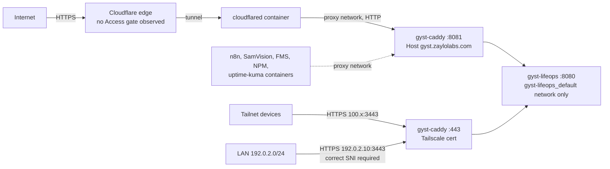

# Stage 2 — Security, Data Integrity and Operations

- **Stage:** 2, a read-only audit of the current system
- **Date:** 2026-09-27. Production checks ran around 05:00–05:26 UTC.
- **Scope:** the system as deployed today. There is no vNext design in this document.
- **Method:** source tracing in the audit worktree, plus narrowly scoped
  read-only production checks (§3). No production writes, restarts, migrations,
  configuration changes or credential rotation.

Status labels: **CONFIRMED** means evidence from code and/or runtime.
**PROBABLE** means the code supports it but it has not been demonstrated.
**UNKNOWN** means not evidenced. **ACCEPTABLE** means reviewed and fine for the
current single-user design.

---

## 1. Executive summary

GYST's application-level security is **better than typical for a personal
project**, and it is well tested:
- the password is stored with bcrypt
- only SHA-256 hashes of session tokens are stored, and logout revokes the session server-side
- a header-based CSRF guard covers every cookie-authenticated write
- every SQL value is a bound parameter
- templates are auto-escaped
- the Health API is write-only and tightly validated
- foreign keys are enforced on every connection

**No CRITICAL or HIGH findings were confirmed.**

The practical risks are operational and environmental, not code-injection:

1. **The public login has no brute-force control or visibility.** The login page
   is reachable on the internet through Cloudflare, with no rate limit, no
   lockout and no logging of failures. One password protects all personal and
   health data.
2. **Calendar-day integrity.** Tasks, completions and tracker check-ins are dated
   with the **container's UTC clock**, while Health and prayer use
   `America/Winnipeg`. Production data shows evening entries recorded against the
   next day.
3. **No scheduled or off-host backups.** Backups are manual, on the same
   filesystem and bind mount as the database, and restore is undocumented and
   untested.
4. **Host file permissions.** `.env` (all secrets) and the database and backups
   (health data) are world-readable on a host with two login accounts.
5. **No operational visibility.** There is no request, error or auth logging, no
   health check and no alerting. Internal errors go to the browser and nowhere else.

**OPS1 is resolved: PASS.** `PRAGMA foreign_key_check` on the live database
returned 0 rows, and `integrity_check` returned `ok` (§16).

Findings: **0 CRITICAL · 0 HIGH · 5 MEDIUM · 9 LOW · 7 INFO** (§17).

---

## 2. Audit base

| Item | Value | Evidence |
|---|---|---|
| Production checkout HEAD | `dab7995bae6a792442d6476636f45c6f7da0fec7` | `git rev-parse HEAD` in `/srv/server/repos/gyst-lifeops` |
| Production checkout clean | yes (0 changes) | `git status --short` |
| Audit branch base | `dab7995…` | `git merge-base audit/vnext HEAD` |
| Stage 1 commit | `9be649ad46fef651c9fc30c121e30c78d18ced07` | `audit/vnext` |
| Running app container | image `sha256:af525f02…`, started 2026-09-24T23:33:05Z, 0 restarts | `docker inspect` (same as Stage 1) |
| Deployed assets | 85/85 files in `web/`, `migrations/`, `seeds/` identical to the baseline | sha256 comparison, container vs. worktree |
| Deployed binary | go1.25.14. Module versions identical to `go.mod`/`go.sum`. **No VCS stamp.** | `go version -m` on a copied binary |

**No change since Stage 1.** The binary can't be tied to a commit by its own
metadata (see S2-14). The equivalence rests on the build time plus identical assets.

---

## 3. Production read-only checks

| # | Check | How it was made read-only |
|---|---|---|
| P1 | Git HEAD/status, container/image IDs, start time, restart count | `git`, `docker inspect` |
| P2 | sha256 of deployed `web/`, `migrations/`, `seeds/` | `docker exec … sha256sum` |
| P3 | Deployed binary build info | `docker cp` to scratchpad → `go version -m` in a throwaway container → copy deleted |
| P4 | SQLite metadata, applied migrations, schema, FKs, row counts, `integrity_check`, `foreign_key_check`, aggregate orphan/date counts | Host `sqlite3 -readonly 'file:…?mode=ro'`. The DB files are `root:root 0644`, so user `jay` has **no OS write permission** as well. |
| P5 | Schema drift | Scratch DB built from repo migrations in the scratchpad, `sqlite_master` diffed |
| P6 | Integrity/FK check of two existing backups | Same `-readonly mode=ro` method |
| P7 | Env var **presence** for both containers, bcrypt cost and token-length **shape** | `docker inspect` piped through `awk`. Values were never printed. |
| P8 | Container hardening, ports, mounts, networks, user | `docker inspect`, `docker exec id/ps` |
| P9 | Host listeners, interfaces, `proxy` network membership | `ss -tln`, `ip -brief addr`, `docker network inspect` |
| P10 | HTTP response headers and status codes | Unauthenticated `curl`: `GET /login`, `GET /health`, `GET /static/…`, `POST /api/health/sync` (no token → 401). Cookie values redacted. |
| P11 | cloudflared mode | `docker inspect` Cmd with the token redacted |
| P12 | Application log | line counts and pattern **counts** only |
| P13 | File modes and ownership, login-account count, `docker` group size, backup schedules (user crontab, `/etc/cron.d`, systemd timers) | `stat`, `/etc/passwd`, `getent`, `crontab -l`, `systemctl list-timers` |

Not performed, because they need root or are out of scope: host firewall
(`ufw`), root crontab, router port-forwarding, and Cloudflare dashboard settings.

---

## 4. Authentication

### 4.1 Flow

```mermaid
sequenceDiagram
    participant B as Browser
    participant L as handlers.login (auth.go:70)
    participant A as services.AuthConfig.VerifyPassword
    participant S as services.CreateSession
    participant R as repository.sessions
    B->>L: POST /login (password, next)
    L->>L: requireSameOrigin, 8 KiB body cap, safeNextPath
    L->>A: bcrypt.CompareHashAndPassword(GYST_PASSWORD_HASH)
    A-->>L: ok / ErrInvalidCredentials
    L->>S: 32 random bytes → base64url token
    S->>R: INSERT sessions(token_hash=sha256(token), expires_at=now+30d)
    L-->>B: Set-Cookie gyst_session=token; HttpOnly; SameSite=Lax; Secure (if TLS/XFP https)
    Note over B,R: every request → ValidateSession: sha256 → lookup → expiry → touch ≤1×/24h
```

### 4.2 Answers

| Question | Answer | Evidence |
|---|---|---|
| What proves authentication? | A cookie `gyst_session` whose SHA-256 matches a non-expired `sessions` row | `middleware.go:99` `Authenticated`, `services/auth.go:98` |
| Where is state stored? | `sessions(token_hash PK, created_at, expires_at, last_seen_at)` in SQLite. Production has **7 rows, 0 expired**, max expiry 28 days ahead. The raw token is only in the cookie. | P4. Hash column length is 64 (hex SHA-256). |
| Forgeable? | No. 256-bit random token; server-side lookup; no signed or client-side session data. | `auth.go:80` |
| Reusable / longer than intended? | Rolling 30 days, extended at most once per 24 h, so an active session can live indefinitely. **Changing `GYST_PASSWORD_HASH` does not end existing sessions.** There is no "sign out everywhere". Expired rows are deleted when encountered; `SweepExpiredSessions` is never called (S2-11). | `auth.go:98-126`, grep |
| Cookie flags | HttpOnly, SameSite=Lax, Path=/, Expires. Secure when `r.TLS` or `X-Forwarded-Proto: https`; both Caddy paths set this. No Domain attribute (host-only). **ACCEPTABLE** | `auth.go:42-66`, `TestSessionCookieAttributes` |
| Logout | POST only, same-origin guard, **server-side revoke**, cookie cleared | `auth.go:131`, `TestLogoutRevokesTheSession` |
| Remember-me / account creation / reset / change | **None.** Single password from the environment; changing it means editing `.env` and redeploying. | source |
| Password storage | bcrypt; production hash is **cost 10** (P7). The hash never reaches the DB, logs or templates. | S2-12 |
| Password logging | None. The login handler logs only template-render failures. | grep `log.Print` |
| Default credentials | None. An empty hash means nobody can sign in (503 message). Seeds contain no credentials. | `auth.go:106`, `seeds/example.sql` |
| Dev/test bypass | `GYST_AUTH_DISABLED=1` disables all auth and logs every request. Production: **EMPTY** (off). | `app.go:80`, P7, S2-16 |
| Account-existence leak | Not applicable: there are no usernames. "No password is configured" appears only when the hash is unset. | `auth.go:106` |
| Brute-force control | **None**, plus no failed-attempt logging, on a publicly reachable login (P10). | S2-01 |

**Session fixation:** a fresh token is minted on every login. **ACCEPTABLE.**

---

## 5. Authorization

There is **one principal**. Every valid session has full read, create, update
and delete rights over every resource. There are no roles, no ownership columns
and no tenant model.

| Resource class | Read | Create / Update / Delete | Object-level check | Notes |
|---|---|---|---|---|
| Tasks, checklists, reminders | session | session | n/a (single owner) | Checklist item update scoped by `task_id` |
| Projects, missions, proof, roadmaps, milestones | session | session | Items scoped `AND project_id = ?` (`projects.go:532`) | Proof is a URL/path string; no file upload exists |
| Courses and blocks | session | session | Blocks scoped `AND course_id = ?` | |
| Goals, trackers | session | session | — | |
| Health snapshots | session (pages) | **Health bearer token** (write-only) | — | Token can overwrite any valid date's metrics (S2-18) |
| Health cycles, plan | session | session | — | No UI/API writes weight |
| Training cache | session | session (manual sync) and background goroutine | — | Hevy key NOT CONFIGURED; table empty |
| Settings (prayer, calendar token) | session | session | — | Calendar token stored in plaintext in `app_settings` (needed for display); 0 rows in production |
| Imports (plan, roadmap) and exports (roadmap Markdown) | session | session | — | The "public" export only filters content; it is still session-gated |
| External links and sync | session | session | — | Sync makes outbound requests (S2-09) |
| Push subscribe | session | session | — | Server will later POST to any stored `https://` endpoint |
| ICS feeds | path token (`/calendar/feed/*`) or session + env flag | — | constant-time token compare | No token exists in production, so all token feeds return 404 |

**IDOR/BOLA:** not applicable in the multi-user sense; there is nobody else's
data. Where child objects are addressed, the parent ID is enforced in SQL.
UI hiding is not used as a control; every route is enforced in the middleware.
**ACCEPTABLE for the current single-user design.** This is an architectural
input for vNext (§20), not a vulnerability.

---

## 6. Request integrity / CSRF

| Aspect | Finding | Status |
|---|---|---|
| Write methods | POST (plus DELETE for push unsubscribe). No HTMX; the only JS writes are `fetch` for tracker toggles, push and Galaxy data. | CONFIRMED |
| Guard | `requireSameOrigin`: reject `Sec-Fetch-Site: cross-site`, and reject any `Origin` whose host ≠ `Host`. Applied to every unsafe method after session validation, and to `/login` and `/logout` explicitly. | CONFIRMED, tested (`TestCrossSiteMutationsAreRejected`, `TestCrossOriginMutationIsRejectedByOriginHost`) |
| Sibling subdomains (`*.zaylolabs.com` hosts other services) | `Sec-Fetch-Site` would say `same-site` (allowed), but the `Origin` host check rejects it | ACCEPTABLE |
| Requests with neither header | Allowed by design (non-browser clients) | ACCEPTABLE. Modern browsers send `Origin` on cross-origin POST; SameSite=Lax adds a second layer. |
| Form tokens | None. The header-based design is deliberate and tested. | ACCEPTABLE |
| GET routes that mutate | `/galaxy/data` persists computed positions once per project (idempotent). `ValidateSession` touches `last_seen_at`. | INFO (S2-15) |
| Referer-based redirect | `redirectBack` redirects to the raw `Referer` after POSTs. A cross-site POST is already rejected, and browsers send only the origin as Referer cross-origin by default. | Theoretical only; INFO |

---

## 7. Input validation / output encoding

| Surface | Result |
|---|---|
| SQL | Every user value is a bound `?` parameter. All `fmt.Sprintf` SQL interpolates only column-list constants, fixed `WHERE` fragments, or `NULL`/`CURRENT_TIMESTAMP` chosen in code (`tasks.go:303`, `projects.go:495`, `roadmap.go:527`, `courses.go:179`). **No SQL injection found.** |
| HTML templates | `html/template` throughout. The only type cast is `template.CSS` of a clamped integer (`handlers.go:2163`). **No stored or reflected XSS found.** |
| Client JS | `innerHTML` sinks write static markup only; data goes in via `textContent` (`app.js:130`, `:403`; `galaxy.js:71`). `celebrate_title` from the query string is inserted with `textContent`. |
| JSON | Health API: `DisallowUnknownFields`, single object, 16 KiB, content-type enforced, numeric range checks. Push: 16 KiB, https-only endpoint. |
| Forms | `ParseForm` default 10 MiB cap; login capped at 8 KiB. IDs via `strconv.ParseInt`. |
| Redirects | `next` and `return_to` must be rooted and not `//`; `next` also rejects CR/LF (tested). Referer redirect: see §6. |
| Paths / files | No uploads. File reads only from configured migration, seed and static directories; `http.FileServer` for `/static/`. No path built from request data. |
| Commands | No `os/exec` anywhere. |
| Outbound URLs | GitHub and Slack use fixed hosts. **Jira uses the host of the stored link** (S2-09). |
| Crash paths | net/http recovers handler panics per request. No custom recovery. No panics in the current log (log has 1 line). |
| Error output | `serverError` writes `err.Error()` to the response (S2-06) |

---

## 8. Database and transaction integrity

### 8.1 Production SQLite state (P4, P5)

| Property | Value |
|---|---|
| SQLite (host CLI used for inspection) | 3.46.1. The app uses `modernc.org/sqlite` v1.52.0. |
| Journal mode | `wal` |
| Page size / pages / freelist | 4096 / 127 (~520 KB logical) / 0 |
| Files | main 512,000 B (mtime 2026-09-22), `-wal` 4,124,152 B (~1,001 frames, mtime 2026-09-26), `-shm` 32 KiB |
| `integrity_check` | `ok` |
| `foreign_key_check` | **0 rows** |
| `foreign_keys` / `busy_timeout` | Applied per app connection via DSN `_pragma` (code + `pragma_scope_test.go`). A standalone CLI connection reports 0, as expected. |
| Applied migrations | **20/20**, identical filenames to `migrations/` (001 applied 2026-06-25 … training_cache 2026-09-24T23:33:05) |
| Objects | 33 tables (31 app + `schema_migrations` + `sqlite_sequence`), 79 indexes |
| **Schema drift** | **None.** Live `sqlite_master` is identical to a DB built from the repo migrations. |
| FK rules (live) | 21 foreign keys: **10 `CASCADE`, 11 `SET NULL`** |

**Row counts** (safe aggregates): achievements 15 · activity_events 0 ·
app_settings 0 · categories 7 · courses 0 · daily_health_snapshots 5 (dates
2026-09-12…2026-09-25) · external_links 1 · goal_progress_entries 5 · goals 4 ·
health_cycles 1 · health_sync_states 1 · health_weight_entries 0 ·
learning_blocks 0 · project_items 83 · projects 13 · push_deliveries 12 ·
push_subscriptions 1 · reminders 7 · roadmap_imports 1 · roadmap_milestones 0 ·
roadmap_project_meta 8 · roadmap_resources 8 · roadmap_weekly_reviews 0 ·
roadmaps 1 · sessions 7 · task_checklist_items 0 · task_completions 6 · tasks 6 ·
tracker_items 8 · tracker_logs 38 · training_snapshots 0.

What the counts show:
- `training_snapshots = 0`: Hevy has never attempted a sync. A failed attempt would have written a row.
- `app_settings = 0`: prayer settings are at defaults, and no calendar token exists.
- `categories` (7 rows) and `activity_events` (0 rows) have no code references (Stage 1).

### 8.2 Code-level integrity

| Topic | Finding |
|---|---|
| Transactions | Used for task status plus XP (`tasks.go`), item completion plus XP (`projects.go`), roadmap import, health sync (snapshot plus sync state), migrations. |
| Multi-step writes without a transaction | `ArchiveTask` (task archive then reminder dismiss, 2 statements). `reconcileProjectStatus` runs **after** the item transaction commits: project status, achievement insert and dependent unlock (`projects.go:514,535,538-576`). A failure between steps leaves partial state. (S2-13) |
| Duplicate prevention | XP awards: `INSERT OR IGNORE` plus unique indexes on `achievements.source_*`. Push: `ClaimPushDelivery` insert-or-ignore claim. Health: date primary key with partial upsert. |
| Polymorphic links without FKs | `external_links(entity_type, entity_id)` and `reminders(source_type, source_id)`. Production orphans: **0 and 0**. Deleting a project item (`projects.go:532`) does **not** delete its external links, so orphans can be created. |
| Lost updates | Edit forms write whole rows; no version check on `sync_version`. Low impact for a single user, but possible across two devices. |
| Schema constraint vs. model | `health_cycles CHECK (end_date > start_date)` prevents a one-day cycle, although the model comment says "any duration" (INFO, S2-20). |
| **Date / timezone consistency** | **Mixed clocks.** The container runs in **UTC** (`/etc/localtime → Etc/UTC`, `TZ` unset). `Service.Today()` and `TodayString()` use `time.Now()` in process-local time (36 call sites): task occurrences, overdue, completions, tracker `log_date` (via `DailyMission`), analytics. Health date, prayer times, greeting and next-reminder use `America/Winnipeg` from prayer config (default). **Production evidence:** 18 of 38 tracker logs and 6 of 6 task completions were written between 00:00 and 06:00 UTC (local evening) and carry the UTC date, which is the next local day. (S2-02) |
| Shutdown | No signal handling. On SIGTERM the process exits without `DB.Close()`. SQLite WAL recovery handles this safely; in-flight requests are cut. INFO. |
| Checkpointing | Default auto-checkpoint (1,000 frames). The WAL is at the threshold, and the main file hasn't been written since 2026-09-22. That is consistent with low write volume, not evidence of a fault. UNKNOWN whether a long-lived reader ever blocks checkpoints. |

---

## 9. Privacy / sensitive data

| Category | Sensitivity | Where | Access | Logged | Exported | In backups | Deletion |
|---|---|---|---|---|---|---|---|
| Health metrics (calories, macros, steps, energy, exercise) | **High** (health) | `daily_health_snapshots`, `health_sync_states` | session read; token write | No | No (no read API) | Yes | No delete path in UI/API |
| Health plan (targets, notes) | High | `health_cycles` | session | No | No | Yes | Edit only; no delete route |
| Body weight | High | `health_weight_entries` (0 rows; no write path) | session | No | No | Yes | — |
| Training (sets, loads, muscles) | Medium–high | `training_snapshots` JSON (0 rows) | session | Hevy error text stored in `last_error` | No | Yes | Replaced wholesale per sync |
| Religious practice (prayer and athkar check-ins, prayer location) | **High** (special category in many regimes) | `tracker_logs`, `tracker_items`, `app_settings` | session | No | Push payload names the prayer (visible on lock screen) | Yes | No delete route |
| Tasks, projects, goals, courses, notes, proof URLs | Medium (personal/work) | task/project/goal/course tables | session | No | Roadmap Markdown export; ICS feeds (when token exists) | Yes | Archive (soft) plus a few hard deletes |
| External work links and snapshots | Medium (may reference employer systems) | `external_links` | session | No | No | Yes | Hard delete |
| Push subscription keys | Medium (lets the holder push to the device) | `push_subscriptions` | session | No | No | Yes | Removed on 404/410 or unsubscribe |
| Session token hashes | Low (hashes of random tokens) | `sessions` | — | No | No | Yes | Revoke / expiry |

Additional observations:
- Error responses (`serverError`) can include SQL or template error text, but
  only for signed-in users (S2-06).
- The DB file, WAL and every backup are **world-readable on the host** (S2-04).
- There is no data-export (portability) or bulk-delete feature. Retention is
  indefinite.

---

## 10. Secrets and configuration

| Mechanism | Finding |
|---|---|
| Loading | Compose interpolates `.env` into container env; the app reads `os.Getenv`. The Go app never reads `.env` itself. |
| `.env` | Untracked (gitignored), excluded from the Docker context. Host mode **0644 jay:jay** (S2-04). |
| `.env.example` | **Does not exist**, although older docs mention it. |
| Committed secrets | **None found.** Pattern scan (GNU grep, local only) of all tracked files, all history on all refs, and the 3 stashes. Categories: AWS, GitHub, Slack, JWT-like, private keys, bcrypt hashes, `KEY=value` assignments for every GYST secret name. The pattern was validated against synthetic samples. No `.env`/`.pem`/`.key` has ever been committed. `stash@{1}` contains only `${VAR}` references. |
| Hard-coded secrets / signing keys | None. VAPID keys come from env. There is no cookie-signing key; opaque DB-backed tokens don't need one. |
| Debug modes | `GYST_AUTH_DISABLED` only (EMPTY) |
| Dead config | Compose sets `DB_PATH` and `PORT`, but the app reads neither. It uses the `-db` and `-addr` flag defaults, which happen to resolve to the same values (C18). |

**Credential presence (P7)** — values were never printed:

| Variable | Container | State |
|---|---|---|
| `GYST_PASSWORD_HASH` | app | PRESENT (bcrypt, cost 10) |
| `GYST_HEALTH_SYNC_TOKEN` | app | PRESENT (length ≥ 32) |
| `VAPID_PUBLIC_KEY` / `VAPID_PRIVATE_KEY` / `VAPID_SUBSCRIBER` | app | PRESENT / PRESENT / PRESENT |
| `HEVY_API_KEY` | app | EMPTY |
| `GITHUB_TOKEN` | app | EMPTY |
| `JIRA_EMAIL` / `JIRA_API_TOKEN` | app | EMPTY / EMPTY |
| `SLACK_BOT_TOKEN` | app | EMPTY |
| `GYST_AUTH_DISABLED` | app | EMPTY (auth enforced) |
| `ALLOW_PUBLIC_CALENDAR_FEEDS` | app | MISSING (not passed by compose, so false) |
| `GYST_TLS_HOSTNAME` | caddy | PRESENT |
| cloudflared tunnel token | cloudflared (outside this repo) | PRESENT. Passed as a **command-line argument**, visible in `docker inspect` to anyone with Docker access. Out of GYST scope; noted. |

---

## 11. Network / HTTP surface



Addresses use the RFC 5737 documentation range; the real LAN address is withheld.

| Item | Finding |
|---|---|
| App listener | `:8080` inside the container. **Not published.** Only on `gyst-lifeops_default` with Caddy. |
| Host exposure | `0.0.0.0:3443` and `[::]:3443` (P9). **Reachable via the LAN IP** when the Tailscale SNI is sent (P10: 200). A wrong or absent SNI fails the TLS handshake. Host firewall and router forwarding: UNKNOWN (S2-08). |
| Public exposure | `https://gyst.zaylolabs.com/login` returns 200 directly. **No Cloudflare Access or other pre-auth gate** observed. Cloudflare rate-limit/WAF rules: UNKNOWN. |
| TLS | Tailnet: Caddy with a Tailscale certificate. Public: Cloudflare edge TLS, then plain HTTP over the Docker `proxy` network to `:8081`. |
| Forwarded headers | `:8081` rewrites `X-Forwarded-Proto: https`. The app uses XFP only for the cookie `Secure` flag. The app is reachable only via Caddy, so the header can't be spoofed from outside. |
| Host validation | Caddy site blocks match only the tailnet hostname and `gyst.zaylolabs.com`. The CSRF guard compares `Origin` with `Host`. |
| CORS | None (no `Access-Control-*` headers) |
| Security headers | **HSTS** (1 year, both paths) ✔. `Cache-Control: no-store` on the public path for everything, including static assets. **Missing:** CSP, `frame-ancestors`/`X-Frame-Options`, `X-Content-Type-Options`, `Referrer-Policy`, `Permissions-Policy` (S2-07). |
| Disclosure | `via: 1.1 Caddy`, `server: cloudflare`. No Go or app version. The tailnet path advertises `alt-svc: h3=":443"`, but UDP 443 isn't published (harmless, INFO). |
| Server timeouts | `http.ListenAndServe` with no read, header or idle timeouts. Mitigated by Caddy/Cloudflare in front (INFO). |
| Lateral | Every container on `proxy` can reach `gyst-caddy:8081`. A session is still required (S2-17). |

---

## 12. Logging / error handling

| Item | Finding |
|---|---|
| Log content | The app log contained **1 line** (startup) for ~2.2 days of uptime. No request, error or auth logging. |
| Sensitive values in logs | Pattern counts for password/bearer/token/cookie: **0**. Panics: 0. |
| Errors to clients | `serverError` returns raw `err.Error()` with 500 (`handlers.go:2455`), for example SQLite constraint text, template errors, provider error strings. Session-gated. The Health API uses fixed messages. |
| Auth failures | Not logged. There is no audit trail of logins, logouts, token failures or settings changes. |
| Security events | Only `GYST_AUTH_DISABLED` and "hash unset" are logged, at startup. |
| Log retention | Docker `json-file` with **no `max-size`**. Volume is tiny today; unbounded by configuration. |
| Health check / alerting | No compose `healthcheck` and no `/healthz`. uptime-kuma exists on the host; whether it monitors GYST is UNKNOWN. |

---

## 13. Backup / recovery

| Question | Finding |
|---|---|
| Mechanism | `lifeops backup`: `VACUUM INTO` from a read-only source, then `integrity_check` on the copy, with the copy deleted on failure (`internal/db/backup.go`, 12 tests) |
| What | The whole DB, including sessions, push keys and health data |
| Schedule | **None.** Nothing for GYST in user crontab, `/etc/cron.d` or systemd timers. Root crontab UNKNOWN. |
| Destination | `data/backups/`, i.e. the **same directory tree, bind mount and filesystem** (`/`, 78% used) as the live DB. No off-host copy. |
| Existing backups | 7 files, 2026-09-12 → 2026-09-24T23:39Z, all taken around deployments. A separate, older set of 7 manual copies (June–August) sits in the repo-root `backups/`. |
| Retention | None (files accumulate) |
| Permissions | `root:root 0644`, world-readable (S2-04) |
| Consistency | `VACUUM INTO` produces a consistent snapshot while the app runs. **Verified:** the newest and oldest backups pass `integrity_check` and have 0 FK violations; the newest has 20 migrations. |
| Failure visibility | CLI exit status only. Nothing records or alerts on the last successful backup. |
| Restore instructions | **None found** (grep: no restore procedure in README, docs or tasks) |
| Restore tested | **No evidence** |

---

## 14. Dependencies / supply chain

| Item | Finding |
|---|---|
| Go | `go.mod` says `go 1.25.0`. Deployed binary built with **go1.25.14** (floating `golang:1.25-bookworm` tag). |
| Direct modules | `webpush-go v1.4.0`, `golang.org/x/crypto v0.31.0`, `modernc.org/sqlite v1.52.0` |
| Indirect | `golang-jwt/jwt/v5 v5.2.1` (via webpush, signing only), `google/uuid`, `go-humanize`, `modernc` libc/mathutil/memory, `x/sys v0.42.0`, `bigfft` |
| go.sum | Present; binary hashes match. Reproducible at the module level. |
| Vendored frontend | Three.js `0.180.0` (`web/static/js/vendor/`), Lucide icon subset (license file present). No npm. |
| Base images | Builder `golang:1.25-bookworm` and runtime `debian:bookworm-slim` are **floating tags**. `caddy:2.10.2-alpine` is version-pinned, not digest-pinned. |
| Build provenance | `.git` excluded, so there is no VCS stamp; builds come from the working tree; no registry or tags (S2-14). |
| Vulnerability status | **UNKNOWN.** No local scanner is installed (govulncheck, osv-scanner, trivy, grype). None was downloaded, and no source was sent externally. `x/crypto v0.31.0` and `jwt v5.2.1` are older releases that need a govulncheck run. |
| Dev deps leaking to runtime | None. The runtime image contains the binary, `web/`, `migrations/`, `seeds/` and CA certs. |

---

## 15. Security test coverage

| Boundary | Tested? | Tests |
|---|---|---|
| Unauthenticated page → redirect; API → 401; mutation → 401 | ✔ | `auth_test.go` (16 tests) |
| Exempt-path list pinned entry by entry | ✔ | `TestExemptPathsAreReachableWithoutASession`, `TestNonExemptPathsRequireASession` |
| Wrong password; unconfigured hash fails closed | ✔ | handlers and services |
| Session lifecycle, expiry, rolling refresh, raw token never stored, uniqueness | ✔ | `services/auth_test.go` (9 tests) |
| Cookie attributes; Secure follows the connection | ✔ | |
| Logout revokes server-side | ✔ | |
| CSRF: cross-site and cross-origin rejected; safe GET allowed | ✔ | |
| Open redirect via `next` | ✔ | `TestNextPathRejectsOpenRedirects` |
| Auth-disabled escape hatch | ✔ | |
| Health API auth, validation, partial/zero semantics | ✔ | `health_test.go`, `repository/health_test.go` |
| FK enforcement on every pooled connection; seeded schema has no FK violations | ✔ | `pragma_scope_test.go` |
| Migrations from fresh and from old versions; 005 rebuild data-safe | ✔ | `migrate_test.go` |
| Backup correctness, including under concurrent writes | ✔ | `backup_test.go` (12) |
| XP duplicate prevention | ✔ (partly) | `quest_test.go`, `projects_group_test.go` |
| Push endpoint https-only | ✔ | `push_test.go` |
| Login rate limiting | ✘ (feature absent) | — |
| Day boundary / timezone behaviour of tasks and trackers | ✘ | — |
| Error responses don't leak internals | ✘ | — |
| Security headers | ✘ | — |
| `redirectBack` Referer handling | ✘ | — |
| Jira outbound host binding | ✘ | — |
| Non-atomic reconcile / archive partial failure | ✘ | — |
| Restore procedure | ✘ | — |
| Session invalidation on password change | ✘ (feature absent) | — |

---

## 16. OPS1

**OPS1: PASS**

Evidence:
- `PRAGMA foreign_key_check` on the **live** production database returned **0 rows**
  (2026-09-27 ~05:20Z, host `sqlite3 -readonly mode=ro`, no OS write permission).
- `PRAGMA integrity_check` returned `ok`.
- The latest backup (`lifeops-20260924T233929Z.db`) and the oldest
  (`20260912T182354Z`) also have 0 FK violations and pass integrity.

Caveat: the OPS1 procedure specified stopping the app first. That wasn't done,
because restarts are prohibited. A WAL-mode read transaction sees a
transactionally consistent snapshot, so the result is valid **for that moment**.
It doesn't certify rows written afterwards; those are protected by
per-connection FK enforcement (B1).

This resolves Stage 0 contradiction C1 at the evidence level. The ledger
documents (`docs/tasks/OPS1-*.md`, `tasks/README.md`, `AI_HANDOFF.md` §4) still
say PENDING or UNKNOWN and have not been changed (C19).

---

## 17. Findings register

Severity reflects **practical risk to this single-user deployment today**.

### S2-01 — Public login with no brute-force control, lockout or failed-login visibility
- **Severity:** MEDIUM (becomes HIGH if the password is not high-entropy) · **Status:** CONFIRMED
- **Evidence:** P10 — public `/login` returns 200 with no pre-auth gate. There is no rate-limit or attempt-tracking code (grep). Failed logins aren't logged (§12). Production bcrypt cost is 10.
- **Component:** `handlers/auth.go` `login`, Cloudflare ingress
- **Impact:** a guessed password gives full read/write of all personal, health and religious-practice data.
- **Precondition:** internet access plus a guessable password. Cloudflare-side rate limiting is UNKNOWN.
- **Current mitigation:** bcrypt; single password (no username to enumerate); HTTPS only; CSRF guard on the login POST.
- **Direction:** throttle login and add a failure audit log. Consider a pre-auth gate (Cloudflare Access or Tailscale-only) for the public hostname.
- **Remediation stage:** security hardening, before vNext expands the attack surface

### S2-02 — Calendar-day values are computed in container UTC; Health and prayer use Winnipeg time
- **Severity:** MEDIUM · **Status:** CONFIRMED
- **Evidence:** container `TZ` unset and `/etc/localtime → UTC`. `Service.Today()` uses `time.Now()` (36 call sites). Tracker `log_date` comes from `DailyMission` (`today.html:112,128`). Production: 18/38 tracker logs and 6/6 completions were written 00–06 UTC with the UTC date.
- **Component:** `services/lifeops.go` `Today`/`TodayString`, trackers, tasks, analytics
- **Impact:** evening check-ins (including Isha and evening athkar) and completions are stored on the **next** local day. Today's list rolls over at 18:00–19:00 local. Streaks and analytics are skewed. Existing rows are already affected.
- **Precondition:** normal use after 18:00/19:00 local time
- **Current mitigation:** none. Health snapshots use the correct local date.
- **Direction:** one explicit application timezone for every calendar-day decision. Any correction of historical rows needs a separate, approved data decision; it is not implied here.
- **Remediation stage:** data-integrity fix stage (needs a product decision on historical rows)

### S2-03 — No scheduled or off-host backups; restore undocumented and untested
- **Severity:** MEDIUM · **Status:** CONFIRMED
- **Evidence:** §13. No schedule found; the backups share the live DB's filesystem and bind mount; no restore procedure exists.
- **Component:** operations
- **Impact:** disk loss, host compromise or an accidental `data/` deletion loses everything since the last manual backup (currently 2026-09-24) and every backup with it.
- **Current mitigation:** a correct, verified `VACUUM INTO` tool; backups taken before each deployment.
- **Direction:** scheduled backup, off-host copy, retention, a recorded last-success time, a documented and rehearsed restore.
- **Remediation stage:** operations

### S2-04 — Secrets and health data world-readable on the host
- **Severity:** MEDIUM · **Status:** CONFIRMED
- **Evidence:** `.env` 0644; `data/lifeops.db*` and `data/backups/*` 0644 root, in 0755 directories; 2 login-capable accounts on the host (identity of the second not examined).
- **Impact:** any local account or non-root host process can read the password hash (offline cracking at cost 10), the health sync token, the VAPID private key and all personal data.
- **Current mitigation:** none at the file level
- **Direction:** restrictive modes and ownership for `.env`, `data/` and backups.
- **Remediation stage:** operations/hardening

### S2-05 — No operational visibility: no error/request/auth logs, health check or alerting
- **Severity:** MEDIUM (operational) · **Status:** CONFIRMED
- **Evidence:** 1 log line in ~2.2 days; `serverError` doesn't log; no compose `healthcheck`; Docker log rotation not configured.
- **Impact:** failures, sync outages and attacks are invisible. Diagnosis depends on user reports.
- **Direction:** structured logging of errors and security events (without bodies or secrets); a liveness endpoint and health check; log rotation.
- **Remediation stage:** operations

### S2-06 — Internal error text returned to the browser
- **Severity:** LOW · **Status:** CONFIRMED
- **Evidence:** `handlers.go:2455` `http.Error(w, err.Error(), 500)`
- **Impact:** SQL, schema or provider details shown to the (authenticated) user; not logged server-side.
- **Precondition:** a valid session
- **Direction:** generic client message; detail to the server log.
- **Remediation stage:** hardening

### S2-07 — Missing browser security headers (CSP, frame protection, nosniff, Referrer-Policy)
- **Severity:** LOW · **Status:** CONFIRMED (P10)
- **Impact:** no defence-in-depth against injected script if an XSS appears later; the login page can be framed.
- **Mitigation:** SameSite=Lax means a cross-site frame is unauthenticated, which limits clickjacking; templates auto-escape.
- **Direction:** a baseline header set at the Caddy or app layer. The inline `<script>` usage must be inventoried before any CSP.
- **Remediation stage:** hardening

### S2-08 — Tailnet listener bound on all host interfaces
- **Severity:** LOW · **Status:** CONFIRMED (LAN reachability from the host itself). Other-host reachability UNKNOWN.
- **Evidence:** port binding `HostIp ""` → `0.0.0.0:3443`; `192.0.2.10:3443` returned 200 with the tailnet SNI.
- **Impact:** a Tailscale-only intent isn't enforced at the bind level. LAN devices, and the internet if a router forward exists, can reach the app, though the session is still required.
- **Direction:** bind to the Tailscale address, or firewall it.
- **Remediation stage:** operations

### S2-09 — Jira sync would send credentials to the stored link's host
- **Severity:** LOW (latent; HIGH if Jira credentials are configured) · **Status:** PROBABLE (code path), not exploitable today
- **Evidence:** `providers/jira.go` builds the endpoint from `u.Scheme+"://"+u.Host`. Classification accepts any host containing `jira` or `atlassian.` and `http` (`services/external_links.go:26,47`). `JIRA_EMAIL` and `JIRA_API_TOKEN` are **EMPTY**, so the fetch returns `ErrNotConfigured` before any request.
- **Precondition:** Jira credentials configured **and** a crafted link stored by a signed-in user
- **Direction:** bind credentials to a configured Jira base URL; https only.
- **Remediation stage:** before enabling Jira

### S2-10 — Containers run as root without hardening
- **Severity:** LOW · **Status:** CONFIRMED
- **Evidence:** both `uid=0`; no `USER`, cap-drop, read-only rootfs, pids or memory limits; not privileged.
- **Impact:** a code-execution bug would get root in the container and write access to `data/`.
- **Direction:** non-root user, dropped capabilities, read-only rootfs apart from `data/`.
- **Remediation stage:** hardening

### S2-11 — Sessions survive password changes; no global sign-out; sweep never runs
- **Severity:** LOW · **Status:** CONFIRMED
- **Evidence:** sessions aren't bound to the password hash; `SweepExpiredSessions` has no caller; production has 7 sessions, 0 expired.
- **Impact:** rotating a leaked password doesn't evict an attacker's session. Stale rows accumulate slowly.
- **Direction:** revoke all sessions on password change, or on demand.
- **Remediation stage:** hardening

### S2-12 — Password hash cost differs from the documented cost; two generators disagree
- **Severity:** LOW · **Status:** CONFIRMED
- **Evidence:** production hash cost 10. `cmd/passwordhash` uses 12; `lifeops passwordhash` and `-passwordhash` (`internal/app/passwordhash_cmd.go:35`) use `bcrypt.DefaultCost` (10). The docs say 12.
- **Impact:** offline cracking is about 4× cheaper than documented if the hash leaks (see S2-04).
- **Direction:** one generator and one cost.
- **Remediation stage:** hardening

### S2-13 — Non-atomic multi-step writes and orphan-capable deletes
- **Severity:** LOW · **Status:** CONFIRMED (code); no bad data observed (0 orphans, FK check clean)
- **Evidence:** `reconcileProjectStatus` runs after commit; `ArchiveTask` makes 2 statements; project-item delete leaves `external_links`.
- **Direction:** include the follow-up writes in the same transaction; clean up polymorphic links.
- **Remediation stage:** data-integrity

### S2-14 — Deployments are not traceable or reproducible
- **Severity:** LOW (operational) · **Status:** CONFIRMED
- **Evidence:** no VCS stamp; build from the working checkout; floating base tags; no registry, tags or scanning in CI.
- **Impact:** you can't prove from the artifact what's running; rollback means rebuilding.
- **Remediation stage:** operations / CI

### S2-15 — `GET /galaxy/data` writes to the database
- INFO · CONFIRMED · Idempotent, one-time position persistence. Conflicts with the CSRF guard's "GET is safe" assumption but can't be abused meaningfully.

### S2-16 — Authentication kill-switch exists
- INFO · CONFIRMED · `GYST_AUTH_DISABLED=1` serves everything unauthenticated. EMPTY in production, tested, loudly logged. It needs operational discipline.

### S2-17 — Shared `proxy` network with other services
- INFO · CONFIRMED · n8n, SamVision, FMS, nginx-proxy-manager, uptime-kuma and cloudflared can reach `gyst-caddy:8081`. A session is still required. A compromised neighbour gets an unauthenticated network path to the login endpoint without Cloudflare in between.

### S2-18 — Health token can overwrite any date
- INFO · CONFIRMED · Write-only by design. A leaked Shortcut can falsify but not read history. Bounded by validation.

### S2-19 — Dependency vulnerability status unknown
- INFO · UNKNOWN · No local scanner. `x/crypto v0.31.0` and `jwt/v5 v5.2.1` need checking.

### S2-20 — Schema forbids single-day health cycles
- INFO · CONFIRMED · `CHECK (end_date > start_date)` vs. the model comment "any duration".

### S2-21 — Unused tables and dead configuration
- INFO · CONFIRMED · `categories` (7 seeded rows) and `activity_events` (0) have no code references. Compose `DB_PATH` and `PORT` are ignored by the app.

**Totals:** CRITICAL 0 · HIGH 0 · MEDIUM 5 · LOW 9 · INFO 7

### Reviewed and acceptable for the current design

Session token design · logout revocation · cookie flags · CSRF header guard ·
SQL parameterisation · template escaping · Health API validation and
write-only surface · open-redirect guards · FK enforcement and PRAGMA scope ·
backup correctness (`VACUUM INTO` + verification) · no committed secrets ·
app port unpublished · no CORS · single-principal authorization.

---

## 18. Contradictions (continuing the register; C1–C14 in Stage 0)

| # | Contradiction | Evidence |
|---|---|---|
| C15 | Root `AGENTS.md`: `SweepExpiredSessions` "runs hourly". It has no caller. | grep |
| C16 | `AGENTS.md`/docs: bcrypt cost 12. Production hash is cost 10; `lifeops passwordhash` uses 10 and `cmd/passwordhash` uses 12. | P7, source |
| C17 | `AGENTS.md`/`CODEX_PROMPT.md`: "10 CASCADE and 13 SET NULL". Live schema: 10 CASCADE, **11** SET NULL. | P4 |
| C18 | Compose sets `DB_PATH` and `PORT`; the app reads flags only. It works by coincidence. | `cli.go`, `docker-compose.yml` |
| C19 | OPS1 ledger says PENDING/UNKNOWN; handoff table says DONE; direct evidence now says PASS (as of 2026-09-27). | §16 |
| C20 | `AI_HANDOFF.md` §5 / RULES 3.6 say "generic `training_*` tables with provider/provider_id". Actual: one JSON blob per provider in `training_snapshots`. | schema |
| C21 | `models/health.go`: cycles "may have any duration". The schema forbids `end_date = start_date`. | schema |
| C22 | README and prayer docs imply local (Winnipeg) days. Tasks and trackers use UTC days in the container. | §8.2 |
| C23 | `ALLOW_PUBLIC_CALENDAR_FEEDS` is described as enabling "unauthenticated plain .ics routes". Those paths aren't auth-exempt, so they still need a session. | `middleware.go:55-77`, `courses.go:305` |
| C24 | `.env.example` is referenced in `AGENTS.md` §9 but does not exist. | `ls` |
| C25 | README says backups go to `backups/` beside the DB (inside the mount). A second, older manual backup set exists in the repo-root `backups/`, outside the mount. Two backup locations, neither documented as canonical. | §13 |
| C26 | Public ingress sets `Cache-Control: no-store` on all responses, including static assets. The tailnet ingress doesn't, so caching behaviour differs by entry point. | P10 |

Stage 0 C1 (OPS1) is now evidence-resolved (see C19). C12 (Haiku attribution)
remains open; this commit uses the actual model attribution.

---

## 19. Unknowns requiring later work

| Unknown | Why it matters | How to resolve (later, with approval) |
|---|---|---|
| Password entropy | Sets the real severity of S2-01 | Operator self-assessment |
| Cloudflare rate-limit, WAF and Access configuration | Could mitigate S2-01 | Cloudflare dashboard review (operator) |
| Host firewall and router port-forwarding | Sets the real exposure of S2-08 | Root/`ufw` and router review (operator) |
| Root crontab, other backup tooling | Could change S2-03 | Root review |
| Identity of the second login account | Sets the real risk of S2-04 | Operator |
| Dependency CVEs | S2-19 | Local govulncheck/osv run, approved |
| uptime-kuma coverage of GYST | S2-05 | Operator |
| Whether historical UTC-dated rows should be corrected | S2-02 remediation scope | Product decision |
| Whether any container on the `proxy` network is internet-exposed without auth | S2-17 blast radius | Separate host-level audit |

---

## 20. Inputs to vNext design

These are constraints and facts, not designs:

1. **Single-principal authorization.** Every future caller (agents, n8n, GitHub
   webhooks, the phone) would currently get all-or-nothing access. The only
   precedent for scoped access is the write-only Health token and path tokens for ICS.
2. **Calendar-day semantics must be decided once.** Today there are two clocks
   (S2-02). Any "Today"-centric vNext needs one timezone source of truth.
3. **Operations are manual.** vNext should assume backups, deploys, health
   checks and logging don't exist yet (S2-03, S2-05, S2-14).
4. **The public login is the main attack surface.** Adding agent or server-control
   features behind the same single password would raise the stakes of S2-01
   substantially.
5. **Outbound integrations must bind credentials to fixed hosts** (lesson of S2-09).
6. **Data is small** (hundreds of rows; ~520 KB), clean (FK and integrity pass),
   and the schema has no drift. SQLite capacity isn't a constraint today.
7. **Sensitive categories:** health and religious-practice data sit alongside work
   data in one file and one backup. Any sharing or export feature needs
   category-aware handling.
8. **Test culture is strong at security boundaries.** New boundaries should keep
   the "negative test for every control" pattern (RULES 1.6).
