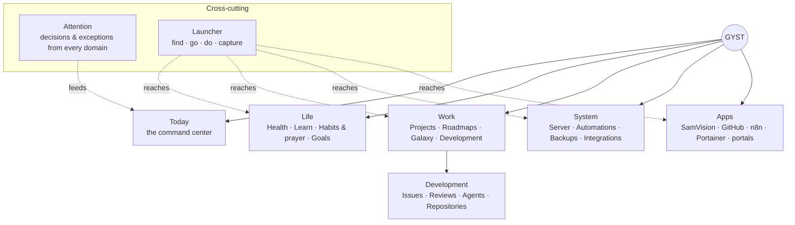

# Stage 4A — Product Vision

- **Stage:** 4, product vision (with `05_INFORMATION_ARCHITECTURE.md`)
- **Date:** 2026-09-27
- **Inputs:** Stage 1 (`9be649a`), 2A (`05f2f96`), 2B (`80b2613`), 3 (`21fa63a`),
  `docs/UI_SYSTEM.md` (NAV1 approved navigation), `docs/UI_SCREEN_MAP.md`
- **Evidence rule:** Stage 3 live-browser evidence outweighs older aspirational
  design documents. Stage 2B's feature-status table defines what exists.
- **Scope:** what GYST should become and the principles that govern it. No
  screens, no technical integration design (that's Stage 5), no implementation.

---

## A. What GYST is

**GYST is Jay's personal operating system: one calm place, open all day on
phone and desktop, that tells him what to do, what needs him, what is running,
and where to go next.**

It has two jobs:

1. **Life system (it owns the data):** daily tasks and routines, prayer and
   habits, health observations and plans, projects, learning and goals. GYST is
   the system of record for these, as it is today.
2. **Control plane (it doesn't own the data):** a single view over the systems
   Jay runs — GitHub, coding agents, the server, automations, and his other
   apps. GYST **reflects their state, routes his attention, and takes him to the
   right place**. It triggers only a small set of explicitly approved actions.

The distinction matters. For life data, GYST is the authority. For external
systems, GYST is a **window and a doorbell**, never the authority.

## B. What GYST is not

| Not | Because |
|---|---|
| An enterprise admin dashboard or metrics wall | It must be glanceable on a phone. Density is controlled, not maximised. |
| A replacement for every external app | Specialised tools stay specialised; GYST links into them |
| A GitHub clone | GitHub Issues remain the canonical development record; GYST shows and routes |
| An n8n clone or workflow editor | n8n remains the automation editor; GYST shows status and may run approved automations |
| A Portainer clone or unrestricted terminal | Server control stays in dedicated tools. GYST shows health and offers a few safe, audited actions at most. |
| An IDE or agent runtime | Claude and Codex run elsewhere, in isolated workspaces (parent `AGENTS.md` §19). GYST shows and assigns. |
| A multi-user product | Single owner. No accounts, teams or sharing model. |
| A food logger, workout logger or health-data source | MyFitnessPal, Apple Health, Apple Watch and Hevy remain providers |

## C. Core product principles

1. **Simple at first glance, powerful when opened.** Every surface shows what
   matters, current state and next action. Everything else is one deliberate
   step away.
2. **One fact, one place per screen.** Never repeat the same task, status or
   progress on a surface (Stage 3 found the first task 4× on Today).
3. **Exceptions surface; normal stays quiet.** Healthy servers, succeeded
   automations and synced data don't need Jay's eyes. Only exceptions and
   decisions reach Today.
4. **Honest state.** Missing is not zero. Disconnected is not "no activity".
   Unbuilt is not a disabled button in prime space.
5. **GYST routes; specialised tools execute.** Deep work happens in GitHub,
   n8n, Portainer, SamVision and course portals. GYST gets Jay there in one step.
6. **Owned data is correct before it's pretty.** One calendar day (fixing the
   UTC defect), deterministic health arithmetic, and no invented values.
7. **Consistent across devices, adapted per device.** The same concepts and
   hierarchy everywhere; phone, tablet and desktop present them differently.
8. **Calm, native, distinctly GYST.** Apple-inspired restraint with a GYST
   identity: Galaxy, the ship, XP and prayer rhythm.
9. **Earn every permanent slot.** A tab, a Today row or a card must justify
   daily use. New capabilities start in the launcher or a secondary area and
   get promoted when they prove their value.
10. **Every action is reversible or confirmed; every external action is audited.**

## D. User jobs — questions GYST should answer

| # | Question | Where it's answered (IA in `05`) | Today (Stage 3) |
|---|---|---|---|
| Q1 | What matters today? | Today → Now + Today list | Partly (repeated, unprioritised) |
| Q2 | What should I do next? | Today → Now (one next action) | Weak (Focus = first task) |
| Q3 | What needs my attention or decision? | Today → Attention (when non-empty) → Attention page | No |
| Q4 | What is running? | Status strip (exceptions and active runs) → System / Development | No |
| Q5 | What changed? | Attention plus the "since you last looked" marker on Attention; per-domain activity | No |
| Q6 | Is anything unhealthy, blocked or waiting? | Status strip and Attention | No |
| Q7 | Where should I continue? | Now ("continue" item) and launcher recents | No |
| Q8 | How am I doing? (health, habits, progress, goals) | Health summary; Review (weekly); XP chip | Partly |
| Q9 | Where is X? (project, repo, app, course, page) | Universal launcher | Partly (9 static commands) |
| Q10 | Let me capture this quickly | Launcher capture mode / Add | Yes (mixed with search) |

## E. Product domains

Five conceptual domains, plus two cross-cutting services.

| Domain | Owns / reflects | Contains | Notes |
|---|---|---|---|
| **Today** | Composes the others | Now, Attention, today's tasks and sessions, rhythm (prayer, habits), status strip | Not a domain of data; a lens over all domains for *this day* |
| **Life** | **Owns** | Health (Summary, Nutrition, Training, Progress, Plan), Learn (Courses and sessions), Habits and prayer, Goals, Reminders | Personal, long-horizon, sensitive |
| **Work** | **Owns** projects; **reflects** development | Projects, Roadmaps, Galaxy (a view), personal and project tasks, Development (Issues, Reviews, Agents, Repositories) | Development is *work on software projects*; it belongs with Projects, not beside them |
| **System** | **Reflects** | Server and services, Automations (n8n), Backups, Integrations (connection status of Hevy, Apple Health, GitHub …) | Mostly invisible; surfaces only on exceptions |
| **Apps** | Neither | Registry of external destinations | One list, reused by the launcher and More |
| Attention (cross-cutting) | Derived | Items requiring a decision or response, from any domain | One queue, several presentations (see §F) |
| Launcher (cross-cutting) | — | Search, navigation, approved commands, capture | The universal way in |

**Why "Development inside Work" and not a sixth domain:** Jay's projects already
include software (GYST itself, SamVision, HealthLens AI, "AI Engineering
Portfolio"). A repository, its issues and its PRs are how a software project
gets done. Separating them would recreate the duplication Stage 3 found in
Projects/Roadmap. Development is a **sub-area of Work** with its own screens.

## F. Today / command-center philosophy

**Today is a short answer, not a dashboard.** It should fit about 1.5 phone screens
on a normal day and grow only when something needs Jay.

Ordered by importance:

1. **Header:** greeting, date, a tiny XP/level chip.
2. **Now:** exactly one next action (a task, a due study session, or "continue
   X"), plus the next prayer and the next timed item. One compact block, no duplicates.
3. **Attention:** *only when non-empty.* Up to 3 rows (icon · what · why), then
   "N more". Decisions and exceptions from any domain.
4. **Today list:** tasks and sessions due today (checklist), completed ones collapsed.
5. **Rhythm strip:** prayer, athkar and gym as compact one-tap tiles, always
   reachable without scrolling past cards. It's GYST's most frequent interaction
   (Stage 3 T2).
6. **Status strip:** *only exceptions and live activity* (e.g. "Health stale",
   "Server degraded", "Codex working · GYST#41"). When everything is fine it
   collapses to nothing, or to a single quiet "All systems normal" affordance (see decision D9).

Signals and their presence on Today:

| Signal | Presence | Reason |
|---|---|---|
| Next prayer and countdown | **ALWAYS** (inside Now) | Core daily rhythm |
| Prayer / athkar / gym tiles | **ALWAYS** (rhythm strip) | Most frequent interaction |
| Next action | **ALWAYS** (Now) | Q2 |
| Today's tasks and sessions | **ALWAYS** (list; empty state is one line) | Q1 |
| XP / level / streak | **ALWAYS**, tiny | Motivation without weight |
| Health glance (intake vs target, steps) | **ONLY WHEN RELEVANT**: once data exists for today; one row | Avoid "No data" noise before the first sync (Stage 3) |
| Health sync stale / failed | **ONLY WHEN RELEVANT** (status strip) | Exception |
| Server healthy | **NEVER** | Normal state is silent |
| Server degraded / down, backup overdue | **ONLY WHEN RELEVANT** (status strip → Attention if action is needed) | Exception |
| Claude / Codex working | **ONLY WHEN RELEVANT**: a live chip while a run is active | Q4 |
| Agent needs input / work ready for review | **ONLY WHEN RELEVANT** (Attention) | Decision |
| PRs / reviews waiting | **ONLY WHEN RELEVANT** (Attention, grouped: "2 reviews waiting") | Decision |
| Automation failed | **ONLY WHEN RELEVANT** (Attention) | Exception needing action |
| Automation succeeded / next run | **NEVER** | Normal |
| Course: session due today | **ONLY WHEN RELEVANT** (Today list) | Scheduled learning is a task |
| Course: "continue learning" | **ONLY WHEN RELEVANT** (as the Now item when nothing more urgent) | Q7 |
| Goals progress | **NEVER daily** (weekly Review) | Long-horizon |
| Galaxy | **NEVER** | Exploration, not daily action |
| Analytics / charts | **NEVER** | Review, not daily |
| Motivational banner | **NEVER** | Takes a prime slot without information (Stage 3 T3) |

**Capacity rule:** Stage 3 measured room for about 2–3 compact status signals.
The status strip shows **at most 3 chips**; beyond that it becomes "N issues",
which opens Attention.

## G. Progressive disclosure philosophy

Four levels, applied everywhere:

| Level | Name | Purpose | Typical form |
|---|---|---|---|
| **0** | Glance | Is anything wrong? What's next? | Today row, status chip, tab badge, list row |
| **1** | Primary | The domain's working surface | Domain screen: list plus summary |
| **2** | Detail | One object in full | Detail page (desktop: side pane; phone: page or sheet) |
| **3** | Advanced | Power tools and raw data | Logs, history, bulk edit, import/export, external app, console |

Rules:
- Each level answers one more question; it never re-answers the previous one.
- Completed, archived and historical items start collapsed at Level 1.
- Destructive and rarely used actions live at Level 2 or 3, behind a menu, edit
  mode or swipe, never repeated per row at Level 1.
- Explanations (formulas, provenance, "why no data") are an **info
  affordance**, not body text.
- Unbuilt features don't occupy Levels 0–1. At most one "Coming later" note at Level 2.

## H. External-system philosophy

| Principle | Meaning |
|---|---|
| **Reflect, don't replicate** | GYST stores *snapshots* (state, counts, last change, link) of external systems, the Hevy pattern from Stage 2B, not full copies |
| **Deep-link, don't embed** | Detail beyond GYST's summary opens the specialised tool at the exact object (issue, PR, workflow, container) |
| **Honest connection state** | Every integration has Connected / Stale / Disconnected / Failed, using the Training "Not connected" pattern (Stage 3) |
| **Narrow, approved actions only** | "Run automation X", "Restart service Y", "Assign issue to agent" are explicit, allow-listed and audited. No generic "run anything". |
| **Credentials are scoped and server-side** | Each integration gets its own least-privilege credential (Stage 2B §L gap). No integration token is visible in the browser. |
| **Failure is local** | An external system being down never breaks a GYST page; it shows as Stale/Failed |

## I. Agent philosophy

Responsibility split (Jay's input, adopted):

| Actor | Role |
|---|---|
| **GitHub Issue** | Canonical record of a development task |
| **GYST** | Control surface: see, assign, review, route |
| **Herder** | Orchestration: queues and dispatches agent work. Not present on the host today; defined by role only. |
| **Claude / Codex** | Workers, running in isolated workspaces |
| **Pull request** | Implementation and review artifact |

Product rules:
1. **Agents appear through the work they do**, not as a destination Jay must
   check. Primary presence: status on the issue ("Codex working"), a live chip
   on Today, and Attention items ("needs input", "ready for review").
2. **An Agents screen exists at Level 1 inside Development** for overview
   (what's running, queued, recently finished, failed) and configuration.
   It's secondary, not a tab.
3. **Every agent outcome is reviewed by Jay** through the Reviews queue
   (backed by PRs). GYST never merges on an agent's behalf by default.
4. **No agent runs inside GYST's process or host privileges** (Stage 2A S2-10;
   parent `AGENTS.md` §19).
5. **Agent state is always attributable:** which agent, which issue, which
   branch, when, and outcome.

## J. Development-task philosophy

- **GitHub Issues are the canonical development task record.** GYST doesn't
  create a competing task store for development work.
- **Personal tasks ≠ development issues.** "Renew insurance" is a GYST task.
  "Fix timezone bug in GYST" is a GitHub issue. The UI keeps them visibly
  distinct (different icon and term), but both can appear in Today's Now and
  Attention.
- **Projects link to repositories.** A software project in GYST references one
  or more repositories. Its development progress comes from issues and PRs;
  its personal checklist remains GYST tasks.
- **GYST adds what GitHub lacks for Jay:** cross-repo "what needs me", agent
  assignment, a review queue on phone, and placement within life priorities.
- **GYST doesn't add:** issue editing beyond quick actions, code browsing, diff
  review (deep-link to GitHub), or board or sprint management.

## K. Information-density principles

| Layer | Shows | Never shows |
|---|---|---|
| **List row** | Icon · name · one state · one progress or secondary signal | Descriptions, per-row destructive actions, repeated progress encodings, metadata jargon ("main") |
| **Summary block** | 1–3 key numbers with state words | Explanations, formulas, placeholders |
| **Detail header** | Name, state, the single most useful next action | The same state repeated in body cards |
| **Detail body** | Sections in priority order; completed items collapsed | Inline creation forms (use a sheet) |
| **Empty state** | One line of honest status plus one action | Paragraphs of instructions or future plans |

Budgets (guidance for design, derived from Stage 3):
- Today ≤ **~1.5 phone screens** on a normal day.
- Domain Level-1 screens ≤ **~2 phone screens** before disclosure.
- ≤ **1 primary action** per screen header.
- **0 targets < 44 px** on phone.

## L. Product constraints

1. **Single owner, single password today.** Control actions (server, agents,
   automations) require the security work from Stage 2A first: login
   throttling, scoped machine credentials, an audit log, and step-up
   confirmation for dangerous actions.
2. **The public internet exposes the login.** Anything powerful added to GYST
   raises the stakes (S2-01).
3. **Owned data must be correct:** fix the single application clock (2B D1)
   before Today becomes the command center.
4. **Health invariants are non-negotiable:** missing ≠ zero; Watch steps ≠ phone
   steps; burn = resting + active; no step-derived calories; no projections
   unless labelled.
5. **SQLite and a single process stay** (small data, clean schema; 2A).
   Control-plane snapshots must fit this.
6. **No agent execution, console or n8n editor inside GYST.**
7. **PWA first; the native iOS app isn't planned now.**
8. **Galaxy stays.**
9. **Approval-gated delivery:** one reviewable change at a time (RULES).

## M. What should remain distinctly GYST

| Keep | How it earns its place |
|---|---|
| **Galaxy** and the pixel **ship** | The emotional, spatial view of Jay's work. Grows with him when completed worlds stay visible. |
| **XP, levels, achievements** | Small, persistent motivation. A chip, not a banner. |
| **Prayer rhythm** as a first-class daily structure | Not a widget: the day's cadence (next prayer, tiles, athkar) |
| **Calm Apple-like surface** with the navy Galaxy exception | Visual identity |
| **Honesty about data** | A product value, not just a rule |
| **The "life + build" combination** | One place for body, faith, learning and making things |

Retire the costume, keep the soul: "trip", "stop", "destination" and "mission"
vocabulary goes (clarity), while Galaxy worlds, the ship and XP stay (identity).
See the terminology system in `05` §X.

## N. Future capability tiers

Product tiers only. Technical design and ordering come in Stage 5 and later.

### CORE NOW (exists; keep and correct)
Today (tasks, recurrence, trackers, prayer, reminders), Projects (with
dependencies, proof, roadmaps), Galaxy, Health today/Nutrition/Plan, Courses,
Goals, Menu, Cmd/Ctrl+K palette, quick capture, dark mode, PWA.

### NEXT (makes the command center possible)
- Single application clock and correct day boundary
- Today restructure (Now / Attention / list / rhythm / status) without new integrations
- Terminology and state-vocabulary consolidation
- Health Summary cleanup (placeholders out of primary space)
- Legacy screens moved onto the new component layer (targets, consistency)
- **Attention model** (a single queue; first sources are GYST-internal: overdue, stale health sync, failed Hevy sync)
- **Launcher v2:** separate search / go / capture modes; Apps registry
- **Integration status** surface (Hevy, Apple Health, GitHub …)
- Security prerequisites for control features (2A S2-01, S2-05, scoped credentials)

### LATER (control plane)
- **Development:** GitHub Issues and PRs read, Reviews queue, repository links on projects
- **System:** server and service health, backup status, n8n automation status (read-only)
- **Agents:** status via Herder, assign issue → agent, needs-input and ready-for-review in Attention
- **Approved actions:** run allow-listed automation, safe service restart, assign agent
- Learning: "continue learning" and next-session suggestion
- Health: week/month summaries, weight entry, training history from Hevy
- Goals linked to real data (habits, training, learning)
- Weekly Review ritual (goals, analytics, completed work)

### EXPERIMENTAL
- Galaxy as a strategic map including repositories and agent activity
- Natural-language capture ("remind me after Isha to…") parsed deterministically
- A health assistant over deterministic services (AI_HANDOFF §5)
- Desktop persistent side pane (status or detail) at ≥ 1440 px

### DO NOT BUILD YET
- Terminal or console inside GYST; generic command execution
- n8n editor, Portainer-like container management, log search UI
- Agent runtime, IDE or diff review in GYST
- A GYST-native development task store competing with GitHub Issues
- Multi-user, sharing, teams
- Meal logging, recipes, food database, portion engine
- Energy projections (except as explicitly labelled future work)
- Native iOS app; a sync client for the `uuid`/`sync_version` columns
- Notifications for anything that isn't time-critical or a decision
