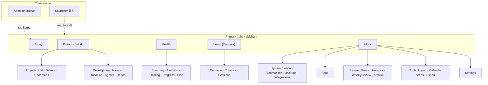
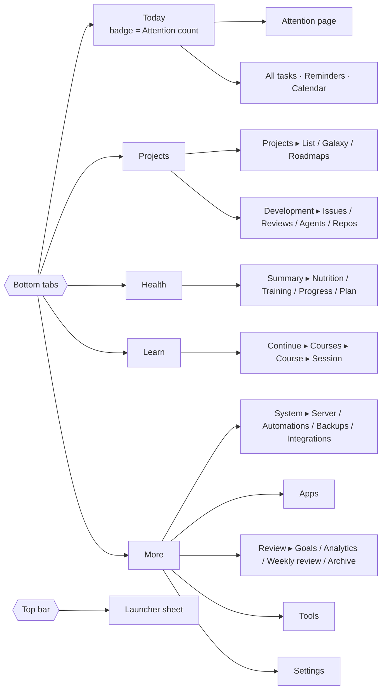
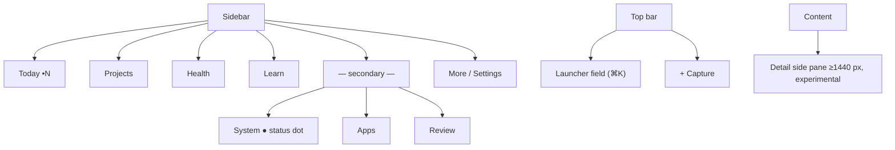
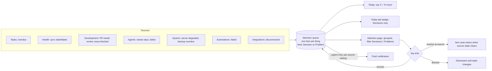
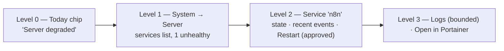

# Stage 4B — Information Architecture

- **Stage:** 4, information architecture (with `04_PRODUCT_VISION.md`)
- **Date:** 2026-09-27
- **Baseline navigation:** NAV1 (approved, `docs/UI_SYSTEM.md`). Phone and
  tablet use five bottom links (Today · Projects · Health · Courses · Menu).
  Desktop ≥ 1024 px uses a left sidebar with the same items. Menu (`/more`) holds
  19 destinations. Cmd/Ctrl+K opens the palette.
- **Scope:** structure, hierarchy, navigation, disclosure, terminology and
  states. No screen designs, no technical integration (Stage 5), no implementation.
- **Nothing here changes navigation.** Every structural change that supersedes
  NAV1 is listed under **Decisions for Jay**.

---

## A. Current IA problems (evidence)

| # | Problem | Evidence |
|---|---|---|
| IA-1 | **No home for the control plane.** Development, Server, Agents, Automations and Apps have no destination. The only extension point is Menu. | Stage 2B §Q; Stage 3 §U |
| IA-2 | **Menu is a sitemap** (19 rows, 2.3 phone screens) that also duplicates tab destinations and Health sections | Stage 3 §C, §M |
| IA-3 | **Primary slots aren't earned by use.** Courses holds a tab while empty; Galaxy, Goals, Roadmaps and Reminders are 2+ taps away. | Stage 3 §C |
| IA-4 | **Today lists rather than prioritises**, and has no place for attention, status or change | Stage 3 §G |
| IA-5 | **Projects has three overlapping maps** (Projects list, Roadmap, Galaxy) and five overlapping nouns (project, quest, mission, trip, destination) | Stage 3 §H–I, §B |
| IA-6 | **Level 1 screens contain Level 3 content** (per-item delete, import forms, full duplicate listings) | Stage 3 §Q |
| IA-7 | **Placeholders occupy primary space** (Health) | Stage 3 §J |
| IA-8 | **Search and capture are fused** in one palette input | Stage 3 §C |
| IA-9 | **"Where am I" collapses to "Menu"** for 7+ secondary pages | Stage 3 §C |
| IA-10 | **No attention model:** overdue reminders aren't even on Today; nothing aggregates decisions | Stage 3 §G; `handlers.go:456` |

---

## B. IA Option 1 — "Preserve five, grow More"

Keep NAV1 exactly. New systems go into Menu sections; the launcher does the heavy lifting.

| Aspect | Design |
|---|---|
| Mobile tabs | Today · Projects · Health · Courses · Menu |
| Desktop | Same five in the sidebar |
| Courses | Stays a tab, unchanged |
| Development / Agents | Menu → Development (Issues, Reviews, Agents, Repos) |
| Server / Automations | Menu → System |
| Goals | Menu → Review |
| Galaxy | Menu and the bottom of Projects (as today) |
| More | Grows: Daily planning, Projects & learning, Health, Development, System, Apps, Review, Settings (~30 rows) |
| Launcher | Primary way to reach anything in Menu |
| Attention | A Today section |

**Pros:** zero navigation churn; tests and NAV1 stay valid; cheapest.
**Cons:** Menu becomes a 30-row junk drawer; Development, the most active
future work, is 2–3 taps deep; Projects and Development are split although they
are the same work; IA-3 and IA-5 remain.
**Migration cost:** Low. **Command-center suitability:** Medium-low (depends
entirely on Today plus the launcher). **Scalability:** Poor; every new system
lengthens Menu.

## C. IA Option 2 — "Life / Work hubs + Inbox"

Regroup around the two big halves of life and add an explicit inbox tab.

| Aspect | Design |
|---|---|
| Mobile tabs | Today · Life · Work · Inbox · More |
| Desktop | Sidebar: Today, Inbox, Life (Health, Learn, Habits, Goals), Work (Projects, Galaxy, Development), More |
| Courses | Life → Learn |
| Development / Agents | Work → Development → Agents |
| Server / Automations | More → System |
| Goals | Life → Goals |
| Galaxy | Work → Galaxy |
| More | System, Apps, Tools, Settings |
| Launcher | Global |
| Attention | A dedicated **Inbox tab**, plus a Today section |

**Pros:** clean conceptual model; scalable; Development sits with Projects.
**Cons:** **Health, used daily, drops to 2 taps** (Life → Health); hub pages
are an extra layer with little value of their own; the Inbox tab duplicates
Today's attention section; biggest change to muscle memory.
**Migration cost:** High. **Command-center suitability:** High.
**Scalability:** High.

## D. IA Option 3 — "Command-first (launcher + attention)"

Treat GYST like Spotlight plus an inbox: small fixed tabs, and everything else via search.

| Aspect | Design |
|---|---|
| Mobile tabs | Today · Attention · **Search** (centre, launcher) · Health · Me |
| Desktop | Minimal sidebar (Today, Attention, Health, pinned items); launcher always visible as a top search field |
| Courses | Via launcher and pins; Me → Learning |
| Development / Agents | Via launcher, Attention and pins; no fixed home |
| Server / Automations | Surface via Attention; launcher to open |
| Goals | Me → Goals |
| Galaxy | Launcher and pin |
| More | "Me": settings, pins, everything else |
| Launcher | **Primary navigation** |
| Attention | A dedicated tab |

**Pros:** smallest fixed surface; scales without IA changes; very fast for power use on desktop.
**Cons:** poor discoverability, since you have to know what to search for;
Projects, the owner's core creative domain, loses its home; weak on phone,
where browsing beats typing; pinning adds a personal-configuration burden;
highest risk of feeling like a tool rather than a life app.
**Migration cost:** High. **Command-center suitability:** High for experts, low
for glanceability. **Scalability:** Very high.

## D2. IA Option 4 — "Focused five" (refinement of Option 1 using Option 2's Work grouping and Option 3's attention and launcher)

Keep the five-slot shape and muscle memory, but give each slot a clear
**domain scope**, and add attention and launcher as cross-cutting layers
instead of tabs.

| Aspect | Design |
|---|---|
| Mobile tabs | **Today · Projects · Health · Learn · More** (Projects' scope becomes *Work*: projects **and** development; Courses becomes *Learn*: see D1, D2) |
| Desktop | Sidebar: the same five **plus** a secondary group (System, Apps, Review) and the Attention count; launcher field in the top bar |
| Courses | Learn tab (courses today; programs or degrees later) |
| Development / Agents | Projects tab → **Development** section (Issues, Reviews, Agents, Repos); agent state also on issues, Today and Attention |
| Server / Automations | More → **System** (Server, Automations, Backups, Integrations); exceptions surface on Today |
| Goals | More → **Review** (Goals, Analytics, Weekly review, Archive); domain goals also shown in their domain |
| Galaxy | Projects → **view toggle** (List · Galaxy); launcher; never on Today |
| More | ~12 rows: System, Apps, Review, Tools, Settings; no duplicates of tabs |
| Launcher | Global: search, go, commands, explicit capture |
| Attention | One queue: Today section, Today tab badge, full Attention page (Level 2) |

**Pros:** keeps NAV1's proven mechanics and the daily Health slot; gives
Development a home next to the projects it serves; shrinks More; a single
attention model with no duplicate inbox tab; the launcher scales access without
tab growth; incremental migration.
**Cons:** the Projects tab gets richer (needs a clear Projects/Development
switch); renaming Courses → Learn and widening Projects are conceptual changes
that need approval; System stays 2 taps deep on phone (by design: exceptions
come to Jay).
**Migration cost:** Medium, and it can be staged. **Command-center suitability:**
High. **Scalability:** High; new systems join a domain or System and surface
through Attention and the launcher.

---

## E. Comparison matrix

Score 1 (poor) – 5 (excellent).

| Criterion | Opt 1 Preserve | Opt 2 Life/Work | Opt 3 Command-first | **Opt 4 Focused five** |
|---|---|---|---|---|
| Migration cost (5 = cheapest) | 5 | 2 | 1 | 4 |
| Keeps NAV1 muscle memory | 5 | 2 | 1 | 4 |
| Health daily access | 5 | 3 | 4 | 5 |
| Learning prominence | 4 | 3 | 2 | 4 |
| Development discoverability | 2 | 5 | 3 | 4 |
| System/server appropriate prominence (quiet unless wrong) | 3 | 4 | 4 | 5 |
| Command-center suitability | 2 | 4 | 4 | 5 |
| Glanceability on phone | 3 | 4 | 2 | 5 |
| Long-term scalability | 1 | 4 | 5 | 4 |
| Avoids overlapping systems (inbox vs Today) | 4 | 2 | 3 | 5 |
| Distinctly GYST (Galaxy, rhythm) | 3 | 3 | 2 | 4 |
| **Total** | **37** | **36** | **31** | **49** |

---

## F. Recommended IA — Option 4 "Focused five"

**Why:** the evidence says the five-slot mechanics work (Stage 3), Health
deserves a daily slot, and the real problems are *scope, depth and
prioritisation*, not the number of tabs. Option 4 fixes scope (Projects = work,
including development), depth (More becomes small and purposeful; the
launcher reaches everything), and prioritisation (Attention and Now on Today),
while keeping the owner's habits and GYST's identity. It can ship in stages
behind the existing routes.



---

## G. Mobile navigation (phone)



- **Top bar:** page title (replacing the static GYST wordmark on inner pages)
  and the launcher button. Today keeps the brand and greeting.
- **Tab re-tap** returns to the domain root (native convention).
- **Sheets** for creation (Add task, Add session), quick actions and previews
  (Galaxy world, issue summary).
- **Badge:** only the Today tab shows a badge, and only for Attention items of
  type *decision*. One badge, one meaning.

## H. Tablet navigation

| Width | Presentation |
|---|---|
| 768–1023 (portrait) | Bottom tabs as on phone. Lists use two-column rows where they fit. Detail opens as a page. |
| ≥ 1024 (landscape) | Sidebar as on desktop. **List-detail split** for Projects, Development, Learn and Attention (list left, detail right). |
| Galaxy | Full-bleed canvas; the preview becomes a side panel |

## I. Desktop navigation



- Desktop shows **the same concepts**, just with less hiding: secondary items
  (System, Apps, Review) are visible in the sidebar because space allows. The
  System entry carries a status dot that is **only coloured on exceptions**.
- **No bottom tab mimicry.** No dashboards of tiles. The wide width is for
  list-detail splits, not more cards.
- The launcher is a visible field in the top bar, not only a shortcut.

---

## J. Today hierarchy

```text
Today
├─ Header: greeting · date · XP chip
├─ Now (always): next action · next prayer · next timed item
├─ Attention (only when non-empty): ≤ 3 rows → "N more" → Attention page
├─ Today list (always): tasks + due study sessions; done collapsed
│    └─ links: All tasks · Reminders · Calendar (Level 2)
├─ Rhythm strip (always): 5 prayers · athkar · gym (one-tap)
└─ Status strip (only exceptions / live runs, ≤ 3 chips)
      e.g. Health stale · Server degraded · Codex working
```

The signal-by-signal presence rules are in `04_PRODUCT_VISION.md` §F.

What moves off Today: the motivational banner; the duplicate Focus / Next up
blocks (merged into Now); prayer alert setup (→ Settings); the text stats strip
(→ XP chip); the full health snapshot (→ one Health glance row, only once
data exists).

## K. Projects hierarchy

```text
Projects tab (Work)
├─ [Projects | Development]           ← top switch
├─ Projects
│   ├─ View: List (default: Active) | Galaxy | Roadmaps
│   ├─ List row: icon/colour · name · state · one progress signal · next task
│   ├─ Completed: collapsed group "Done (11)"
│   └─ Project (Level 2)
│        ├─ Header: name · state · primary next action
│        ├─ Tasks (open first; done collapsed)
│        ├─ Development (linked repos · open issues · PRs), if any
│        ├─ Roadmap position · depends on / unlocks
│        ├─ Notes · Links (external work)
│        └─ Level 3 (⋯ menu): edit · dependencies · proof · move · archive · delete · export
└─ Development → §O
```

- **Project** = an outcome Jay is working towards, with tasks. May have
  sub-projects, a roadmap position, dependencies and linked repositories.
- **Task** = one actionable step. Standalone (personal) or inside a project.
- **Roadmap** = an ordered route of projects towards a larger goal. It's a *view
  and plan*, not a second copy of the projects (Stage 3 found every project
  listed twice).
- **Completed projects** live in a collapsed "Done" group and remain in Galaxy (D4).
- **Proof and dependencies** stay, at Level 3 (edit) and as state
  ("Blocked · waits for X").

## L. Galaxy placement

| Question | Answer |
|---|---|
| Role | **Signature exploration view of Projects**: the spatial, emotional map of Jay's work. Not a separate product area. |
| Entry point | **View toggle on Projects** (List · Galaxy · Roadmaps), plus the launcher ("Galaxy") and Project detail ("Show in Galaxy") |
| Relation to Projects | Same data, different view; selection opens a preview sheet with the project's next action and "Open" |
| Prominent control? | Yes: a first-class toggle on the Projects root, not a card at the bottom |
| On Today? | **No.** Exception: a one-time celebration when a project completes (the ship lands), optional and brief. |
| Primary tab? | **No.** Exploration isn't a daily task, and the Projects tab already hosts it. |
| Scope | Show completed projects too (dimmed or in an outer orbit) so the universe grows (D4) |
| Mobile | Preview as a bottom sheet; larger hit areas than visuals; first-run hint only |

## M. Health hierarchy

```text
Health tab
├─ Summary (Level 1): today, one row per area, each tapping deeper
│   ├─ Intake: calories vs target · macro mini-bars          → Nutrition
│   ├─ Energy: burned (resting + active) · observed balance  → Nutrition (energy)
│   ├─ Activity: Watch steps · phone steps · exercise min    → Progress (later) / info
│   ├─ Training: last workout · this week (when connected)   → Training
│   ├─ Body: latest weight (when any)                         → Progress
│   ├─ Plan: current plan · day X of Y                        → Plan
│   └─ Sync: last updated · stale/failed state (always, one line)
├─ Nutrition: totals, macros, targets, data timing (info)
├─ Training: connection state, routines, recent workouts, muscle focus
├─ Progress: weight, trends (when they exist)
└─ Plan: current plan (read view first; edit as Level 3), past plans
```

| Information | Always on Summary | Behind a tap | Only in section |
|---|---|---|---|
| Calories vs target, macros (compact) | ✔ | details → Nutrition | full breakdown, data timing, "Edit targets": Nutrition |
| Burned / observed balance / food remaining | ✔ (when data) | formula explanation (info) | — |
| Watch steps, phone steps (separate), exercise | ✔ | source note (info) | — |
| Training summary | ✔ when connected; one "Connect" row when not | — | routines, workouts, muscle map: Training |
| Weight | ✔ only if readings exist | — | history, ranges: Progress |
| Trends (week/month/year) | ✘ until built | — | Progress (future) |
| Plan title and progress through dates | ✔ one row | — | fields and cycles: Plan |
| Health goals and tasks | ✘ | — | Plan (goals) / Today (tasks) |
| Gym check-ins | ✘ (on Today's rhythm strip) | — | Training (manual check-ins) |
| Placeholders (Plan meal, Start workout, periods) | ✘ | — | removed from primary space (D8) |

Invariants in the IA: missing = "—" or "No data" (never 0); Watch and phone steps
are separate rows; burn = resting + active; no step-to-calorie derivation anywhere.

## N. Courses / Learning hierarchy

```text
Learn tab
├─ Continue (Level 0/1): the one next session (due, catch-up, or next unfinished)
├─ Due & upcoming sessions (this week)
├─ Courses (active; paused/completed collapsed)
│   └─ Course (Level 2): progress · next session · sessions list · notes · links
│        └─ Level 3: edit · calendar feed · archive
└─ (Designed for later) Programs: a degree or certificate grouping courses by term
```

- **What Learn represents:** structured, self-directed education (courses,
  bootcamps, certifications, a future Master's) as a long-term life domain.
- **Prominence:** keeps a primary slot (D1). Education is a lasting domain, and
  the slot will earn its place once "Continue" exists. While empty, Learn shows a
  one-line state and "Add course".
- **"Continue learning":** the single most useful next session, shown in
  Learn's header and, when nothing more urgent exists, as Today's Now item.
- **Master's study (later):** "Program → Term → Course → Session" is compatible
  with this hierarchy without building it now.

## O. Development hierarchy

```text
Projects tab → Development
├─ Needs me (Level 1 top): reviews waiting · agent needs input · blocked issues
├─ Active work: issues in progress (with agent state)
├─ Reviews: PRs awaiting Jay (→ GitHub for diff)
├─ Agents: running · queued · recently finished · failed
└─ Repositories: list → repo (open issues, PRs, linked project, open in GitHub)
    Issue (Level 2): title · state · repo · linked project · agent · PR
       actions: assign agent · change state (approved set) · open in GitHub
```

- **GitHub Issues are the canonical record.** Development screens read them
  and link to them; GYST tasks are not development tasks.
- **Structure evaluated:** the proposed "Tasks · Repositories · Reviews · Agents"
  was adopted as **Issues · Reviews · Agents · Repositories**. "Issues" uses the
  canonical term and avoids a collision with GYST Tasks, and "Needs me" sits
  above all four as the entry point.

## P. Agents placement

| Surface | What appears |
|---|---|
| Issue (Level 2) | Assigned agent, state (Queued, Working, Needs input, Needs review, Failed), link to branch or PR |
| Today status strip | Live chip only while an agent is **Working** on something Jay started |
| Attention | **Needs input**, **Needs review**, **Failed** |
| Development → Agents (Level 1) | Overview: running, queued, finished, failed; per-agent recent history |
| Settings / System → Integrations | Agent provider connection (Herder) and credentials status |
| Never | A primary tab; a terminal; live token streams on Today |

## Q. Server placement

| Surface | What appears |
|---|---|
| Today | **Only when unhealthy** (status chip); becomes Attention if action is needed |
| Desktop sidebar | "System" with a status dot, coloured only on exceptions |
| More → System → Server (Level 1) | Overall health, services list with state, backups status |
| Service (Level 2) | State, recent events, **safe allow-listed actions** (e.g. restart), open in Portainer |
| Level 3 | Logs (bounded), console **link-out** (not embedded) |
| Prominence | Low by design. Normal is silent; exceptions come to Jay. |

## R. Automations placement

| Surface | What appears |
|---|---|
| More → System → Automations (Level 1) | Automations with state (Healthy, Failed, Disabled), last run, next run |
| Automation (Level 2) | Recent executions, error summary, **Run now** (approved automations only), open in n8n |
| Attention | Failed automation (with retry or open n8n) |
| Launcher | "Run …" commands for approved automations (confirmed) |
| Never | n8n editor inside GYST; succeeded runs on Today |

## S. Reviews / Attention hierarchy

**One queue, several presentations. No second notification system.**



- **Kinds:** *Decision* (needs Jay: review, input, approve) vs *Problem* (something is
  wrong: failed, stale, unhealthy, overdue).
- **Lifecycle:** items are **derived from source state** and auto-resolve.
  Snooze and dismiss exist; there's no manual "mark read" bookkeeping.
- **Reviews** are the Decision items from Development; the Reviews list in
  Development is the same data filtered to PRs.
- **Notifications** are a delivery channel of the queue, not a separate system.
  Prayer push remains a separate *time* notification (it isn't attention).

## T. Apps / external destinations

- **One Apps registry** (name, icon, URL, optional health signal): SamVision,
  GitHub, n8n, Portainer, uptime-kuma, FMS, MyFamilyExpenses, course portals, etc.
- **Where it appears:**
  1. **Launcher**, the primary path ("sam…" → SamVision)
  2. **More → Apps**, a browsable list
  3. **Contextual deep links**: project → repo → GitHub; automation → n8n;
     service → Portainer; course → portal
- **Not** on Today, **not** a tab, **not** duplicated in the Menu's other sections.

## U. More hierarchy

```text
More
├─ System        Server · Automations · Backups · Integrations
├─ Apps          (registry)
├─ Review        Goals · Analytics · Weekly review · Archive
├─ Tools         Import plan · Calendar feeds · Export
└─ Settings      Prayer · Appearance & motion · Notifications · Security (sessions) · About
```

About 12 rows (from 19), grouped by purpose, with no duplicates of tab destinations.

**Must not live in More:** anything reachable from a tab (Today, All tasks,
Reminders, Calendar/Monthly → Today; Health sections → Health; Courses →
Learn; Projects, Galaxy, Roadmaps → Projects); Attention (→ Today); anything
requiring daily use.

## V. Universal launcher

**Concept:** one entry (⌘K / Ctrl+K on desktop; top-bar search button on phone)
with **three explicit intents**:

| Intent | Trigger | Covers |
|---|---|---|
| **Go** (default) | Type | Pages, projects, tasks, issues, repos, courses, sessions, apps, settings |
| **Do** (commands) | Type ">" or pick from a "Commands" group | Create task / project / session; run approved automation; assign issue to agent; sync Hevy; open Galaxy at project |
| **Capture** | "+" button, or the last result row "Create task: '…'" | Quick task with natural-language date and priority parsed deterministically |

Rules:
- **Typing never fills the capture form implicitly** (fixes Stage 3 IA-8).
  Capture happens only by choosing "Create task: '…'" or opening capture directly.
- **Navigation vs commands:** Go never changes state. Do always shows what will
  happen, and external or destructive commands need confirmation. There are no
  destructive commands in the launcher at all (delete lives at Level 3 of
  objects).
- **Empty state:** recents, then suggestions (Now item, Attention top item).
- **Phone:** a full-height sheet from the top-bar button. Today's Add button
  opens Capture directly.
- **Scope:** everything GYST knows plus the Apps registry; external search
  (e.g. GitHub code) links out.

## W. Progressive disclosure map



| Domain | Level 0 (glance) | Level 1 (primary) | Level 2 (detail) | Level 3 (advanced) |
|---|---|---|---|---|
| Today | Now item, Attention rows, status chips | Today | Attention page, All tasks, Calendar | Task history, analytics |
| Projects | Next task in Now | Project list (Active) / Galaxy / Roadmaps | Project | Edit, dependencies, proof, import/export, archive/delete |
| Development | "2 reviews waiting" | Development: Needs me, Active, Reviews, Agents, Repos | Issue, PR summary, Repo | Open in GitHub, agent logs |
| Health | Health glance row | Summary | Nutrition, Training, Progress, Plan | Plan editing, data timing, source details |
| Learn | Continue item | Learn | Course | Edit, calendar feed |
| System | Exception chip / status dot | Server, Automations, Backups, Integrations | Service, Automation | Logs, run history, open Portainer/n8n |
| Review | — (weekly) | Review | Goal, Analytics | Archive, export |
| Apps | — | Launcher / Apps list | — | External app |

## X. Terminology system

| Concept | **Primary term** | Retire | Notes |
|---|---|---|---|
| Outcome you work towards | **Project** | Quest, Trip | |
| Sub-project | **Sub-project** (in Galaxy: *moon*) | Stop | Playful term only inside Galaxy |
| Actionable step (standalone or in a project) | **Task** | Mission | Different tables, one user-facing term (D3) |
| Checklist within a task | **Checklist** | — | |
| Ordered plan of projects | **Roadmap** | "Galaxy map", Route (as a page name) | The rocket visual inside it may be called the *route* |
| Spatial view of projects | **Galaxy** (items: *worlds*) | Destination, Planet (in copy) | Identity preserved |
| Evidence of completion | **Proof** | — | |
| Reward | **XP**, **Level**, **Achievement** | Fuel, Medal, Stars (in copy) | |
| Unit of learning | **Session** (types: lesson, study, assignment, exam, live) | Learning block | |
| Postponed learning | **Catch-up** | — | |
| Learning domain | **Learn** (contains **Courses**) | Learning deck | D1 |
| Prayer / athkar / gym check-ins | **Rhythm** (items: *prayers*, *athkar*, *habits*) | Tracker, Daily mission | "Tracker" stays internal |
| Health plan period | **Plan** (past ones: *Past plans*) | Cycle (user-facing) | |
| Observed energy | **Burned**, **Balance (observed)**, **Food remaining** | "Observed burn so far" (caps) | Keep "observed" precision |
| Development work item | **Issue** | Dev task | GitHub term |
| Implementation artifact | **Pull request (PR)** | — | |
| Owner's decision on a PR | **Review** | — | |
| Worker | **Agent** (Claude, Codex) | Bot | |
| One piece of agent work | **Run** | Job, Session | "Session" is taken by Learn |
| Orchestrator | **Herder** (named in settings and status only) | — | |
| Code home | **Repository (repo)** | — | |
| Server components | **Service** | Container (in UI) | |
| n8n workflows | **Automation** | Workflow (in GYST UI) | |
| Connection to a provider | **Integration** | Provider (in UI) | |
| Items needing Jay | **Attention** | Inbox, Alerts | D5 |
| Global search/command | **Launcher** (UI label: *Search*) | Command palette | |
| Overflow destination | **More** | Menu | iOS convention |
| Next action block | **Now** | Focus, Next up | |

## Y. State vocabulary

One small set per object family. **Every state always has a word and an icon;
colour is never the only signal.**

| Family | States | Maps from current |
|---|---|---|
| Projects and tasks | **Planned · Active · Blocked · Paused · Done · Archived** | upcoming→Planned; locked→Blocked (reason "Waits for X"); completed/done→Done |
| Task occurrences | **To do · Done · Skipped · Overdue** | pending→To do |
| Learning sessions | **To do · Done · Skipped · Catch-up** | postponed→Catch-up |
| Data and integrations | **Up to date · Syncing · Stale · Disconnected · Failed** | "Not connected"→Disconnected |
| Issues (dev) | **Open · In progress · Blocked · In review · Done** | from GitHub state and labels (Stage 5) |
| Agent runs | **Queued · Working · Needs input · Needs review · Done · Failed · Cancelled** | new |
| Services / server | **Healthy · Degraded · Down · Unknown** | new |
| Automations | **Healthy · Failed · Disabled** (+ Running while active) | new |
| Attention kinds | **Decision · Problem** | new |
| Health values | **value · — (no data) · Stale** | "No data", "Not logged yet" → one form |

Semantic colours (existing tokens): green = Done/Healthy/Up to date; blue =
Active/Working/In progress; amber = Stale/Degraded/Needs input/Paused;
red = Failed/Down/Overdue/Blocked; grey = Planned/Disconnected/Archived/Unknown.

## Z. Migration considerations

| Topic | Consideration |
|---|---|
| **Order** | 1. Day-boundary fix (data correctness) → 2. Terminology and state vocabulary (copy only) → 3. Today restructure (Now/Attention/list/rhythm/status, internal sources only) → 4. More regroup and launcher intents → 5. Projects view toggle (List/Galaxy/Roadmaps) and legacy-screen migration → 6. Health Summary rows → 7. Learn rename → 8. Development / System / Agents areas as their integrations land (Stage 5) |
| **URLs** | Keep existing routes working (`/courses`, `/more`, `/galaxy`, `/roadmap`). Add aliases (e.g. `/learn`) rather than moving. PWA `start_url` stays `/today`. |
| **NAV1** | Options 2–4 supersede parts of the approved NAV1; they need explicit approval and a new NAV task record |
| **Tests** | Navigation tests pin five destinations and Menu reachability (`TestPrimaryNavigationHasFiveDestinations`, `TestMoreMethodAndReachability`). Change them deliberately with the IA, never loosened. |
| **Service worker** | Asset version bumps with each shell change (existing cache-policy check) |
| **Data model** | Terminology needs no schema change. Galaxy including completed projects is a query change. Attention and control-plane areas need new backend (Stage 5). |
| **Legacy screens** | Migrate onto the `ui-*` layer screen by screen (Roadmap, project detail, All tasks, Monthly, Settings, forms); Stage 3 targets are the acceptance bar |
| **Security gate** | Development actions, System actions and agent assignment wait for the Stage 2A prerequisites (login throttling, audit log, scoped credentials, step-up confirmation) |
| **Device review** | Each phase needs a real-iPhone review (Stage 3 couldn't emulate touch or safe areas) |
| **Placeholders** | Removing placeholder controls from Health is a product change (D8), not just styling |
| **Risk** | Richer Projects tab: the Projects/Development switch must stay obvious. Validate on phone before adding Development content. |

---

## Decisions for Jay

Only decisions that need the product owner. Nothing below has been changed.

### D1 — What does the fourth tab represent?
- **Question:** Keep the tab labelled "Courses", or broaden it to "Learn" (with Courses inside)?
- **Option A:** Keep "Courses" (no change).
- **Option B:** Rename to "Learn". Courses are one part; "Continue learning", sessions and future programs (Master's) live here.
- **Option C:** Replace the tab with Development, moving Courses to More.
- **Recommendation:** **B.** Education is a long-term domain; "Learn" leaves room for programs without overbuilding; Development belongs with Projects (D2).
- **Consequence:** A copy change plus a `/learn` alias; the Courses routes stay. C would demote a long-term life domain based on today's empty data.

### D2 — Where does Development live, and what is the second tab called?
- **Question:** Should the Projects tab also host Development (Issues, Reviews, Agents, Repos), and should the tab be renamed?
- **Option A:** Projects tab hosts Projects and Development; label stays **"Projects"**.
- **Option B:** Same scope, label becomes **"Work"**.
- **Option C:** Development as its own destination under More (Option 1 style).
- **Recommendation:** **A now, revisit B later.** The software work *is* project work; keeping the label avoids churn. Consider "Work" only if non-project work (issues without projects) dominates.
- **Consequence:** The Projects root gets a Projects | Development switch. C keeps Development 2–3 taps deep.

### D3 — Unify "Mission" into "Task"?
- **Question:** Should project items be called Tasks (like standalone tasks), retiring Mission, Quest, Trip, Stop and Destination?
- **Option A:** Yes: Project / Task / Sub-project; playfulness stays in Galaxy, the ship and XP.
- **Option B:** Keep "Mission" for project items only (standalone = Task).
- **Option C:** Keep the current mixed vocabulary.
- **Recommendation:** **A.** Stage 3 found five nouns for two concepts; clarity wins, and identity lives in Galaxy and XP.
- **Consequence:** Copy changes across Projects, Roadmap and Today; no schema change.

### D4 — Should Galaxy show completed projects?
- **Question:** Galaxy hides done projects, so it currently shows 2 of 13.
- **Option A:** Show completed worlds (dimmed or an outer "done" orbit).
- **Option B:** Keep active-only.
- **Option C:** A toggle (Active / All).
- **Recommendation:** **A**, optionally with C. The universe should grow with Jay's work; that's what makes it a signature feature rather than a novelty.
- **Consequence:** A small query and visual change; a denser scene to design for.

### D5 — The name and shape of the attention system
- **Question:** One queue shown on Today plus a page and a badge (recommended IA). What should it be called, and should it get its own tab?
- **Option A:** "Attention": a Today section, Today badge and Attention page; no tab.
- **Option B:** "Inbox" as its own tab (Option 2 style).
- **Option C:** Notifications only (push and a bell), no queue.
- **Recommendation:** **A.** Items are derived and auto-resolve, which isn't inbox-zero semantics. A tab would duplicate Today.
- **Consequence:** One backend model for all sources; push becomes a filtered channel of the same queue.

### D6 — How visible are System and Apps on each device?
- **Question:** Where do Server, Automations, Backups, Integrations and Apps appear?
- **Option A:** Phone: More → System / Apps. Desktop: secondary sidebar group with a status dot.
- **Option B:** More only, on all devices.
- **Option C:** A dedicated System tab.
- **Recommendation:** **A.** Quiet on phone, one click on desktop; exceptions reach Today anyway.
- **Consequence:** The desktop sidebar gains a secondary group; phone unchanged.

### D7 — Where do Goals live?
- **Question:** Goals are cross-domain and long-horizon.
- **Option A:** More → Review (Goals, Analytics, Weekly review, Archive), with domain goals also shown in their domain (e.g. health goals in Health Plan).
- **Option B:** Goals only inside each domain.
- **Option C:** Goals on Today.
- **Recommendation:** **A.** A weekly Review ritual fits long-horizon goals better than a daily surface.
- **Consequence:** Goals leave the "Projects & learning" Menu group; a Weekly review surface becomes part of Review.

### D8 — Placeholders for unbuilt Health features
- **Question:** What to do with the disabled Week/Month/Year, Plan meal, Start workout, and the trend placeholders.
- **Option A:** Remove from primary surfaces until built; at most one "Coming later" note at Level 2.
- **Option B:** Keep them visible as disabled.
- **Recommendation:** **A.** Stage 3 showed they dominate the Summary and blur what's real.
- **Consequence:** Health Summary becomes much shorter. Future features reappear when their backend exists.

### D9 — What does Today show when everything is normal?
- **Question:** The status strip when there are no exceptions.
- **Option A:** Nothing (strip disappears).
- **Option B:** One quiet "All systems normal" chip (tap → System).
- **Recommendation:** **B** once System exists (reassurance with one tap to verify); **A** until then.
- **Consequence:** The strip is either absent or a single chip, never a row of green checks.

### D10 — Prayer's position on Today
- **Question:** How prominent should the prayer rhythm be in the new Today?
- **Option A:** Next prayer in Now (always) plus the rhythm strip near the top (one-tap check-ins).
- **Option B:** Next prayer in Now; check-ins in a collapsible section lower down.
- **Option C:** Current placement (countdown card and tiles at the bottom).
- **Recommendation:** **A.** It's the most frequent interaction, and Stage 3 found it buried at the bottom.
- **Consequence:** Today's top area holds Now plus the rhythm strip; alert setup moves to Settings.

### D11 — Approve superseding NAV1
- **Question:** The recommended IA keeps five slots but changes their scope and labels and restructures More. That supersedes parts of the approved NAV1.
- **Option A:** Approve Option 4 as the target IA, to be delivered in stages as separate approved tasks.
- **Option B:** Approve only copy and scope changes (D1–D3) now; keep NAV1's Menu until Development and System exist.
- **Option C:** Keep NAV1 unchanged (Option 1).
- **Recommendation:** **A as the target, B as the first delivery step.**
- **Consequence:** A new NAV task record and updated navigation tests when implementation is authorised.
