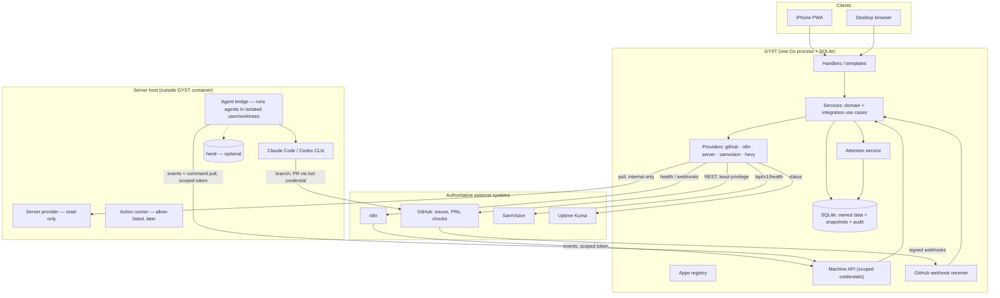
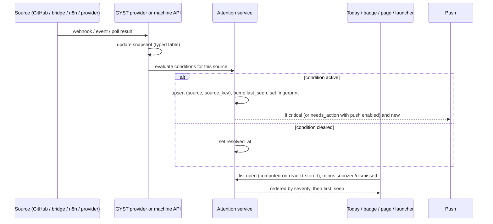
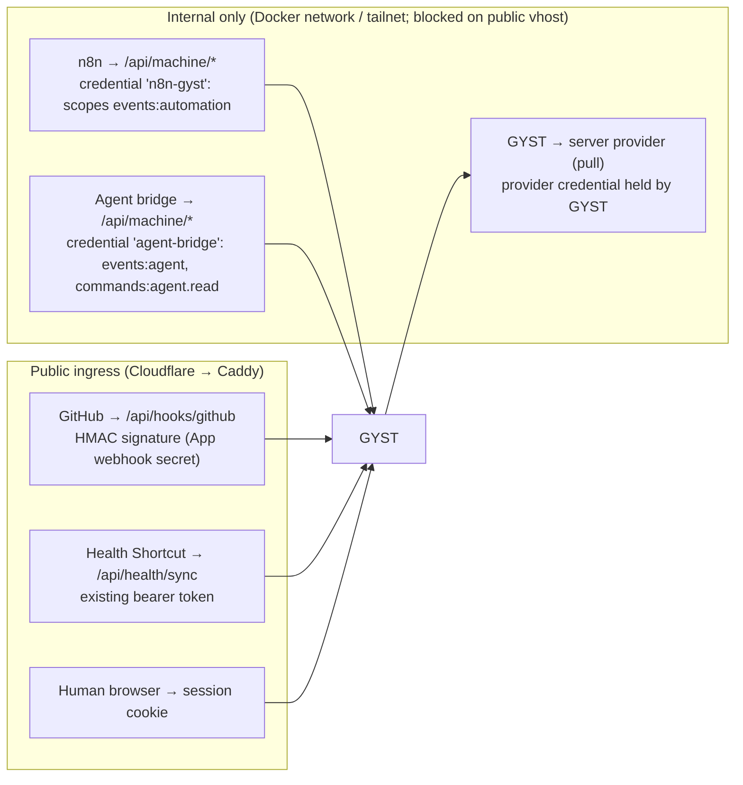

# Stage 5A — Command-Center Integration Architecture

- **Stage:** 5, integration architecture (with `07_AGENT_ORCHESTRATION_ARCHITECTURE.md`
  and `08_SERVER_AUTOMATION_ARCHITECTURE.md`)
- **Date:** 2026-09-27
- **Binding inputs:** `05A_PRODUCT_DECISIONS.md` (D1–D11, C1); Stage 2A findings;
  Stage 2B patterns and debt.
- **Scope:** architecture only. Nothing is implemented, installed, configured or
  credentialed. No migrations are written; schemas below are *minimum shapes* for
  later design review.

## Evidence gathered for Stage 5 (read-only)

| Fact | Evidence |
|---|---|
| Claude Code **2.1.283** and Codex CLI **0.154.0** installed for user `jay` | `claude --version`, `codex --version` |
| **No Herder/herd/herdr installed** anywhere on the host | `command -v`, filesystem search |
| `jay` is in groups **`docker`, `lxd`, `sudo`** | `id -nG`. Docker and LXD membership are root-equivalent. |
| Only **Portainer** mounts `/var/run/docker.sock` (marked read-only, which doesn't restrict the API) | `docker inspect` of all containers |
| **n8n 2.39.8**, self-hosted, public at `n8n.zaylolabs.com`, `/healthz` endpoint, on the shared `proxy` network | `docker inspect`, `n8n --version` |
| n8n API keys can only be **scoped on Enterprise**; other editions' keys are full-access | n8n docs (Authentication) |
| **SamVision** exposes `/api/v1/health`; container is healthy on `127.0.0.1:8502` | Docker healthcheck definition |
| **Uptime Kuma** runs and is already used as a **push-monitor** for SamVision backups | user crontab (04:00 job pings Kuma on success) |
| Nightly **Postgres backups** for FMS and MyFamilyExpenses (03:30, 14-day retention) and SamVision (04:00). **None for GYST.** | user crontab, `/srv/server/backups/postgres` |
| `deploy-repo.sh` = `git pull --ff-only && docker compose up -d --build` (no deploy record) | script |
| SamVision repo already has `.claude/worktrees`, `.claude/agents`, `.github/workflows`, `.codex/hooks.json` | directory listing |
| `myproject-claude` and `myproject-codex` are separate SamVision copies | directory listing (evidence of per-agent workspaces) |

---

## A. Command-center architecture

**GYST = control plane + user interface + attention router.** It keeps
*references and snapshots* of external state, turns conditions into Attention,
and forwards a small set of approved commands. It executes nothing heavy itself.



**Pattern for every integration** (the proven Hevy chain, with normalized
storage where queries need it):

```text
Provider (fetch or receive) → normalize → snapshot/cache (typed tables) → service → Attention + UI
```

New integration code follows the **newer layering** (Stage 2B §C): handlers
parse and render only; services own use cases and transactions; providers own
I/O; repositories own SQL. No integration logic in handlers.

## B. System boundaries

| System | Authoritative for | GYST's role | GYST must never |
|---|---|---|---|
| GitHub | Issues, labels, comments, PRs, reviews, checks, branches | Snapshot, route, create/update issues via API (later) | Hold an editable copy of issues; merge PRs automatically |
| Orchestrator / agent bridge | Agent processes, runs, execution state | Show, select work, approve, request stop | Run agents in its own process or container |
| Claude / Codex | Model execution inside a run | None directly (via bridge) | Hold model credentials |
| Server provider | Host and container facts | Display, derive Attention | Mount the Docker socket; run shell commands |
| n8n | Workflows, executions, credentials | Status, approved triggers, link to editor | Embed the editor; hold a full-access n8n key by default (D-J6) |
| SamVision | Its business data and tenants | Launch, health, selected summaries via API (later) | Read SamVision's database |
| Uptime Kuma | Availability monitors and heartbeats | Read status | Duplicate its checks |
| Apple Health / MFP / Hevy | Raw measurements | **Authoritative store of received observations** (existing) | Invent values |

## C. Data ownership matrix

| Data | Source of truth | GYST stores | Refresh |
|---|---|---|---|
| Personal tasks, recurrence, completions | **GYST** | AUTHORITATIVE DATA | — |
| Projects, roadmaps, goals, courses | **GYST** | AUTHORITATIVE DATA | — |
| Prayer config, trackers | **GYST** | AUTHORITATIVE DATA | — |
| Health observations | Apple Health (via Shortcut) | AUTHORITATIVE (received observations) | Push from Shortcut |
| Hevy training | Hevy | SNAPSHOT (existing JSON blob; D7 in 2B) | Background refresh |
| Development issue | **GitHub** | CACHE (normalized row: id, repo, number, title, state, labels, derived status, assignee, updated_at, url) | Webhook + reconcile poll |
| Issue body, comments, attachments | **GitHub** | NONE (fetch on demand for detail; short-lived cache optional) | On demand |
| PR, reviews, checks, merge state | **GitHub** | CACHE (summary fields) | Webhook + reconcile poll |
| Repository | **GitHub** | REFERENCE plus minimal CACHE (name, default branch, visibility, url) | Daily and on install |
| Project ↔ repository link | **GYST** | AUTHORITATIVE (GYST-owned relationship) | — |
| Agent run / session | **Orchestrator / bridge** | SNAPSHOT (run id, agent, issue ref, state, started, updated, branch, PR ref, last error) | Bridge push |
| Agent logs / transcripts | Orchestrator / CLI | NONE (bounded excerpt on demand, not stored) | On demand |
| Server metrics | Server / provider | SNAPSHOT (latest values only; short history optional) | Poll 60 s while viewed, 5 min background |
| Container state | Docker (via provider) | SNAPSHOT | Same |
| Service availability | Uptime Kuma | SNAPSHOT | Poll 1–5 min |
| Backup state | Backup jobs (status files / Kuma push) | SNAPSHOT (last success, age, size) | Poll 15 min |
| Automation workflow definition | **n8n** | REFERENCE (id, name, url) | Daily or on demand |
| Automation execution result | **n8n** | SNAPSHOT (last run, result, error summary) | Event push from n8n; optional poll |
| SamVision business data | **SamVision** | NONE (later: selected summaries via its API) | — |
| Apps registry | **GYST** config | AUTHORITATIVE (non-secret) | — |
| Attention items | Derived from sources | Derived state plus owner-side snooze/dismiss (GYST-owned) | On source change |
| Machine credentials | **GYST** | Hashes only | — |
| Audit log | **GYST** | AUTHORITATIVE | — |

## D. GitHub architecture

### D.1 Responsibility split: validated

| Role | Assessment |
|---|---|
| GitHub Issues = canonical dev task | **Valid.** Keeps one editable task store, works with agents, PRs and CI, and survives GYST outages. |
| PR = implementation/review artifact | **Valid.** Reviews, checks and merge rules are enforced by GitHub (branch protection). |
| GYST = control surface | **Valid** with the rule "write-through, never write-local": every edit is a GitHub API call followed by a snapshot refresh |
| Claude/Codex = workers | **Valid**, provided they run outside GYST under an isolated identity (`07` §L) |
| Orchestrator = coordination | **Valid in principle; no orchestrator exists on the host today** (`07` §D) |

### D.2 Data and refresh

| Resource | Store | Primary refresh | Fallback |
|---|---|---|---|
| Repositories (installed set) | Normalized table | App install event / daily | On-demand |
| Issues (open plus recently closed, 30 d) | Normalized table | Webhooks: `issues`, `issue_comment`, `label` | Reconcile poll every 15 min using conditional requests (ETag) |
| PRs | Normalized table | Webhooks: `pull_request`, `pull_request_review` | Same |
| Checks / CI | Summary per PR head SHA (success, failure, pending, count) | Webhooks: `check_suite`, `workflow_run` | Poll while a PR is open, 5 min |
| Comments, body, files | Not stored | Fetched on opening detail | — |

- **Webhooks vs polling:** webhooks for freshness; a reconcile poll for
  correctness (missed deliveries, downtime). Without webhooks, poll open items
  every 5 min, but only while GYST has viewers or open review items.
- **Not a JSON blob:** development data is queried for lists, counts and
  Attention, so it uses **typed tables** (unlike the Hevy snapshot).
- **Staleness:** each repository records `last_synced_at` and
  `last_error`. The UI shows "Updated 3 min ago" or "GitHub unreachable · showing
  data from 14:02".

### D.3 GitHub authentication

| Mechanism | Scope control | Lifetime | Webhooks | Identity of writes | Fit |
|---|---|---|---|---|---|
| **GitHub App** (private, installed on selected repos) | Per-repo install, fine-grained permissions | Installation tokens are short-lived; app private key stays server-side | Built-in, one secret | Actions attributed to the app | **Best** for read, write, webhooks and agents |
| **Fine-grained PAT** | Per-repo, fine-grained | Up to the chosen expiry; must be rotated | Per-repo webhooks configured separately | Acts as Jay | Acceptable **read-only interim** |
| OAuth App | Broad user scopes, all repos | Doesn't expire until revoked | Per-repo | Acts as Jay | **Reject** (least-privilege failure) |
| The host's existing `gh` login | Jay's full account | Long-lived | — | Jay | **Never reuse** |

**Recommendation (D-J2):** a **private GitHub App** installed only on selected
repositories, with **two installations of intent**:

| Credential | Holder | Permissions |
|---|---|---|
| **GYST App** | GYST container | Metadata: read · Issues: read → **write later** (labels, comments, create) · Pull requests: read · Checks: read · Commit statuses: read · webhooks |
| **Agent bot** (a second App or a fine-grained token) | Agent bridge only, never GYST | Contents: write (branches only; branch protection on default) · Pull requests: write · Issues: write (comments) |

Branch protection on each default branch requires Jay's review, so **no
credential GYST or agents hold can merge to main unaided**.

## E. Development task architecture

### E.1 Lifecycle mapping

| Lifecycle | Canonical representation in GitHub | GYST derives |
|---|---|---|
| Inbox | Open issue, no status label | "Inbox" |
| Needs Specification | label `status:needs-spec` | Attention (Decision) if marked for Jay |
| Ready | label `status:ready` | Candidate for work |
| Ready for AI | label `status:ready` **and** `agent:ready` (Jay's approval) | Eligible for dispatch (`07` §G) |
| In Progress | label `status:in-progress` (set by agent bridge or Jay) or linked open draft PR | "In progress" plus agent run state |
| Review | Open non-draft PR linked to the issue (`Closes #n`) | "In review"; Attention if reviews are requested of Jay |
| Blocked | label `status:blocked` (+ reason comment) | Attention (Problem) |
| Done | Issue closed as completed (PR merged) | "Done" |

Labels are the default (simple, REST, visible to agents). **GitHub Projects v2
status fields** are the alternative (D-J3).

### E.2 Where each field lives

| Field | Lives only in GitHub | Cached in GYST | Generated / derived |
|---|---|---|---|
| Issue ID / number, repository | ✔ | ✔ (key) | |
| Project (GYST) | | ✔ **GYST-owned link** (issue or repo → project) | |
| Name (title) | ✔ | ✔ | |
| Summary | ✔ (issue body, template section) | first line only | |
| Detailed explanation, acceptance criteria, out-of-scope, implementation notes, verification | ✔ (issue template sections) | ✘ (fetched for detail) | Checklist progress count from task lists |
| Screenshots / files | ✔ (GitHub attachments) | ✘ | |
| Priority, type | ✔ labels (`priority:*`, `type:*`) | ✔ | |
| Dependencies | ✔ (GitHub issue relationships, or "Blocked by #n" in body) | ✔ ids only | "Blocked" derivation |
| Status | ✔ labels / issue state | ✔ | Lifecycle (E.1) |
| Assigned agent (intent) | ✔ label `agent:claude` / `agent:codex` | ✔ | |
| Assigned agent (execution) | | ✔ run snapshot from bridge | |
| Branch | ✔ (git) | ✔ from PR / run | |
| PR | ✔ | ✔ number, state, draft, checks, review | |
| Review status | ✔ | ✔ | "Needs Jay" |
| Verification result | ✔ (checks, review comments) | ✔ check summary | |

**Rule:** GYST never holds an editable copy of any GitHub-owned field. The
Development task form in GYST (later) creates or updates the GitHub issue
through the API using an **issue template** structure, then shows the refreshed snapshot.

## F. Reviews architecture

- A **review** is a GitHub PR awaiting a decision by Jay: review requested from
  Jay, or an agent-authored PR reaching `Review`.
- **No separate review store** (D5). "Reviews" is a filtered view of PR snapshots
  plus the Attention items of kind *Decision* with source `github.pr`.
- **Review detail in GYST:** title, repo, linked issue, author (agent or human), check
  summary, secondary agent's review summary (from the PR review/comment), files
  changed count, **Open in GitHub** for the diff. GYST doesn't render diffs.
- **Actions (later, with write permission):** request changes or approve
  (GitHub review API), re-run the review agent (via bridge). **Merge is not a GYST action.**

## G. Apps / launcher registry

**Storage:** a **version-controlled configuration file** (non-secret) as the
default set, plus an optional **database overlay** for owner edits (hide, reorder,
add). This keeps the list reviewable in git and editable from the UI.

| Field | Notes |
|---|---|
| `id` | Stable slug (`samvision`, `n8n`, `portainer`, `github`) |
| `name`, `icon`, `category` | category: work, system, learning, personal |
| `url` | Public or tailnet URL |
| `environment` | `public` · `tailnet` · `local` (the UI marks tailnet-only apps) |
| `health` | Optional reference to a health source (`kuma:<monitor>` or `http:<internal url>`), never a secret |
| `visibility` | launcher · more · both · hidden |
| `open` | `new-tab` · `same-tab` · `deep-link-template` (e.g. GitHub repo URL pattern) |

- **No secrets in registry records.** Health checks that need credentials go
  through the owning provider, which holds its secret server-side.
- **Used by:** launcher (primary), More → Apps (D6), contextual deep links,
  and Attention (an unhealthy app becomes a Problem).

## H. Attention architecture

### H.1 Model

Attention is **derived from source state** (D5). Two producer types feed one service:

| Producer type | Examples | Storage |
|---|---|---|
| **Computed on read** (GYST-owned data) | Overdue tasks, session due, health sync stale, GYST backup overdue | None: evaluated when Attention is listed |
| **Condition upsert** (external snapshots) | PR needs review, agent needs input, run failed, automation failed, service down, backup stale, integration disconnected | One row per active condition, upserted or resolved by the provider refresh or push event |

**Minimum schema** (for design review; not a migration):

```text
attention_conditions
  id               integer pk
  source           text      -- 'github.pr_review', 'agent.run', 'n8n.execution', 'server.service', 'backup.gyst'
  source_key       text      -- stable id: 'JayDalool/gyst-lifeops#218', 'run:abc', 'svc:n8n'
  kind             text      -- decision | problem
  severity         text      -- info | needs_action | warning | critical
  title            text
  target           text      -- internal route to act on (e.g. /dev/reviews/218)
  external_url     text      -- optional deep link
  fingerprint      text      -- hash of the condition's state (reopens a dismissed item if it changes)
  first_seen_at    text
  last_seen_at     text
  resolved_at      text null -- set when the source condition clears
  snoozed_until    text null -- owner action
  dismissed_fingerprint text null -- owner action; hidden until fingerprint changes
  unique (source, source_key) where resolved_at is null
```

No second task store: Attention rows never hold editable work; they point at the source.

### H.2 Severity behaviour

| Severity | Meaning | Today | Badge | Page | Push |
|---|---|---|---|---|---|
| `info` | FYI (agent finished and PR opened, awaiting its own review) | ✘ | ✘ | ✔ | ✘ |
| `needs_action` | A **Decision**: review, input, approve | ✔ (top 3) | ✔ | ✔ | Optional per source |
| `warning` | A **Problem**, not urgent: stale sync, backup older than 36 h, automation failed once | ✔ status strip / list | ✘ | ✔ | ✘ |
| `critical` | A **Problem**, urgent: service down more than 5 min, GYST backup older than 72 h, repeated agent failure | ✔ top | ✔ | ✔ | ✔ |

### H.3 Flow



Presentation (D5, C1): Today section, Today badge (needs_action + critical),
Attention page (reached from Today, badge, launcher and push deep links, with no
permanent menu item), launcher entry "Attention". Push uses the existing Web
Push infrastructure, as one delivery channel of this model.

## I. Machine-auth model

Stage 2B found no general scoped credentials. Minimal design for one owner:



| Element | Design |
|---|---|
| **Principals** | One credential per caller: `n8n-gyst`, `agent-bridge`, `server-provider` (if it pushes), and later `samvision`. **Never shared**, and never the human password. |
| **Token** | Random 32 bytes, shown once, format `gyst_<principal>_<random>`. Stored as **SHA-256 hash** plus a short visible prefix, like sessions today. |
| **Scopes** | Explicit strings, checked per endpoint: `events:automation`, `events:agent`, `commands:agent.read`, `commands:agent.ack`, `attention:write:<source>`, `health:sync` (future home of the existing token) |
| **Record** | `name, principal, scopes, token_hash, prefix, created_at, expires_at, last_used_at, revoked_at` |
| **Rotation** | Create new → update caller → revoke old. Overlap allowed. Default expiry 180 days, with an Attention `warning` 14 days before. |
| **Ingress restriction** | Machine endpoints (`/api/machine/*`) are **not routable on the public vhost** (Caddy deny). Only `/api/hooks/github` (HMAC) and the existing Health sync are public. |
| **GitHub webhooks** | Verified by `X-Hub-Signature-256` (HMAC-SHA256, constant-time), delivery id deduplicated |
| **Audit** | Every machine call that changes state and every human control action writes an audit row: `at, actor (session / credential name / job), action, target, result, ingress` |
| **Rate limits** | Per credential and per endpoint, in process (no Redis) |
| **Admin** | A Settings → Security page lists credentials (name, scopes, last used, expiry) and revokes. Creation is gated by step-up (re-enter password). |

**Direction rule:** hosts and tools that run with privilege (server provider,
agent bridge) **never receive inbound connections from the public internet**.
The server provider is pulled by GYST over an internal channel; the agent
bridge pushes events to GYST and **pulls** approved commands, so the host needs
no inbound port.

## J. Webhook / polling strategy

| Source | Mechanism | Freshness target | Notes |
|---|---|---|---|
| GitHub issues, PRs, checks | **Webhook** + 15 min reconcile | < 1 min (webhook), ≤ 15 min worst case | Conditional requests (ETag) to spare rate limits |
| GitHub repository list | Install event + daily | 1 day | |
| Agent runs | **Push** from bridge (events) + bridge heartbeat every 60 s | < 30 s while running | Missing heartbeat for 3 min → run "Unknown" (warning) |
| Agent commands | Bridge **pulls** every 10–30 s while enabled | < 30 s | No inbound to host |
| n8n executions (GYST-relevant workflows) | **Push**: n8n error workflow and completion nodes → GYST machine API | < 1 min | No n8n admin key needed (D-J6) |
| n8n availability | Poll `/healthz` via internal network, 1–5 min | 5 min | |
| Server metrics and containers | **Pull** from provider: 60 s while System is open; 5 min background | 5 min | |
| Service availability | Poll Uptime Kuma, 1–5 min | 5 min | Reuse existing monitors |
| Backups | Poll status files / Kuma, 15 min | 15 min | |
| SamVision health | Poll `/api/v1/health` (internal), 5 min | 5 min | |
| Hevy | Existing background refresh (37 min) | as is | |

Background refresh runs as simple goroutines in the existing process (like
push and Hevy), each with context cancellation, jitter, back-off on failure, and
a status row per provider.

## K. Failure / staleness behaviour

| Failure | GYST behaviour |
|---|---|
| GitHub unavailable or rate-limited | Development shows the last snapshot with "Updated n min ago · GitHub unreachable". Writes are disabled with a clear message, never queued silently. Warning Attention after 30 min. |
| Webhook secret mismatch | Reject with 401, log a security event, no state change |
| Agent bridge down | Runs show "Unknown since HH:MM". No new dispatch. Warning Attention. Nothing is assumed finished. |
| n8n down | Automations show the last results plus "n8n unreachable". "Run now" disabled. Critical if down more than 5 min (via Kuma). |
| Server provider down | System shows "Status unavailable" (not "healthy"). Warning. |
| SamVision down | App tile shows Down. Critical only if configured as critical. |
| Any provider panic or timeout | Isolated per provider (timeouts, recover). Pages render; the provider's section shows its error state. |

**Rules:** never render a missing snapshot as healthy; never block page render
on external I/O (pages read snapshots only, as today for external links); every
provider exposes `last_success_at`, `last_error`, `stale_after`.

## L. Integration API principles

1. **Snapshots in, links out:** pages read local snapshots; detail pulls
   on demand; deep links go to the owning tool.
2. **Write-through only:** writes to external systems go straight to their
   APIs, then refresh. No local queues of pending external edits.
3. **Providers behind interfaces with capability flags.** A provider declares
   what it supports; the UI shows only supported actions.
4. **Services own use cases.** Handlers never call providers or repositories
   for integration work (Stage 2B C-8).
5. **Least privilege per credential; one credential per caller; hashes at rest.**
6. **Internal by default.** Machine endpoints stay off the public ingress unless
   the caller is public by nature (GitHub), and then they're signature-verified.
7. **Every state-changing external action is allow-listed, confirmed in the
   UI, and audited.**
8. **Honest staleness everywhere.**
9. **No new infrastructure without need:** no queues, brokers, Redis or
   microservices. The only new processes are host-side boundaries that exist
   *for security* (server provider, agent bridge).
10. **Typed tables when queried; JSON snapshot only for render-only payloads.**


### Sources (primary documentation consulted)

- GitHub Apps vs tokens: [Deciding when to build a GitHub App](https://docs.github.com/en/apps/creating-github-apps/about-creating-github-apps/deciding-when-to-build-a-github-app)
- Fine-grained PAT permissions: [Permissions required for fine-grained personal access tokens](https://docs.github.com/en/rest/authentication/permissions-required-for-fine-grained-personal-access-tokens)
- n8n API authentication and scopes: [docs.n8n.io/connect/n8n-api/authentication](https://docs.n8n.io/connect/n8n-api/authentication)
- herdr socket API: [herdr.dev/docs/socket-api](https://herdr.dev/docs/socket-api/) (details in `07` §D)

---

## Decisions for Jay

Only decisions needing the product owner; safer technical defaults are already chosen above.

### D-J1 — Which orchestration tool do you mean by "Herder/Herd"?
- **Question:** Several tools share the name. None is installed.
- **Options:**
  - A: **herdr**, a terminal multiplexer for coding agents with a local socket API (agent state, prompt, start, worktrees; no task queue or PRs; no remote API or auth).
  - B: one of the "herd" orchestrators (e.g. worktree-isolated, merge-queued runners); not evaluated.
  - C: no third-party orchestrator; a minimal GYST agent bridge dispatching Claude/Codex CLIs.
- **Recommendation:** **C for dispatch and state, with A optional** as the interactive "watch the agents" layer if you like working in the terminal. Evaluate B only against a concrete need.
- **Consequence:** C means GYST's bridge owns a small amount of custom queue logic (`07` §G). A adds a local socket dependency without authentication.

### D-J2 — GitHub credential type
- **Options:** A: private **GitHub App** (per-repo, short-lived tokens, webhooks). B: fine-grained PAT (simpler, acts as you, manual rotation).
- **Recommendation:** **A**, with B acceptable only for a read-only first phase.
- **Consequence:** A needs a one-time App setup and a private key stored server-side.

### D-J3 — Canonical development status in GitHub
- **Options:** A: **labels** (`status:*`, `priority:*`, `type:*`, `agent:*`). B: **GitHub Projects v2** fields.
- **Recommendation:** **A**: simple, REST-accessible, readable by agents, no Projects permission.
- **Consequence:** A consistent label set must exist in each repo (a one-time setup).

### D-J4 — Agent autonomy boundary
- **Options:**
  - A: adding `agent:ready` to a Ready issue is your approval, and a run starts automatically within limits (concurrency, budget, time).
  - B: every run needs a per-run "Start" confirmation in GYST.
  - C: agents may also merge after reviewer-agent approval.
- **Recommendation:** **A** (and **never C**; merge stays human via branch protection).
- **Consequence:** A lets work proceed while you're away while keeping approval explicit per issue.

### D-J5 — Agent execution identity
- **Options:**
  - A: run agents under a **dedicated OS user without `docker`/`lxd`/`sudo`**, in isolated worktrees.
  - B: keep running them as `jay` (current practice), which is **root-equivalent** via the docker and lxd groups.
- **Recommendation:** **A** before any unattended agent runs.
- **Consequence:** A needs separate CLI logins or API keys for that user and repo access via the agent bot credential. Interactive work as `jay` can continue.

### D-J6 — n8n integration depth
- **Options:**
  - A: **event push + per-workflow webhook credentials only** (no n8n API key in GYST).
  - B: also give GYST an n8n API key to read executions. On this edition that key is **full-access** (scopes need Enterprise).
- **Recommendation:** **A**; revisit B only if the push events prove insufficient.
- **Consequence:** A requires small additions to GYST-relevant workflows (an error workflow and completion nodes posting to GYST).

### D-J7 — Control features on the public domain
- **Options:**
  - A: Level-2 actions (restart, run backup, run automation), logs and credential admin **only via the tailnet hostname**. The public domain is view-only for System.
  - B: allowed on both, protected by step-up re-authentication.
- **Recommendation:** **A.**
- **Consequence:** From a phone off-tailnet you can see status but must connect Tailscale to act.

### D-J8 — Console access
- **Options:** A: **link out to Tailscale SSH** (its own auth, ACLs, optional session recording), no web terminal. B: a separate web terminal gateway on the tailnet. C: a terminal inside GYST.
- **Recommendation:** **A**, as a future item. **Never C.**
- **Consequence:** Console stays outside GYST's trust boundary. See `08` §K.
