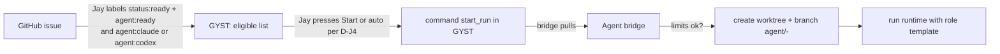
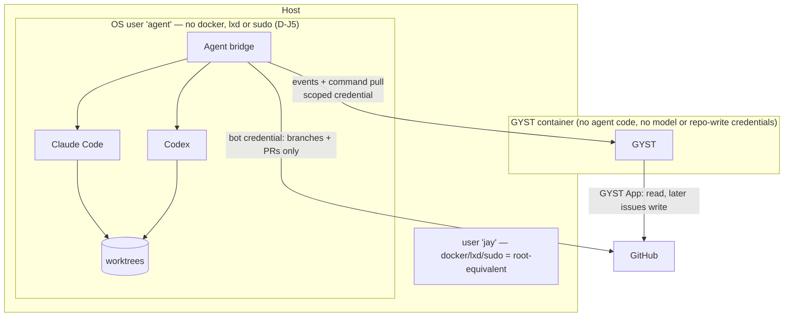

# Stage 5B — Agent Orchestration Architecture

- **Stage:** 5, agents (see `06` for the umbrella architecture and Decisions D-J1–D-J8)
- **Date:** 2026-09-27
- **Evidence rule:** capabilities are stated only from local CLI help output
  (installed versions) or primary documentation. Anything else is **UNKNOWN**.
- **Nothing installed, configured or credentialed.**

Capability labels: **SUPPORTED** · **SUPPORTED VIA CLI WRAPPER** ·
**SUPPORTED VIA LOCAL ADAPTER** · **REQUIRES CUSTOM ORCHESTRATOR** · **UNKNOWN**.

---

## A. Agent terminology

These are separate things and must not be conflated:

| Term | Meaning | Examples |
|---|---|---|
| **Model provider** | The company or API serving the model | Anthropic, OpenAI |
| **Agent runtime** | The CLI program that runs an agent loop with tools | Claude Code, Codex CLI |
| **Agent session** | One running or saved runtime instance (a process or background session) | a `claude --bg` session; a `codex exec` process |
| **Orchestrator** | Decides *which* work runs, *where*, *when*; tracks execution | herdr (visibility and control), a custom dispatcher |
| **Agent bridge** | GYST's host-side adapter: translates orchestrator and CLI state into GYST events, and pulls approved commands | (to be built) |
| **Run** | One attempt by one agent on one issue in one worktree (GYST's unit of tracking) | "Codex · GYST#41 · run 2" |
| **Role / profile** | A fixed configuration of runtime, flags, tools, prompt and limits | *implementer*, *reviewer* |
| **Agent** (UI) | The user-facing name: runtime plus role | "Claude (implementer)", "Codex (reviewer)" |

The UI uses **Agent** and **Run** (`05` §X). "Session" is reserved for Learn.

## B. Claude integration reality

Installed: **Claude Code 2.1.283** (`~/.local/bin/claude`, user `jay`). From `claude --help`:

| Capability | Status | Evidence / mechanism |
|---|---|---|
| Non-interactive run with a prompt | **SUPPORTED VIA CLI WRAPPER** | `-p/--print`; `--output-format` (json / stream-json); `--input-format` |
| Structured final result | **SUPPORTED VIA CLI WRAPPER** | `--json-schema` |
| Progress events while running | **SUPPORTED VIA CLI WRAPPER** | `--output-format stream-json`, `--include-partial-messages`, `--include-hook-events` |
| Background session with id | **SUPPORTED VIA CLI WRAPPER** | `--bg/--background` prints an id |
| List active sessions | **SUPPORTED VIA CLI WRAPPER** | `claude agents --json` (`--all` includes completed) |
| Read recent output | **SUPPORTED VIA CLI WRAPPER** | `claude logs <id>` |
| Stop | **SUPPORTED VIA CLI WRAPPER** | `claude stop <id>` (conversation kept) |
| Resume / restart | **SUPPORTED VIA CLI WRAPPER** | `--resume`, `claude attach`, `claude respawn` |
| **Pause** | **UNKNOWN** (no pause command) | Stop plus resume is the available substitute |
| Isolated worktree | **SUPPORTED VIA CLI WRAPPER** | `-w/--worktree [name]` |
| Tool and permission restriction | **SUPPORTED VIA CLI WRAPPER** | `--allowedTools`, `--disallowedTools`, `--tools`, `--permission-mode`, `--restricted`, `--settings` |
| Spend cap | **SUPPORTED VIA CLI WRAPPER** | `--max-budget-usd` |
| Deterministic config (no user hooks or memory) | **SUPPORTED VIA CLI WRAPPER** | `--bare` (API-key auth only), `--safe-mode`, `--setting-sources` |
| Code review mode | **SUPPORTED VIA CLI WRAPPER** | A review prompt via `-p`; custom `--agents` definitions; `ultrareview` is cloud-hosted and billed, so not for automation |
| Start from a PR | **SUPPORTED VIA CLI WRAPPER** | `--from-pr` |
| Programmatic SDK | **UNKNOWN locally** (the Claude Agent SDK is documented by Anthropic; not installed here) | Not needed for the first design |
| Remote job-control API / daemon over network | **UNKNOWN / not present** | `--remote-control` and `--cloud` exist but are interactive/cloud features, not a local job API |

## C. Codex integration reality

Installed: **Codex CLI 0.154.0** (`~/.local/bin/codex`). From `codex --help` and `codex exec --help`:

| Capability | Status | Evidence / mechanism |
|---|---|---|
| Non-interactive run | **SUPPORTED VIA CLI WRAPPER** | `codex exec [PROMPT]` (stdin supported) |
| Machine-readable events | **SUPPORTED VIA CLI WRAPPER** | `codex exec --json` |
| Structured final result | **SUPPORTED VIA CLI WRAPPER** | `--output-schema <FILE>`, `-o/--output-last-message` |
| Sandbox policy | **SUPPORTED VIA CLI WRAPPER** | `-s read-only | workspace-write | danger-full-access` |
| Isolated worktree | **SUPPORTED VIA CLI WRAPPER** | `--worktree`, `-C/--cd` |
| Code review | **SUPPORTED VIA CLI WRAPPER** | `codex review`, `codex exec review` |
| Resume / fork | **SUPPORTED VIA CLI WRAPPER** | `codex exec resume`, `fork` |
| Session list / daemon | **SUPPORTED VIA LOCAL ADAPTER — experimental** | `codex app-server daemon`, `codex agents` ("shared local app-server daemon"); protocol schema via `app-server generate-json-schema` |
| Remote control | **Experimental; not recommended** | `codex remote-control start/pair` |
| Stop | **SUPPORTED VIA CLI WRAPPER** | Terminate the `codex exec` process (the bridge owns the process) |
| **Pause** | **UNKNOWN** | Not in the help output |
| Existing use on this host | Evidence | `scripts/codex-build.sh` ran `codex exec --sandbox workspace-write` / `--ask-for-approval never` |

**Assessment:** both runtimes can be driven **reliably as child processes** of
a local adapter with structured output. Neither offers a stable, authenticated
network API for job control. The experimental Codex app-server isn't a
foundation to build on yet.

## D. Herder / Herd / orchestrator reality

**Nothing named Herder, herd or herdr is installed** (`command -v`, filesystem search).
Public research found several different tools under similar names:

| Tool | What it is (per its documentation) | Relevant capabilities | Limits |
|---|---|---|---|
| **herdr** (`ogulcancelik/herdr`, herdr.dev) | A terminal multiplexer for AI coding agents | **Local socket API** (Unix socket, newline-delimited JSON): `agent.list/get/read/prompt/start/wait`; states `working · blocked · idle · done · unknown`; `events.subscribe`; `worktree.create/list/remove`; plugins | **No authentication** beyond socket file permissions; **no remote/HTTP API**; **no task queue, no PR operations** |
| "herd" projects (e.g. worktree-isolated, merge-queued runners; a head-agent delegator for herdr; `herd-core` adapters) | Various orchestration experiments | Parallel runs, worktrees, some merge queues | Not evaluated; maturity UNKNOWN |
| herdctl | Runs Claude Code agents on schedules and webhooks | Scheduling | Claude-centric |

**What an orchestrator must provide versus what exists:**

| Need | herdr | CLIs alone | Status |
|---|---|---|---|
| See which agents are working, blocked or done | ✔ (socket) | Partly (`claude agents --json`; Codex process state) | **SUPPORTED VIA LOCAL ADAPTER** |
| Start an agent with a prompt in a worktree | ✔ (`agent.start`, `worktree.create`) | ✔ (flags) | **SUPPORTED VIA LOCAL ADAPTER / CLI WRAPPER** |
| Queue of approved issues → next run | ✘ | ✘ | **REQUIRES CUSTOM ORCHESTRATOR** |
| Issue ↔ run ↔ branch ↔ PR linkage | ✘ | ✘ | **REQUIRES CUSTOM ORCHESTRATOR** |
| Hand-off implementer → reviewer | ✘ (agents can prompt each other, but it's unstructured) | ✘ | **REQUIRES CUSTOM ORCHESTRATOR** |
| Concurrency, budget and time limits | ✘ | Budget flag (Claude) | **REQUIRES CUSTOM ORCHESTRATOR** |
| Authenticated remote control | ✘ | ✘ | **Not provided; must not be exposed** |

**Conclusion:** the boundary "GYST → orchestration API → workers" is right, but
**no existing tool on the host provides the orchestration API**. The smallest
correct design is a **GYST agent bridge**: a small host-side program owning
dispatch, limits and linkage, using the CLIs directly and **optionally** herdr
for visibility. This is decision **D-J1**.

## E. Provider abstraction

Don't model per-*model* providers. GYST talks to **one orchestration provider
interface**, implemented by the bridge. Capabilities are declared, not assumed.

```text
OrchestratorProvider (GYST side; data arrives by push, commands leave by pull)
  Capabilities() -> {list_runs, run_detail, recent_activity, start_run, stop_run, request_review, pause_run=false}
  // Inbound (bridge → GYST machine API, scope events:agent)
  ReportHeartbeat(bridge_id, agents[])            // runtime availability: idle/busy/unavailable
  ReportRun(run)                                  // create/update run snapshot
  ReportActivity(run_id, bounded_events[])        // last N summarised events, no transcripts
  // Outbound (bridge pulls, scope commands:agent.read / commands:agent.ack)
  PendingCommands(bridge_id) -> [start_run | stop_run | request_review]
  AckCommand(command_id, result)
```

| Method in the suggested interface | Kept? | Why |
|---|---|---|
| `ListAgents()` | ✔ as the heartbeat's `agents[]` | Runtime availability (Claude/Codex installed, logged in, busy) |
| `GetAgent()` | Derived | From heartbeat and runs |
| `GetJob()` | ✔ as the run snapshot | |
| `StartJob()` | ✔ as the command `start_run` | Only for issues labelled `agent:ready` (D-J4) |
| `StopJob()` | ✔ as the command `stop_run` | Kills or stops the session; the worktree is kept |
| `GetRecentActivity()` | ✔ bounded | Summarised events (tool used, file changed, test run), max N, redacted |
| `Pause` | **✘ not offered** | Neither runtime supports it (UNKNOWN) |

## F. Job (Run) model

```text
agent_runs (GYST snapshot; bridge is authoritative)
  run_id          text pk     -- bridge-generated
  issue_ref       text        -- 'JayDalool/gyst-lifeops#41'
  role            text        -- implementer | reviewer
  runtime         text        -- claude | codex
  state           text        -- queued | working | needs_input | needs_review | done | failed | cancelled
  worktree        text        -- path label only (no host details in the UI)
  branch          text
  pr_ref          text null
  started_at, updated_at, finished_at
  last_error      text null   -- one-line summary
  cost_usd        real null   -- when the runtime reports it
```

| State | Entered when | Attention |
|---|---|---|
| queued | Bridge accepted a `start_run` | — |
| working | Runtime process started | Today live chip only (not Attention) |
| needs_input | Runtime is blocked on a question or permission (herdr `blocked` state, or a structured result requesting input) | **needs_action** |
| needs_review | Implementer finished, PR opened, reviewer finished | **needs_action** (the review Decision) |
| done | PR merged or issue closed | resolves |
| failed | Non-zero exit, timeout, budget exceeded, tests failed after retries | **warning** (critical on repeat) |
| cancelled | Stopped by Jay | resolves |

## G. Task assignment



- **Eligibility is visible in GitHub** (labels), so the intent is auditable
  outside GYST.
- **Limits enforced by the bridge:** max concurrent runs (default 1),
  max wall time, max budget (Claude flag or bridge timer), max retries (1).
- **Role templates are fixed files** in the bridge's config (runtime, flags,
  allowed tools, sandbox, prompt skeleton). GYST selects a template by name; it
  never sends arbitrary shell or flags.
- **Prompt content** = issue title, body and acceptance criteria (fetched by the
  bridge from GitHub with its own credential), plus the repo's `AGENTS.md`/`CLAUDE.md`.

## H. Branch / PR lifecycle

```mermaid
sequenceDiagram
    participant J as Jay (GYST)
    participant GH as GitHub
    participant G as GYST
    participant B as Agent bridge
    participant I as Implementer (Codex or Claude)
    participant R as Reviewer (the other runtime)
    J->>GH: label issue status:ready + agent:ready (via GYST or GitHub)
    GH-->>G: webhook → issue snapshot (eligible)
    J->>G: Start (or auto, D-J4)
    G->>G: create command start_run(issue, implementer)
    B->>G: pull commands
    B->>GH: set status:in-progress (bot)
    B->>B: worktree + branch agent/41-fix-timezone
    B->>I: run with role template (sandboxed, isolated user)
    I-->>B: stream events / result JSON
    B->>G: ReportRun(working → …), ReportActivity
    B->>B: run repo checks (tests) in the worktree
    B->>GH: push branch, open draft PR "Closes #41" (bot)
    B->>R: review run on the PR branch (read-only sandbox)
    R-->>B: review summary
    B->>GH: post review comment; mark PR ready; set status:review
    GH-->>G: webhooks (PR, checks)
    G->>G: Attention needs_action "Review #218"
    J->>GH: review and merge (branch protection: Jay's approval required)
    GH-->>G: PR merged, issue closed → run done, Attention resolved
```

- Branch naming: `agent/<issue-number>-<slug>`; one branch per run.
- **Draft PR first**, marked ready only after tests and the reviewer run.
- **Tests run in the worktree by the bridge** (the repo's documented check
  command). Results are summarised in the PR body.
- **Worktree cleanup** after merge or cancel, by the bridge.

## I. Review lifecycle

| Step | Actor | Record |
|---|---|---|
| Implementer finishes | Bridge | Run `needs_review` pending reviewer |
| Secondary review | **Different runtime** than the implementer (Codex reviews Claude and vice versa) in a read-only sandbox | PR review comment ("Agent review: pass / concerns") |
| Human review | **Jay** | GitHub review. GYST shows the summary and "Open in GitHub". |
| Changes requested | Jay | Optional "Re-run implementer with review feedback" command (new run on the same branch) |
| Merge | **Jay only** | Branch protection enforces it. GYST offers no merge action. |

The self-review rule from `docs/RULES.md` §7 ("a review by the same agent that
wrote the code is not independent") becomes structural here.

## J. Agent telemetry

| Shown in GYST | Source | Stored? |
|---|---|---|
| Agent availability (Claude/Codex: available, busy, logged out) | Bridge heartbeat | Latest only |
| Run state, elapsed, issue, repo, branch, PR | Run snapshot | Yes (snapshot) |
| Recent actions (≤ 20 summarised events: "ran tests", "edited 3 files") | Bridge summary of stream events / herdr state | Latest N only |
| Errors | One-line `last_error` | Yes |
| Logs | **On demand**, bounded (e.g. last 200 lines), redacted by the bridge, **tailnet only** | No |
| Cost | Runtime-reported | Yes, where available |

Example target UI (from the brief), mapped: "Claude ● Working · SAM-142 · 18m" =
runtime + run state + issue ref + elapsed; "Codex ○ Idle" = heartbeat;
"Reviewer ● Reviewing PR #218" = reviewer-role run.

## K. Human approvals

| Action | Approval |
|---|---|
| Make an issue eligible for agents | Jay adds `agent:ready` (in GitHub or GYST) |
| Start a run | Automatic within limits **or** per-run Start (D-J4) |
| Stop a run | Jay (any time) |
| Re-run after review | Jay |
| Merge | Jay, in GitHub |
| Change role templates, limits or credentials | Jay, **outside GYST** (bridge config on host), audited in git |
| Anything touching production (deploy, migrations, server actions) | **Never an agent capability** in this design |

## L. Security boundaries



| Boundary | Rule |
|---|---|
| **Process isolation** | Agents never run inside the GYST process or container (parent `AGENTS.md` §19) |
| **OS identity** | Agents run as a **dedicated user without `docker`, `lxd` or `sudo`**. Today's `jay` is root-equivalent (`id -nG` shows docker, lxd, sudo), so agents run as `jay` can reach the Docker socket. |
| **Filesystem** | Worktrees under an agent-owned directory. No access to `/srv/server/repos/*/data`, `.env` files, `/srv/server/private` or production checkouts. |
| **Sandboxes** | Codex `--sandbox workspace-write` (implementer) and `read-only` (reviewer). Claude `--permission-mode` plus `--allowedTools` allow-list. **Never** `--dangerously-*` flags outside an externally sandboxed environment. |
| **Credentials** | Model credentials and the GitHub **bot** credential live only in the agent user's environment. GYST holds neither. The bot can push branches and open PRs but **can't merge** (branch protection). |
| **Network** | The bridge makes outbound calls only (GitHub, model APIs, GYST internal endpoint). No listening port. |
| **Command surface** | GYST can request only `start_run(issue, role)`, `stop_run(run)`, `request_review(pr)`. Payloads contain references, never shell. |
| **Data exposure** | Logs are redacted and bounded, and only visible via the tailnet hostname (D-J7). |
| **Production** | Agents have no deploy, migration or production-DB capability (RULES §3.1) |
| **herdr (if adopted)** | Its socket is unauthenticated: run it under the agent user, socket mode 0600, never exposed |

## M. What is currently impossible or unknown

| Item | Status |
|---|---|
| Authenticated network job-control API for Claude Code or Codex | **Not available** (only local CLI; Codex app-server is experimental) |
| Pausing a run | **UNKNOWN / unsupported** (stop + resume only) |
| Which "Herder" Jay intends | **UNKNOWN** (D-J1) |
| herdr behaviour on this host (hooks vs screen detection accuracy for Claude/Codex) | **UNKNOWN** until trialled |
| Reliable detection of "needs input" in headless runs | **Partly UNKNOWN.** Structured-result conventions or herdr `blocked` state need a trial. |
| Separate agent-user logins for Claude/Codex subscriptions vs API keys | **UNKNOWN** (account and licensing question for Jay; `--bare` requires an API key) |
| Cost reporting from Codex | **UNKNOWN** |
| GitHub native issue dependencies via REST for this account | **UNKNOWN**. The fallback is "Blocked by #n" in the body. |

---

### Sources (primary documentation consulted)

- herdr documentation and socket API: [herdr.dev/docs](https://herdr.dev/docs/), [herdr.dev/docs/socket-api](https://herdr.dev/docs/socket-api/)
- herdr repository: [github.com/ogulcancelik/herdr](https://github.com/ogulcancelik/herdr/tree/master)
- Other "herd" tools surfaced by search (not evaluated): [herdr-orchestrate](https://github.com/alexhooi/herdr-orchestrate), [Talya1412/herd](https://github.com/Talya1412/herd), [vladzima/herd](https://github.com/vladzima/herd), [herd-agent-claude](https://github.com/herd-ag/herd-agent-claude), [herdctl](https://github.com/edspencer/herdctl), [cli-agent-orchestrator](https://github.com/awslabs/cli-agent-orchestrator)
- Local: `claude --help`, `claude agents|logs|stop --help` (2.1.283); `codex --help`, `codex exec --help`, `codex app-server|agents|remote-control|review --help` (0.154.0)
