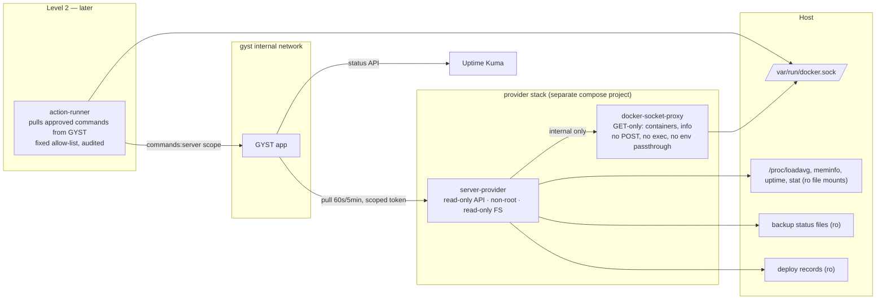
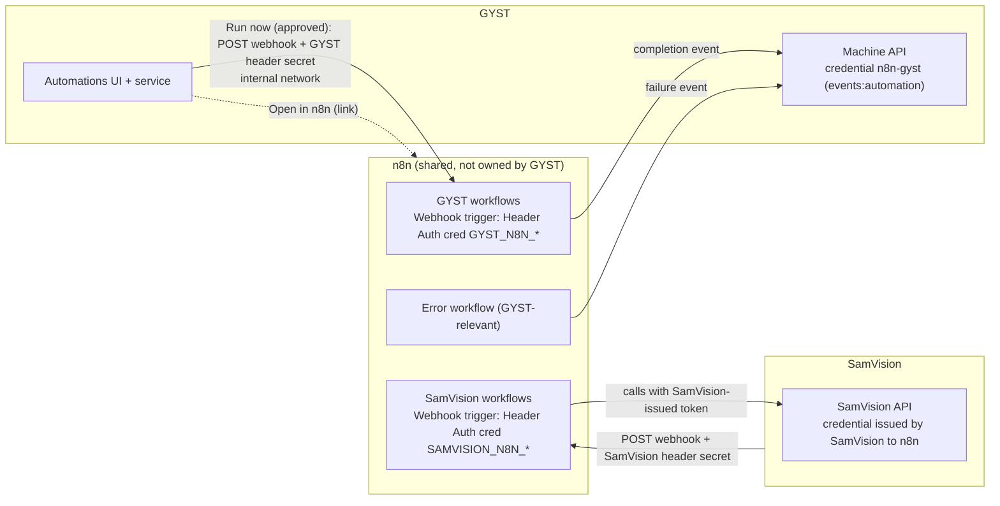

# Stage 5C — Server, Automation and App Architecture

- **Stage:** 5, System domain (see `06` for the umbrella architecture and Decisions D-J1–D-J8)
- **Date:** 2026-09-27
- **Binding inputs:** `05A` (D6 System under More / desktop secondary group; D9
  quiet healthy status). Stage 2A findings S2-01…S2-21.
- **Nothing installed, configured, exposed or credentialed.**

## Host facts relevant to this design (read-only evidence)

| Fact | Evidence |
|---|---|
| 17 containers incl. gyst-lifeops, gyst-caddy, n8n (+postgres), samvision-web (+postgres), fms-*, myfamilyexpenses-*, uptime-kuma, portainer, nginx-proxy-manager, cloudflared, minecraft | `docker ps` |
| Healthchecks defined on 10 of 17 containers; **not** on gyst-lifeops, gyst-caddy, cloudflared, fms-web/api, nginx-proxy-manager, portainer, myfamilyexpenses-app | `docker inspect` |
| Only **portainer** mounts `docker.sock` (as a "read-only" bind) | `docker inspect` |
| `jay` ∈ `docker`, `lxd`, `sudo` | `id -nG` |
| Scheduled backups (user crontab): FMS + MyFamilyExpenses Postgres 03:30 (14-day retention); SamVision 04:00 with **Uptime Kuma push heartbeat** and a `last_run.json`; **no GYST backup**; n8n Postgres backup schedule **not found** | `crontab -l`, `/srv/server/backups` |
| `deploy-repo.sh`: `git pull --ff-only && docker compose up -d --build`; no deploy record | script |
| Uptime Kuma, Portainer, SamVision bound to `127.0.0.1` only; n8n and GYST reached via proxy/Cloudflare; GYST tailnet port 3443 bound on all interfaces (S2-08) | `docker inspect`, `ss` |
| Health endpoints: SamVision `/api/v1/health`, n8n `/healthz`, Kuma built-in | container healthcheck definitions |

---

## A. Server visibility

What GYST should show, by level of detail (D6/D9: quiet when healthy):

| Level | Content |
|---|---|
| 0 (Today / sidebar dot) | Nothing when healthy (D9). On problems: "Server degraded", "n8n down", "GYST backup 3 days old". |
| 1 (System → Server) | Host: uptime, load, CPU %, memory %, disk % per mount, **Services** list (name, state, health, restarts, uptime), **Backups** summary, **Certificates/domains** summary, last deploy per app |
| 2 (Service detail) | State history (recent transitions), health check result, image/tag, last deploy (SHA, time), links (Open app, Open in Portainer), **allowed actions** |
| 3 | Bounded logs (tailnet only), external tools |

## B. Server-provider architecture

**Principle:** GYST never gets host or Docker privileges. A separate, minimal
**server provider** gathers facts and exposes a small, authenticated,
**read-only** API that GYST **pulls** over an internal channel. Controlled
actions (Level 2) are a **separate component** with its own allow-list.

| Need | Minimal access |
|---|---|
| CPU, load, memory, uptime | Read-only bind of **specific** `/proc` files (not all of `/proc`: `/proc/<pid>/cmdline` exposes secrets such as the cloudflared token passed as an argument) |
| Disk usage | `statfs` on read-only mounts of the relevant paths |
| Container list, state, health, restart count, image | Docker API **GET** `/containers/json` and `/containers/{id}/json` via a filtering socket proxy. The provider returns only allow-listed fields and **never environment variables** (they contain secrets). |
| Backup state | Read-only mounts of backup status files (per-job `last_run.json` convention) |
| Last deploy | Read-only mount of a deploy-record directory (written by the deploy script, see §E) |
| Availability and cert expiry | **Uptime Kuma** (already running and monitoring). GYST reads its status rather than duplicating checks. |
| Logs (Level 3) | Docker GET `/containers/{id}/logs` for **allow-listed** containers, bounded tail, redacted (§F) |
| Actions (Level 2) | Not in the provider. A separate action runner (§E). |

**Provider API (read-only, for design review):**
`GET /v1/host` · `GET /v1/services` · `GET /v1/services/{name}` · `GET /v1/backups` ·
`GET /v1/deploys` · (Level 3) `GET /v1/services/{name}/logs?tail=200`.
Authentication: a GYST-held credential scoped `server:read`, over the internal
network only. The provider is not reachable from Caddy's public vhost or the host's LAN.

**Why not simpler alternatives:**

| Alternative | Verdict |
|---|---|
| Mount `docker.sock` into GYST | **Reject**: root-equivalent inside an internet-facing app (§C) |
| Use Portainer's API with a token | **Reject** for GYST: Portainer holds unrestricted socket access, and a Portainer admin token is equivalent to root |
| Run the provider as `jay` on the host | **Reject**: `jay` is in docker, lxd and sudo, so any provider bug would be root |
| Only Uptime Kuma, no provider | **Acceptable Phase-1 subset** (availability and certs only); lacks disk, memory, containers and backups |

## C. Docker security

- **Access to `/var/run/docker.sock` is root on the host.** Through the API a
  caller can start a privileged container with the host filesystem mounted.
- **Mounting the socket `:ro` doesn't help.** Read-only applies to the
  socket *file*, not to the API calls made over it. Portainer's "read-only" mount
  still grants full control (that's how Portainer works).
- **Container inspect exposes secrets:** `/containers/{id}/json` returns each
  container's environment (e.g. database passwords, tokens). Anything that can
  inspect containers can read those secrets.
- **Design rules:**
  1. GYST **never** mounts the socket and never talks to the Docker API directly.
  2. Level 1 goes through a **GET-only filtering proxy** reachable only by the provider on a private network. The provider strips everything except allow-listed fields.
  3. Level 2 goes through a separate **action runner** with a fixed action allow-list; it's the only new component with write access, and it has no inbound listener (pull model).
  4. Consider later whether Portainer needs its socket access at all times (outside GYST scope; noted).
  5. The `docker` and `lxd` group membership of `jay` is an existing root-equivalence to keep in mind for agents (D-J5).

## D. Read-only metrics

| Metric | Source | Freshness | Attention rule (default) |
|---|---|---|---|
| Disk % per mount | provider (statfs) | 5 min | warning ≥ 85%, critical ≥ 95% |
| Memory % / swap | provider (/proc/meminfo) | 1–5 min | warning if > 90% for 15 min |
| Load / CPU | provider | 1–5 min | display only (no Attention by default) |
| Uptime / reboot | provider | 5 min | info on unexpected reboot |
| Service state and health | provider (Docker GET) + Kuma | 1–5 min | critical if a critical service is down > 5 min; warning if unhealthy |
| Restart loops | provider (restart count delta) | 5 min | warning |
| Certificate expiry | Kuma | daily | warning < 14 d, critical < 3 d |
| Missing healthchecks | provider | daily | info (10 of 17 have one today) |

Metrics history: keep **latest values plus a small ring buffer** (e.g. 24 h at 5-min
resolution) in SQLite if trends are wanted. No time-series database.

## E. Controlled actions (Level 2)

| Action | Allowed initially? | Notes |
|---|---|---|
| Restart an **allow-listed** service (n8n, samvision-web, gyst-lifeops) | Yes, after gates | `docker restart <name>` by name from the runner's own allow-list |
| Run a backup job (GYST, Postgres set) | Yes, after gates | Invokes the same script or command the schedule uses |
| Redeploy an approved app | **Later** | Wraps `deploy-repo.sh` with a pinned branch and a recorded SHA; requires CI green |
| Stop, remove, prune, `exec`, pull arbitrary images | **Never** from GYST | Portainer or SSH |
| Anything on GYST's own database | **Never** (RULES §3.1) | Operator-only |

**Action runner design:**
- Runs on the host (systemd service or container) with Docker access. It's the
  one privileged component, so its surface is kept tiny.
- **Pulls** approved commands from GYST (`commands:server` scope). There's no inbound port.
- Validates every command against a **root-owned allow-list file** on the host.
  GYST can only name an action ID and target, never a shell string.
- Reports the result to GYST, and everything is audited in GYST's audit log.
- **Human confirmation in GYST**, tailnet-only (D-J7), with a step-up re-auth.

**Deploy record (design, not implemented):** extend the deploy procedure to
write `deploys/<app>.json` (`repo, sha, branch, image_id, started_at,
finished_at, result`). This fixes Stage 2A S2-14 (untraceable deploys) and
feeds "last deployment".

## F. Logs

| Rule | Detail |
|---|---|
| Scope | Allow-listed containers only |
| Size | Bounded tail (e.g. 200 lines / 64 KB), no streaming in the first version |
| Redaction | Provider-side patterns (bearer tokens, `password=`, API-key shapes, cookie values) before leaving the provider |
| Access | **Tailnet ingress only** (D-J7) plus step-up. Never cached in GYST's DB. |
| GYST's own logs | Depend on Stage 2A S2-05. Today GYST logs almost nothing, so there's little to show until structured logging exists. |

## G. Backup state

**Today:** FMS and MyFamilyExpenses (nightly, 14 days), SamVision (nightly,
heartbeat to Kuma, `last_run.json`), **GYST: none scheduled**, **n8n Postgres:
no schedule found**. All backups sit on the same host.

**Target model (design):**

| Element | Design |
|---|---|
| Convention | Every backup job writes `last_run.json` (`job, started_at, finished_at, result, size_bytes, location, verified`) and pings an Uptime Kuma **push** monitor on success (the pattern SamVision already uses) |
| GYST backup | A scheduled `lifeops backup` (VACUUM INTO + integrity check, already implemented) → status file → Kuma push |
| Off-host copy | A second location off this machine (another tailnet device or storage), with retention (e.g. 7 daily, 4 weekly, 6 monthly) |
| Restore | A documented runbook plus a **periodic restore test** into a scratch location (integrity check + row counts), recorded as its own status file |
| GYST display | System → Backups: per job last success, age, size, off-host copy state, last restore test. Attention: warning > 36 h, critical > 72 h, critical if the restore test is older than 90 days (defaults, adjustable). |
| Run now | Level-2 action (§E) |

## H. n8n architecture

| Topic | Design |
|---|---|
| Ownership | n8n is shared infrastructure. GYST shows GYST-relevant automations and links to the editor. |
| **Per-app identity** | n8n API keys are **full-access on non-Enterprise editions** (docs), so **per-app scoping is done at the workflow boundary**: each app's triggers are Webhook nodes using **that app's own Header-Auth credential** (`GYST_N8N_*` vs `SAMVISION_N8N_*`). No universal shared secret. A GYST secret can't trigger SamVision workflows, and vice versa. |
| n8n → GYST | Each GYST-relevant workflow (and a GYST error workflow) posts events to GYST's machine API with the **GYST-issued** `n8n-gyst` credential (scope `events:automation`) |
| GYST → n8n | Only "Run now" for workflows in a GYST allow-list (id → webhook path), over the **internal network** (not the public n8n URL), tailnet-only in the UI, confirmed and audited |
| n8n API key in GYST | **Not by default** (D-J6). If execution history via API is wanted later, the key is full-access; it would be stored server-side only and used read-only by code. |
| Status shown | name, state (Healthy / Failed / Disabled / Running), last run and result, last error summary, next run (known from GYST's allow-list config for scheduled flows), Run now, Open in n8n |
| Availability | `/healthz` via internal network and/or Kuma |
| Editor | Never embedded; "Open in n8n" only |
| Not in scope | n8n's own public exposure and hardening (a separate audit item; noted) |

## I. SamVision boundary

| Phase | Integration | Mechanism |
|---|---|---|
| Now-next | **Launch** from the Apps registry; **health** tile | Registry URL; `/api/v1/health` (internal) or Kuma monitor |
| Later | Selected summary (e.g. "3 tenants active, last pipeline run OK") | A **SamVision-owned read-only API** endpoint with a SamVision-issued, GYST-scoped token |
| Development | SamVision issues and PRs via the GitHub integration (`samvisionai` repo) | Same as GYST's Development area |
| Never | Reading SamVision's Postgres; sharing credentials; GYST writing SamVision data | — |

SamVision already carries agent tooling (`.claude/worktrees`, `.github/workflows`,
agents and hooks), so it's a natural second repository for the agent pipeline
once GYST's is proven.

## J. Tailscale / public boundary

| Capability | Public (`gyst.zaylolabs.com` via Cloudflare) | Tailnet (MagicDNS host) |
|---|---|---|
| Life features (Today, Health, Projects, Learn) | ✔ | ✔ |
| Development snapshots, Reviews, Attention | ✔ view | ✔ |
| System status (view) | ✔ summary | ✔ |
| GitHub write (labels, comments, create) | ✔ with step-up (lower risk, reversible) | ✔ |
| Agent start / stop | ✘ (D-J7) | ✔ step-up |
| Automation run now | ✘ | ✔ step-up |
| Server actions, logs | ✘ | ✔ step-up |
| Credential and security admin | ✘ | ✔ step-up |
| Machine endpoints `/api/machine/*` | ✘ (Caddy deny) | internal network only |
| GitHub webhooks | ✔ (HMAC) | — |

**Enforcement, in two layers:**
1. **Caddy:** the public site block denies control paths outright.
2. **App:** the tailnet site block sets a header such as `X-GYST-Ingress: tailnet`,
   and the public block strips any incoming copy of it. Control handlers require it.

Related Stage 2A items:
- **S2-08:** the tailnet listener should bind to the Tailscale address or be firewalled, so the LAN path doesn't count as "tailnet".
- **S2-01:** login throttling applies on both hosts.

## K. Console architecture

- **Default design: no console in GYST.** "Open console" is a **link-out** to
  **Tailscale SSH** (identity from the tailnet, ACL-controlled, optional
  check-mode re-authentication and session recording), usable from desktop and
  from mobile SSH clients (D-J8).
- **If a web terminal is ever wanted:** a **separate gateway** service on the
  tailnet only, with its own authentication (not GYST's session), short-lived
  sessions, a non-root target user, and session recording. GYST only links to it.
- **Never:** browser → GYST → shell, or a root shell reachable from the public domain.
- **Status:** FUTURE. Security case not yet made; Stage 2A gates first.

## L. Security gates

Prerequisites before enabling each capability. IDs refer to Stage 2A findings
and Stage 2B debt.

| Gate | Description | Source |
|---|---|---|
| G1 | Login throttling + failed-login logging on both ingresses | S2-01, S2-05 |
| G2 | **Audit log** for all state-changing control actions | `06` §I |
| G3 | **Scoped machine credentials** (hashed, rotatable, per caller) | 2B §L, `06` §I |
| G4 | Secrets and data file permissions (`.env`, `data/`, backups) | S2-04 |
| G5 | Scheduled + off-host GYST backups and a tested restore | S2-03 |
| G6 | Operational logging, `/healthz`, log rotation | S2-05 |
| G7 | **Step-up re-authentication** for control actions | new |
| G8 | Tailnet-only enforcement (Caddy deny + ingress header) and tailnet bind/firewall | S2-08, D-J7 |
| G9 | Single application clock (overdue and age-based Attention correctness) | S2-02, 2B D1 |
| G10 | Non-root containers for GYST and new components | S2-10 |
| G11 | Agents under an isolated OS user without docker/lxd/sudo | D-J5 |
| G12 | Branch protection requiring Jay's review on target repos | `07` §I |
| G13 | Outbound credentials bound to fixed hosts (no URL-derived hosts) | S2-09 |
| G14 | Service-level use cases for any non-HTML writes; no GET mutations | 2B D2, D4 |

| Capability | Required gates |
|---|---|
| Apps registry / launcher links / unauthenticated health reads | G6 (recommended) |
| GitHub **read** | G3 (webhook secret handling), G13, G6 |
| GitHub **write** | + G1, G2, G7, G14 |
| **Agent view** (bridge events) | G2, G3, G11 |
| **Agent start / stop** | + G1, G7, G8, G12, G14 |
| **Server view** | G3, G4, G6, G10 (provider), G13 |
| **Server control** (Level 2) | + G1, G2, G5, G7, G8 |
| **n8n view** (events in) | G2, G3 |
| **n8n control** (run now) | + G1, G7, G8 |
| **Remote console** | All of the above, plus a separate security review. Link-out only. |

## M. Implementation sequence

Ordered by value ÷ risk, respecting dependencies. Each step is a separate,
approved, reviewable task (RULES §2.1).

| # | Step | Why here | Gates |
|---|---|---|---|
| 0 | **Foundations:** single app clock; GYST scheduled backups + off-host + restore runbook; `/healthz` + structured logging; file permissions; login throttling | Correctness and safety for everything after | G1, G4, G5, G6, G9 |
| 1 | **Apps registry + launcher v2** (Go/Do/Capture) with links and **unauthenticated health** reads (SamVision `/api/v1/health`, n8n `/healthz`) | Immediate value, no credentials, tests the registry | G6 |
| 2 | **Attention core** with GYST-internal sources (overdue, health sync stale, GYST backup age) | Proves the single model before external sources | G9 |
| 3 | **Machine auth + audit log** | Prerequisite for any inbound events | G2, G3 |
| 4 | **Uptime Kuma read** → System status (availability, certificates) + Attention | Reuses existing monitoring; the cheapest real System view | G3 |
| 5 | **GitHub read-only** (App, webhooks, reconcile) → Development (Issues, Reviews) + review Attention | Core command-center value; read-only is low risk | G3, G13 |
| 6 | **n8n events in** → Automations view + failure Attention | Low risk; n8n pushes; no n8n key | G2, G3 |
| 7 | **Server provider (Level 1)** → metrics, services, backups, deploy records | Needs the new provider stack | G3, G4, G10, G13 |
| 8 | **Agent bridge, read-only** (heartbeats, runs) under an isolated agent user | Visibility before control | G2, G3, G11 |
| 9 | **GitHub write** (labels, comments, create issue from GYST) | Needed for dispatch intent | G1, G2, G7, G14 |
| 10 | **Agent dispatch** (start/stop, reviewer hand-off, PR lifecycle) | Highest workflow value, but needs 8 and 9 | + G8, G12 |
| 11 | **Level-2 actions** (restart allow-listed services, run backup) + **n8n Run now** | Control after visibility has proven reliable | G1, G2, G5, G7, G8 |
| 12 | **Logs** (bounded, redacted, tailnet-only) | Useful but sensitive | + G8 |
| 13 | **Console** link-out via Tailscale SSH | Much later; outside GYST | All + review |

**Differences from the expected order, and why:**
- Uptime Kuma (step 4) comes **before** GitHub because it's already running,
  needs no new privileged component, and gives an honest System view early.
- **Machine auth and audit (step 3)** come before any external source that
  pushes into GYST.
- n8n *events* (step 6) come before the server provider and agents because
  they're push-based and need no new host component.
- n8n *control* is grouped with the other Level-2 actions (step 11) because it
  shares their gates.

---

### Sources (primary documentation consulted)

- n8n API authentication (scopes on Enterprise only; key sent as `X-N8N-API-KEY`; expiration): [docs.n8n.io/connect/n8n-api/authentication](https://docs.n8n.io/connect/n8n-api/authentication)
- GitHub Apps vs tokens (short-lived tokens, per-repo install, built-in webhooks): [Deciding when to build a GitHub App](https://docs.github.com/en/apps/creating-github-apps/about-creating-github-apps/deciding-when-to-build-a-github-app)
- Fine-grained PAT permissions reference: [Permissions required for fine-grained personal access tokens](https://docs.github.com/en/rest/authentication/permissions-required-for-fine-grained-personal-access-tokens)
