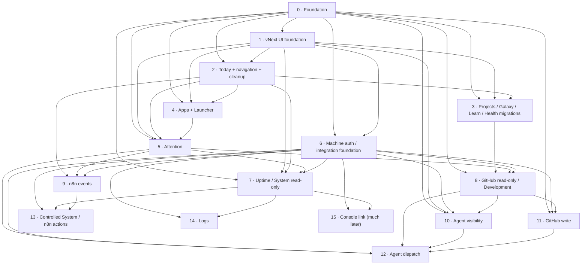
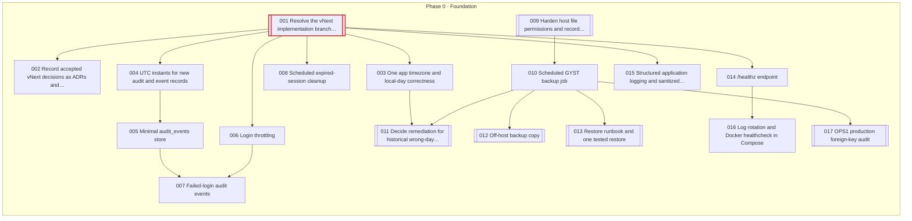
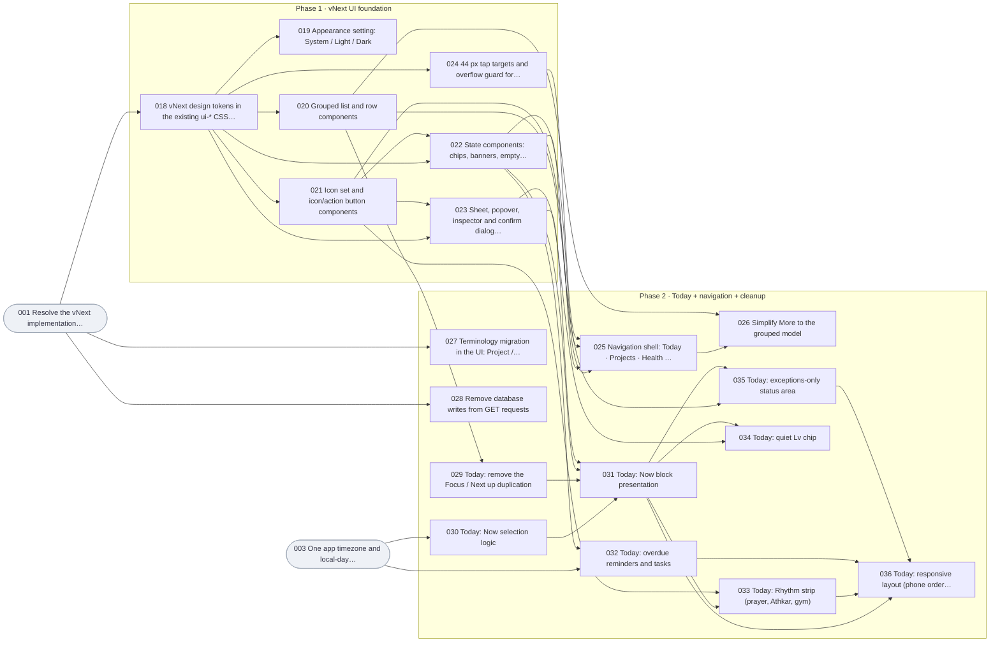
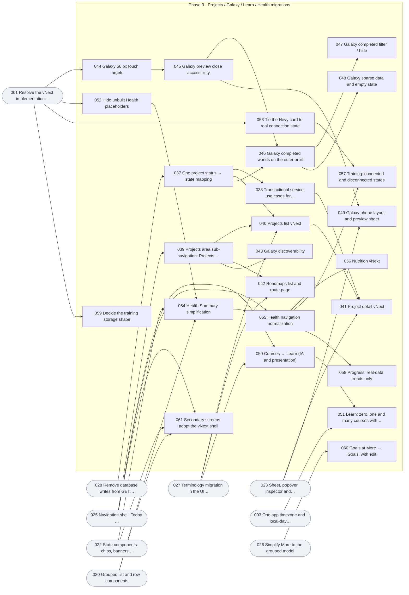
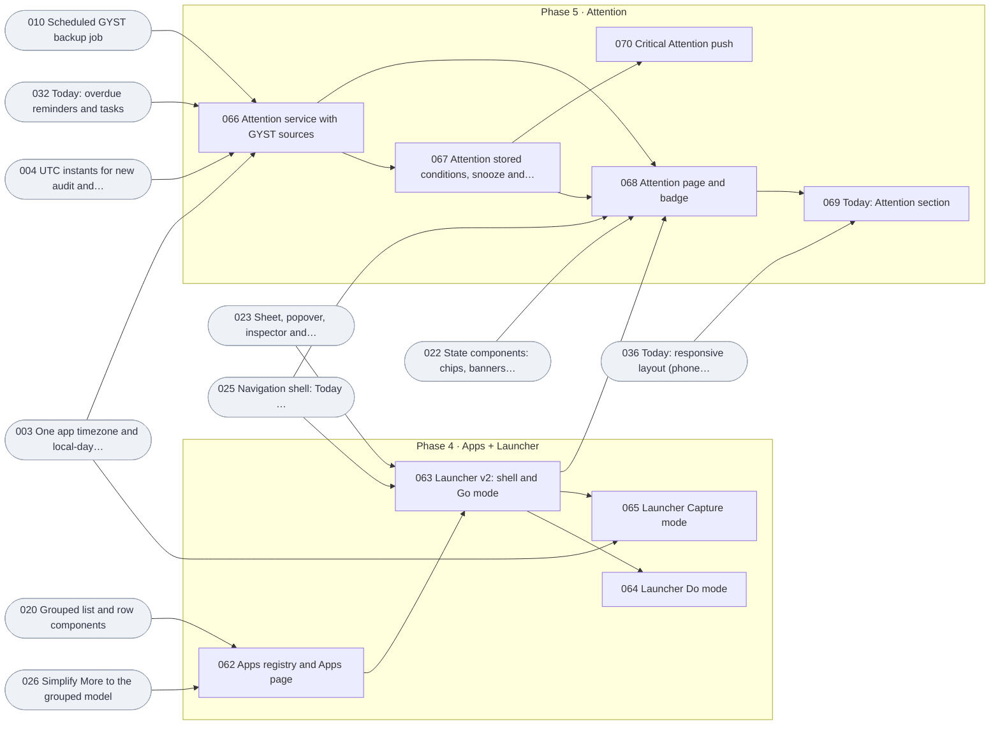
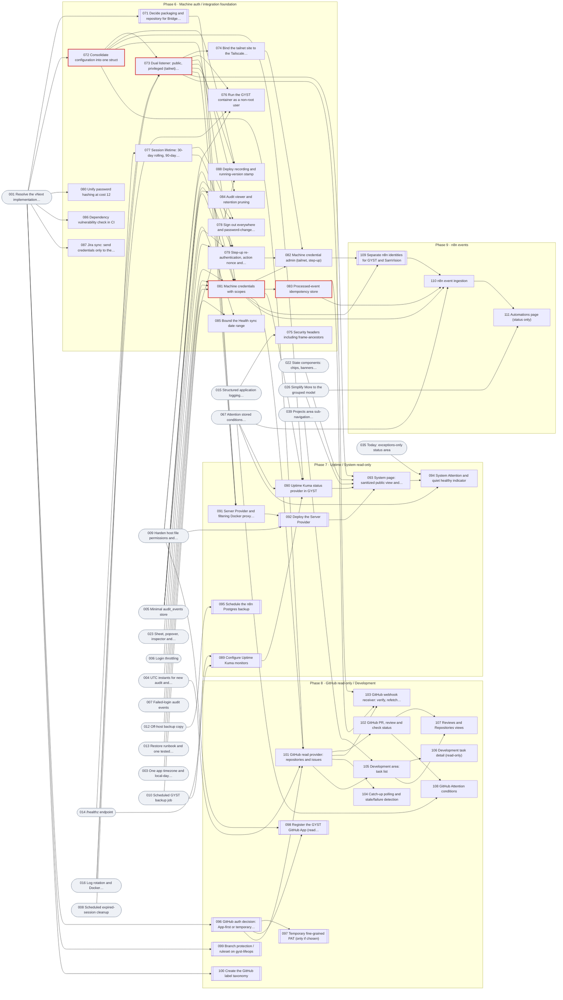
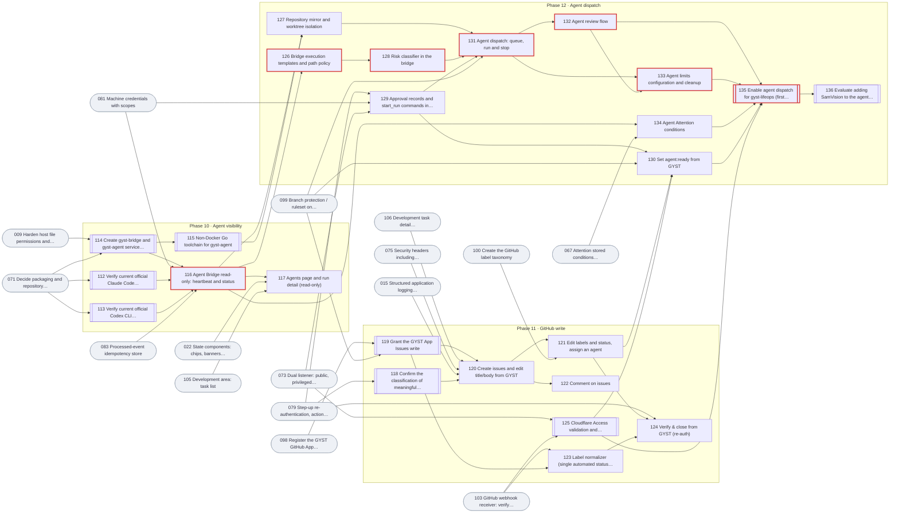
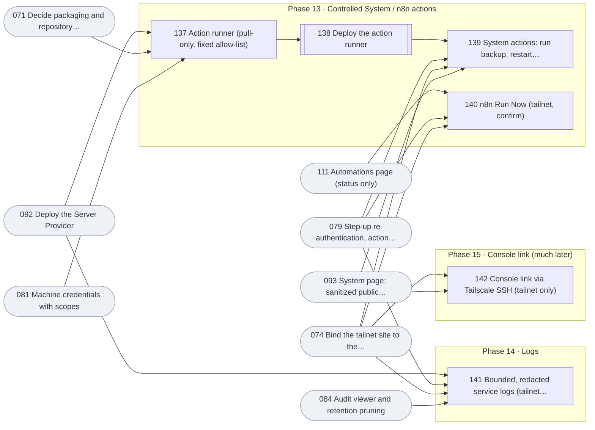

# Stage 8 — Dependency Map (vNext)

- **Recorded:** 2026-09-27 on `audit/vnext`. Planning only.
- **Source:** the DEPENDENCIES field of every task in `15_TASK_BACKLOG.md` (142 tasks). The graphs, the critical path and the hotspot table were generated from that field, so they agree with it.

---

## A. Dependency graph

### A.1 Phase level

An arrow means at least one task in the later phase depends on a task in the earlier phase.

### A.2 Task level, per milestone

Legend:
- Rounded grey nodes are dependencies in an earlier milestone.
- `[[double]]` nodes are NOT AGENT-ELIGIBLE work (Jay).
- Red-outlined nodes are on the critical path.
- Labels show the last three digits of `GYST-VN-nnn`.

### M0 — Safe foundation

### M1 — vNext core experience

### M2 — vNext Life areas

### M3 — Command centre

### M4 — Read-only integrations

### M5 — Agent-assisted development

### M6 — Controlled operations

## B. Critical path

Weights: S = 1, M = 2, L = 3. These are relative effort, not calendar time. The path is measured to the M5 outcome (agent go-live, GYST-VN-135). GYST-VN-136 is an optional P3 tail.

**Longest dependency chain (weight 23):**

1. **GYST-VN-001** Resolve the vNext implementation branch baseline (S, NOT AGENT-ELIGIBLE, Human-only)
2. **GYST-VN-072** Consolidate configuration into one struct (M, ELEVATED, Claude/Codex implementable)
3. **GYST-VN-073** Dual listener: public, privileged (tailnet) and internal machine (L, PRIVILEGED, Claude/Codex implementable)
4. **GYST-VN-081** Machine credentials with scopes (M, ELEVATED, Claude/Codex implementable)
5. **GYST-VN-083** Processed-event idempotency store (S, ELEVATED, Claude/Codex implementable)
6. **GYST-VN-116** Agent Bridge read-only: heartbeat and status (M, PRIVILEGED, Claude/Codex implementable)
7. **GYST-VN-126** Bridge execution templates and path policy (M, PRIVILEGED, Claude/Codex implementable)
8. **GYST-VN-128** Risk classifier in the bridge (M, PRIVILEGED, Claude/Codex implementable)
9. **GYST-VN-131** Agent dispatch: queue, run and stop (L, PRIVILEGED, Claude/Codex implementable)
10. **GYST-VN-132** Agent review flow (M, PRIVILEGED, Claude/Codex implementable)
11. **GYST-VN-133** Agent limits configuration and cleanup (M, PRIVILEGED, Claude/Codex implementable)
12. **GYST-VN-135** Enable agent dispatch for gyst-lifeops (first supervised runs) (S, NOT AGENT-ELIGIBLE, NOT AGENT-ELIGIBLE operational work)

**Reading it:**

- The critical path runs through the **integration foundation**:
  - config
  - the dual listener
  - machine credentials
  - idempotency
- It then runs through the **Agent Bridge chain**:
  - read-only bridge
  - templates
  - risk classifier
  - dispatch
  - review
  - limits
  - go-live
- The biggest single item on it is the dual listener (GYST-VN-073, L, PRIVILEGED). Start it as soon as CP-1 passes.
- Several **human-only** steps sit next to the path and can stall it:
  - the packaging decision (GYST-VN-071)
  - provider-auth verification (GYST-VN-112, GYST-VN-113)
  - service accounts (GYST-VN-114) and the Go toolchain (GYST-VN-115)
  - branch protection (GYST-VN-099)
  - Cloudflare Access validation (GYST-VN-125)
- Schedule those steps just ahead of need. Provider-auth verification must happen **immediately before** bridge implementation, not early (D-S2).
- The **product** path (M1–M3) is short and mostly parallel with M0's operations lane.

**Longest chain per milestone:**

| Milestone | Last task on its longest chain | Weight (S=1, M=2, L=3) | Chain (IDs) |
|---|---|---|---|
| M0 | GYST-VN-007 Failed-login audit events | 4 | 001 → 004 → 005 → 007 |
| M1 | GYST-VN-036 Today: responsive layout (phone order, desktop two columns) | 9 | 001 → 003 → 030 → 031 → 033 → 036 |
| M2 | GYST-VN-041 Project detail vNext | 11 | 001 → 018 → 021 → 022 → 025 → 039 → 040 → 041 |
| M3 | GYST-VN-069 Today: Attention section | 13 | 001 → 018 → 021 → 022 → 025 → 026 → 062 → 063 → 068 → 069 |
| M4 | GYST-VN-094 System Attention and quiet healthy indicator | 14 | 001 → 018 → 021 → 022 → 032 → 066 → 067 → 090 → 093 → 094 |
| M5 | GYST-VN-136 Evaluate adding SamVision to the agent allowlist | 24 | 001 → 072 → 073 → 081 → 083 → 116 → 126 → 128 → 131 → 132 → 133 → 135 → 136 |
| M6 | GYST-VN-139 System actions: run backup, restart allow-listed service | 15 | 001 → 072 → 073 → 091 → 092 → 137 → 138 → 139 |

## C. Parallel lanes

| Lane | Owner | Tasks, in order | Notes |
|---|---|---|---|
| L-OPS Operations | Jay (agent drafts runbooks) | GYST-VN-009, GYST-VN-010, GYST-VN-012, GYST-VN-013, GYST-VN-017 → later GYST-VN-089, GYST-VN-095, GYST-VN-099, GYST-VN-100, GYST-VN-098 | Can start **today**. GYST-VN-009 needs no other task |
| L-AUTH Auth/security backend | Agent | GYST-VN-006, GYST-VN-004, GYST-VN-005, GYST-VN-007, GYST-VN-008 → Phase 6 GYST-VN-077, GYST-VN-079, GYST-VN-078, GYST-VN-080 | `auth.go`/`middleware.go` group: strictly sequential |
| L-TIME Time and core correctness | Agent | GYST-VN-003, GYST-VN-030, GYST-VN-028, GYST-VN-037, GYST-VN-038 | `lifeops.go`/`handlers.go` group; don't run with L-OBS |
| L-OBS Observability | Agent | GYST-VN-014, GYST-VN-015, GYST-VN-016 | `handlers.go`/`middleware.go`: run after GYST-VN-006, and not at the same time as GYST-VN-003 |
| L-UI UI foundation → shell | Agent | GYST-VN-018, GYST-VN-019, GYST-VN-020, GYST-VN-021, GYST-VN-022, GYST-VN-023, GYST-VN-024 → GYST-VN-025, GYST-VN-026 | Shared CSS/gallery: one at a time |
| L-TODAY Today | Agent | GYST-VN-029, GYST-VN-031, GYST-VN-032, GYST-VN-033, GYST-VN-034, GYST-VN-035, GYST-VN-036 → GYST-VN-069 | Single file group: one at a time |
| L-SCREENS Independent screens | Agent | GYST-VN-052, GYST-VN-053 → GYST-VN-054, GYST-VN-055, GYST-VN-056, GYST-VN-057, GYST-VN-058; GYST-VN-050, GYST-VN-051; GYST-VN-060 | Health tasks are sequential among themselves |
| L-GALAXY Galaxy | Agent | GYST-VN-044, GYST-VN-045, GYST-VN-043, GYST-VN-046, GYST-VN-047, GYST-VN-048, GYST-VN-049 | `galaxy.js` group: one at a time. GYST-VN-044 can start immediately |
| L-INT Integrations | Agent + Jay | Phases 6–9 in order | After CP-1 |
| L-AGENT Agent Bridge | Agent + Jay | Phases 10 and 12 | After CP-5; bridge code lives in the repository chosen by GYST-VN-071 |

**Safe to start in parallel immediately** (after GYST-VN-001): GYST-VN-003, GYST-VN-006, GYST-VN-004, GYST-VN-018, GYST-VN-052, GYST-VN-044, and Jay's GYST-VN-009 (host only; it can start even before GYST-VN-001). No shared files between these tasks (checked by the generator against each task's RELEVANT FILES).

**Recommended concurrency:**
- At most two agent implementation sessions at once, on different lanes, with no shared file in the hotspot table.
- Jay's operations lane runs alongside them.

## D. File-contention hotspots

Files named in the RELEVANT FILES of four or more tasks:

| File | Tasks touching it | Count |
|---|---|---|
| `internal/handlers/` | 082, 084, 093, 103, 105, 106, 110, 111, 116, 117, 120, 129, 139 | 13 |
| `internal/handlers/handlers.go` | 003, 014, 015, 028, 037, 038, 060, 063, 065, 073 | 10 |
| `internal/services/github/` | 101, 102, 103, 104, 108, 120, 121, 122, 124, 130 | 10 |
| `web/templates/today.html` | 029, 031, 032, 033, 034, 035, 036, 069, 094 | 9 |
| `internal/handlers/today_view.go` | 003, 029, 030, 032, 034, 035, 069 | 7 |
| `internal/services/auth.go` | 006, 007, 008, 077, 078, 079, 080 | 7 |
| `internal/handlers/middleware.go` | 006, 014, 015, 075, 077, 079, 081 | 7 |
| `web/static/css/ui-today.css` | 029, 031, 033, 034, 035, 036, 069 | 7 |
| `web/static/js/galaxy.js` | 043, 044, 045, 046, 047, 048, 049 | 7 |
| `internal/services/attention.go` | 066, 067, 070, 090, 094, 108, 134 | 7 |
| `docs/adr/` | 002, 059, 071, 096, 112, 113 | 6 |
| `internal/app/app.go` | 003, 008, 015, 072, 073, 088 | 6 |
| `internal/services/lifeops.go` | 003, 030, 032, 038, 065, 066 | 6 |
| `web/templates/galaxy.html` | 039, 043, 045, 047, 048, 049 | 6 |
| `web/templates/dev_task.html` | 106, 120, 121, 122, 124, 130 | 6 |
| `web/templates/ui_gallery.html` | 018, 020, 021, 022, 023 | 5 |
| `web/static/css/ui-components.css` | 020, 021, 022, 023, 024 | 5 |
| `internal/handlers/ui_shell.go` | 025, 026, 039, 062, 068 | 5 |
| `internal/handlers/auth.go` | 006, 007, 078, 079 | 4 |
| `docker-compose.yml` | 016, 073, 074, 076 | 4 |
| `web/static/js/app.js` | 023, 063, 064, 065 | 4 |
| `internal/handlers/projects_view.go` | 028, 037, 040, 041 | 4 |
| `web/static/css/ui-galaxy.css` | 043, 044, 045, 049 | 4 |
| `web/templates/training.html` | 052, 053, 055, 057 | 4 |
| `web/templates/system.html` | 093, 139, 141, 142 | 4 |
| `internal/services/agents.go` | 129, 130, 131, 134 | 4 |

**Groups that must not run in parallel** (tasks in a group are serialized; one open PR per group at a time):

| Group | Files | Tasks |
|---|---|---|
| H-1 Router/handlers | `internal/handlers/handlers.go`, `internal/app/app.go` | GYST-VN-003, GYST-VN-014, GYST-VN-015, GYST-VN-028, GYST-VN-037, GYST-VN-038, GYST-VN-060, GYST-VN-063, GYST-VN-073, GYST-VN-072, GYST-VN-088 |
| H-2 Auth and middleware | `internal/handlers/middleware.go`, `internal/handlers/auth.go`, `internal/services/auth.go`, `internal/repository/sessions.go` | GYST-VN-006, GYST-VN-007, GYST-VN-008, GYST-VN-014, GYST-VN-015, GYST-VN-075, GYST-VN-077, GYST-VN-078, GYST-VN-079, GYST-VN-080, GYST-VN-081 |
| H-3 Shell | `web/templates/layout.html`, `web/templates/ui_shell.html`, `internal/handlers/ui_shell.go`, `web/static/css/ui-shell.css`, `scripts/check-ui-shell.cjs` | GYST-VN-019, GYST-VN-024, GYST-VN-025, GYST-VN-026, GYST-VN-039, GYST-VN-062, GYST-VN-063, GYST-VN-068, GYST-VN-094 |
| H-4 Shared components | `web/static/css/ui-components.css`, `web/templates/ui_components.html`, `web/templates/ui_gallery.html` | GYST-VN-018, GYST-VN-020, GYST-VN-021, GYST-VN-022, GYST-VN-023, GYST-VN-024 |
| H-5 Today | `web/templates/today.html`, `internal/handlers/today_view.go`, `web/static/css/ui-today.css` | GYST-VN-003, GYST-VN-029, GYST-VN-030, GYST-VN-031, GYST-VN-032, GYST-VN-033, GYST-VN-034, GYST-VN-035, GYST-VN-036, GYST-VN-069, GYST-VN-094 |
| H-6 Galaxy | `web/static/js/galaxy*.js`, `web/templates/galaxy.html`, `web/static/css/ui-galaxy.css` | GYST-VN-028, GYST-VN-043, GYST-VN-044, GYST-VN-045, GYST-VN-046, GYST-VN-047, GYST-VN-048, GYST-VN-049, GYST-VN-039 |
| H-7 Health | `web/templates/health*.html`, `internal/handlers/health_*.go`, `web/templates/training.html` | GYST-VN-052, GYST-VN-053, GYST-VN-054, GYST-VN-055, GYST-VN-056, GYST-VN-057, GYST-VN-058, GYST-VN-085 |
| H-8 Launcher/app JS | `web/static/js/app.js`, `internal/services/search.go` | GYST-VN-023, GYST-VN-063, GYST-VN-064, GYST-VN-065, GYST-VN-068 |
| H-9 Attention | `internal/services/attention.go` | GYST-VN-066, GYST-VN-067, GYST-VN-070, GYST-VN-090, GYST-VN-094, GYST-VN-108, GYST-VN-110, GYST-VN-134 |
| H-10 GitHub | `internal/services/github/`, `web/templates/dev_task.html` | Phases 8 and 11 GitHub tasks: sequential |
| H-11 Compose/Caddy/Dockerfile | `docker-compose.yml`, `Caddyfile`, `Dockerfile` | GYST-VN-016, GYST-VN-073, GYST-VN-074, GYST-VN-076, GYST-VN-088: **one per deploy** |
| H-12 Migrations | `migrations/` | Any two migration tasks may run in parallel **only** if their timestamp prefixes differ and they touch different tables; CI's uniqueness check enforces the prefix |

The terminology task (GYST-VN-027) touches many templates. Schedule it **before** the per-screen migrations and alone in its window.

## E. Security prerequisites

| Before this capability | These must be done | Source |
|---|---|---|
| Any external integration (Phase 6+) | M0 complete: GYST-VN-006, GYST-VN-007, GYST-VN-005, GYST-VN-008, GYST-VN-009, GYST-VN-010, GYST-VN-012, GYST-VN-013, GYST-VN-014, GYST-VN-015, GYST-VN-016, GYST-VN-004 | `09` §P Step 0; `10A` O-4 |
| Creating `gyst-bridge`/`gyst-agent` | GYST-VN-009 verified, **and re-verified on the day** | `10A` O-1 (binding) |
| Machine credentials | GYST-VN-005, GYST-VN-004, GYST-VN-073 | `09` §O |
| Any tailnet-only page | GYST-VN-073, GYST-VN-074 | G8 |
| Credential admin, system actions, logs, Run Now, `agent:ready` | GYST-VN-079 | G7 |
| Kuma/Server/GitHub/n8n reads | GYST-VN-081 (and the fixed-host rule) | G3, G13 |
| GitHub webhooks, n8n events, bridge reports | GYST-VN-083 | `09` §F.2 |
| GitHub write | GYST-VN-075, GYST-VN-015, GYST-VN-038, GYST-VN-119, GYST-VN-118 | G14, G15 |
| Public `agent:ready` | GYST-VN-125, GYST-VN-118, GYST-VN-079 | `10A` D-S1, D-S4 |
| Bridge implementation | GYST-VN-112, GYST-VN-113 done **immediately before** | `10A` D-S2 |
| First agent PR | GYST-VN-099 | G12 |
| Agent dispatch | GYST-VN-114, GYST-VN-115, GYST-VN-126, GYST-VN-127, GYST-VN-128, GYST-VN-129 | G11, `09` §I–§J |
| Server Provider | GYST-VN-071; recommended GYST-VN-076 | G10, `09` §K |
| System actions | GYST-VN-138, GYST-VN-010, GYST-VN-013 | G5, `09` §K.2 |

## F. Human-only operations

Every task that needs Jay to act, decide or execute:

| ID | Name | Eligibility | Risk |
|---|---|---|---|
| GYST-VN-001 | Resolve the vNext implementation branch baseline | Human-only | NOT AGENT-ELIGIBLE |
| GYST-VN-009 | Harden host file permissions and record verification | NOT AGENT-ELIGIBLE operational work | NOT AGENT-ELIGIBLE |
| GYST-VN-011 | Decide remediation for historical wrong-day rows | Human-assisted | NOT AGENT-ELIGIBLE |
| GYST-VN-012 | Off-host backup copy | Human-assisted | NOT AGENT-ELIGIBLE |
| GYST-VN-013 | Restore runbook and one tested restore | Human-assisted | NOT AGENT-ELIGIBLE |
| GYST-VN-017 | OPS1 production foreign-key audit | Human-only | NOT AGENT-ELIGIBLE |
| GYST-VN-059 | Decide the training storage shape | Human-assisted | NORMAL |
| GYST-VN-071 | Decide packaging and repository for Bridge, Server Provider and Action Runner | Human-assisted | NOT AGENT-ELIGIBLE |
| GYST-VN-074 | Bind the tailnet site to the Tailscale address only | Human-assisted | PRIVILEGED |
| GYST-VN-089 | Configure Uptime Kuma monitors | NOT AGENT-ELIGIBLE operational work | NOT AGENT-ELIGIBLE |
| GYST-VN-092 | Deploy the Server Provider | NOT AGENT-ELIGIBLE operational work | NOT AGENT-ELIGIBLE |
| GYST-VN-095 | Schedule the n8n Postgres backup | Human-assisted | NOT AGENT-ELIGIBLE |
| GYST-VN-096 | GitHub auth decision: App-first or temporary PAT | Human-only | NOT AGENT-ELIGIBLE |
| GYST-VN-097 | Temporary fine-grained PAT (only if chosen) | NOT AGENT-ELIGIBLE operational work | NOT AGENT-ELIGIBLE |
| GYST-VN-098 | Register the GYST GitHub App (read permissions) | NOT AGENT-ELIGIBLE operational work | NOT AGENT-ELIGIBLE |
| GYST-VN-099 | Branch protection / ruleset on gyst-lifeops | NOT AGENT-ELIGIBLE operational work | NOT AGENT-ELIGIBLE |
| GYST-VN-100 | Create the GitHub label taxonomy | Human-assisted | NOT AGENT-ELIGIBLE |
| GYST-VN-109 | Separate n8n identities for GYST and SamVision | NOT AGENT-ELIGIBLE operational work | NOT AGENT-ELIGIBLE |
| GYST-VN-112 | Verify current official Claude Code authentication for unattended use | Human-assisted | NOT AGENT-ELIGIBLE |
| GYST-VN-113 | Verify current official Codex CLI authentication for unattended use | Human-assisted | NOT AGENT-ELIGIBLE |
| GYST-VN-114 | Create gyst-bridge and gyst-agent service accounts | NOT AGENT-ELIGIBLE operational work | NOT AGENT-ELIGIBLE |
| GYST-VN-115 | Non-Docker Go toolchain for gyst-agent | NOT AGENT-ELIGIBLE operational work | NOT AGENT-ELIGIBLE |
| GYST-VN-118 | Confirm the classification of meaningful GitHub writes | Human-only | NOT AGENT-ELIGIBLE |
| GYST-VN-119 | Grant the GYST App Issues write | NOT AGENT-ELIGIBLE operational work | NOT AGENT-ELIGIBLE |
| GYST-VN-125 | Cloudflare Access validation and machine-endpoint bypass inventory | NOT AGENT-ELIGIBLE operational work | NOT AGENT-ELIGIBLE |
| GYST-VN-135 | Enable agent dispatch for gyst-lifeops (first supervised runs) | NOT AGENT-ELIGIBLE operational work | NOT AGENT-ELIGIBLE |
| GYST-VN-136 | Evaluate adding SamVision to the agent allowlist | Human-only | NOT AGENT-ELIGIBLE |
| GYST-VN-138 | Deploy the action runner | NOT AGENT-ELIGIBLE operational work | NOT AGENT-ELIGIBLE |
| GYST-VN-142 | Console link via Tailscale SSH (tailnet only) | Human-assisted | PRIVILEGED |

Agent-implemented tasks that still need a Jay step (deploy, host install or a production value):

| ID | Name | Jay's step |
|---|---|---|
| GYST-VN-010 | Scheduled GYST backup job | Agent writes the script and status writer; Jay installs and enables the timer |
| GYST-VN-016 | Log rotation and Docker healthcheck in Compose | Agent edits Compose; Jay deploys |
| GYST-VN-073 | Dual listener: public, privileged (tailnet) and internal machine | Agent implements; Jay deploys |
| GYST-VN-076 | Run the GYST container as a non-root user | Agent edits Dockerfile/Compose; Jay deploys and changes ownership |
| GYST-VN-080 | Unify password hashing at cost 12 | Agent unifies code; Jay regenerates the production hash |
| GYST-VN-088 | Deploy recording and running-version stamp | Agent writes the stamp and script; Jay runs deploys |

Rules for these tasks:
- Agents may draft runbooks, scripts, manifests and analysis queries.
- Agents don't run production commands, change GitHub/Cloudflare/n8n/Kuma settings, create accounts or credentials, or read secret values.
- Evidence is recorded as paths, modes, counts and outcomes, never as secret values.
